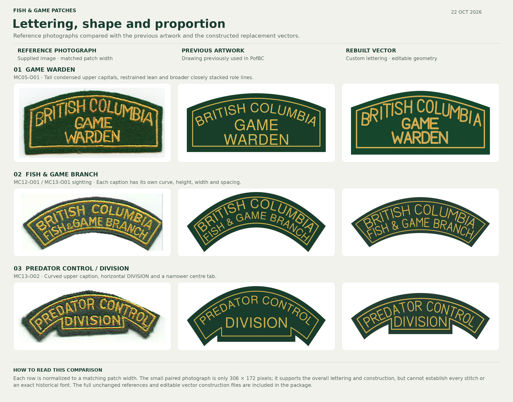

# Fish & Game patch reconstruction review

**22 October 2026**

The replacement artwork rebuilds the lettering, outlines and spacing of three catalogued patch pieces
shown in the two supplied photographs. The upper Fish & Game piece in the paired photo is the existing
MC12-O01 design; the catalogue records MC13-O01 as another sighting of it.

## Designs and changes

| ID | Design | Main corrections |
| --- | --- | --- |
| MC05-O01 | British Columbia / Game / Warden | Tall narrow custom upper capitals, individual vertical placement with modest lean, broader and taller lower captions, closer stacking, constructed shallow domed felt and independent inset |
| MC12-O01 (MC13-O01 sighting) | British Columbia / Fish & Game Branch | Original stroke alphabet, independent curved rows and a deeper central inner outline with appropriate text clearance |
| MC13-O02 | Predator Control / Division | Original stroke alphabet, independent upper curve, horizontal DIVISION and a narrower centre tab |

## Lettering method

The letterforms are built from a small original alphabet of straight strokes and cubic Bézier bowls.
They are not an identified historical commercial font. The M has a shallow middle vertex, the W a
lowered central peak, the R a direct diagonal leg, and the O/C narrow rounded bowls. Each row controls
its own width, cap height, spacing and placement. The Game Warden upper line retains mostly upright
stems, while the rocker rows use individual tangent placement.

The editable SVGs retain these vector strokes. The final SVGs expand the strokes into filled paths and
need no installed fonts, live text or embedded images. Each caption carries `data-live-text` so Patcher
can include it in the raised-lettering pass. Inkscape performs vector stroke expansion and preview
rendering; the generators do not read or trace the reference photographs.

## Comparison method

The three columns show the supplied reference, the previously joined library artwork and the final
replacement. Each row is displayed at a matching visible patch width. No perspective correction,
texture synthesis or image enhancement was applied. The Game Warden photograph is shown in full;
the paired photograph is shown as loose crops clipped through the empty gap between its two pieces,
so the adjacent patch does not distract from the comparison. Pixels within each depicted piece are
unchanged apart from display scaling. Full unchanged originals are included with their source hashes.

This is a visual construction review, not a pixel-overlap accuracy score. The photograph records
stitch texture, felt wear, lighting and small distortions that the regular vector intentionally omits.
The small paired source is only **306 × 172 pixels**, so the evidence cannot establish every embroidered
contour. The historical alphabet, physical patch dimensions and calibrated thread colours remain
unverified.

## Construction packages

- `bc-game-warden/`: MC05-O01 final and editable SVGs, PNG/WebP previews, `compose.py`, layout,
  provenance, README and unchanged reference.
- `bc-fish-game-rockers/`: MC12-O01 and MC13-O02 final and editable SVGs, PNG/WebP previews,
  `compose.py`, per-design layouts, provenance, README and unchanged paired reference.
- `previous-artwork/`: the three joined SVGs used for the middle comparison column.

These folder paths describe the download ZIP. In the PofBC repository the construction packages are
under `vendor/patcher/library/supplied/`; this review is under
`artwork/patches/fish-game-2026-10-22/`.

Each construction package documents its rebuild procedure. Python 3, Pillow and Inkscape are needed
to regenerate the artwork; normal use of the released SVGs needs none of these build tools.

## Checks

The final raster previews have one disconnected gold region per glyph plus the independent inset
border: **26** for Game Warden, **31** for Fish & Game, and **24** for Predator Control / Division.
This checks that letters and borders do not accidentally join at the validation render size. The
Game Warden package also documents a byte-identical repeated build with the same toolchain. Integration
verification belongs to the normal Patcher library import and source-hash checks.

## References

- Uploaded `image(20261022-175504).png`, Game Warden, 1326 × 636.
- Uploaded `image(20261022-175405).png`, Fish & Game / Predator Control pair, 306 × 172.
- Catalogued original [Game Warden photograph](https://moosecop.net/History/BC_Game_Warden.jpg).
- Catalogued original [Predator Control paired photograph](https://moosecop.net/History/BC_Predator_Control.jpg).
- [Game Warden in PofBC](https://projects.ahmadjalil.com/PofBC/?view=patches&patch=MC05-O01).
- [Predator Control / Division in PofBC](https://projects.ahmadjalil.com/PofBC/?view=patches&patch=MC13-O02).

The replacements are reference-based reconstructions, not recovered original government production masters.
