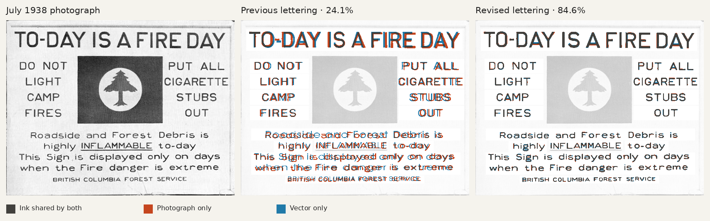

# Lettering on the 1938 Fire Day sign

The July 1938 *Powell River Digester* shows the panel at Second Street and Ocean View on its cover. The scan preserves the headline’s straight-sided O and D, the short middle strokes of E and F, a high-contrast two-storey g in the smaller lettering and a slight slope across individual lines. The publication identifies the British Columbia Forest Service as issuer. It gives no lettering artist or typeface name. [Volume 14, number 7, PDF page 123](https://qathetmuseum.ca/wp-content/uploads/2024/01/digester-1938-prhma__exoptmed_.pdf#page=123)

## How the lettering was fitted

The photographed panel’s four outer corners map to a 550 × 424 drawing. This one planar transformation was held fixed throughout. The frame, tree, background and underline are excluded from the lettering measurement. The source ink mask selects pixels darker than 166/255 and at least 36 levels below a local Gaussian background (sigma 7 pixels). Each SVG was rendered at three times the working resolution, downsampled with Lanczos and thresholded at 142/255. Intersection over union counts pixels shared by the two masks divided by pixels in either mask. The total pools pixels across all text regions.

Each of the 189 visible characters has independently fitted bounds. Trial 1 used the best single candidate face within each region, fitted to individual character positions. Trial 2 kept a consistent outline for each repeated character within each lettering style, comparing the ten font candidates with geometric forms and monoline strokes. Trial 3 adjusted the four edges up to one pixel. Trial 4 refined their positions by half- and quarter-pixel increments. Measurements below use the rendered complete sign.

| Text region | Previous | Trial 1 | Trial 2 | Trial 3 | Trial 4 |
| --- | ---: | ---: | ---: | ---: | ---: |
| Headline | 33.5% | 72.2% | 84.0% | 87.4% | 88.4% |
| Warning columns | 27.1% | 73.4% | 79.5% | 81.6% | 83.8% |
| Lower notice | 16.4% | 67.7% | 75.2% | 79.8% | 82.1% |
| INFLAMMABLE | 17.5% | 73.2% | 78.2% | 82.6% | 82.9% |
| Issuer | 14.8% | 71.6% | 75.8% | 80.2% | 83.3% |
| All lettering | 24.1% | 70.9% | 79.1% | 82.7% | 84.6% |

Across stricter and looser source thresholds (44 and 28 levels below the same local background), final overall overlap was 83.1% and 84.0%. Grain and antialiasing matter most in the small issuer line. This measures the fit to one photograph. A matching physical type specimen or lettering manual would be needed to attribute a historical typeface.

Nimbus Sans Narrow Regular led the ten unmodified candidates for the headline, warning columns and lower notice when all character bounds were fitted. Its average individual-glyph score in the headline was 73.8%. The final headline uses constructed O, D, A, Y, F, R and E outlines, with single-stroke constructions for T, I and S. The r, g and other lower-case forms were compared across the same alternatives. [Font results](font-comparison.csv) · [All chosen glyph constructions and positions](lettering-fits.csv)

Run `python measure.py /path/to/digester-1938.pdf` from this directory in a PofBC checkout with its JavaScript dependencies installed, plus PyMuPDF, Pillow, NumPy and SciPy. The script reads the first version of the drawing from Git. The sign viewer’s Original and Overlay controls use the same [registered photograph](../../../src/signs/forest-service/fire-day.reference.png).
