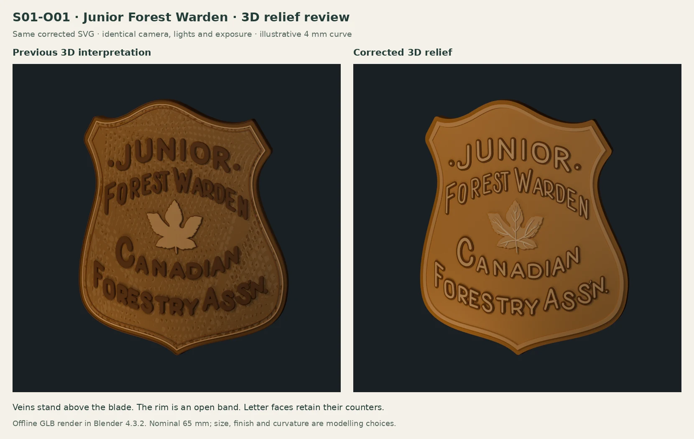

# S01-O01: source-based 3D relief

The Junior Forest Warden badge now uses the named parts of its supplied drawing to build the
rim, lettering and maple leaf. It keeps the catalogue's **leather** attribution as an unverified
rendering assumption. It is a visual reconstruction, with nominal dimensions and an invented
plain reverse, not a measured specimen or a manufacturing master.



These are offline Blender renders of the actual exported GLBs, using the same camera, scale and
studio lighting. They are not screenshots of the WebGL viewer.

## Why the drawing needed a 3D profile

The generic paint classifier gave the leaf blade a bevel but removed the bevel from its smaller
veins. Their tops consequently sat below the blade. Increasing contrast or light intensity could
not reveal geometry that was buried inside another mesh.

The outer and inner rim paths are full, nested shields. Raising the outer shield as a plate would
cover the inner field; their geometric difference is the actual rim band. The letter paths already
distinguish their wider relief boundaries from their narrower faces, so they can be stacked directly.

`junior-warden-tooled-v1` activates only for a leather record in the `junior-warden` family with the
expected named source paths. Unrecognized artwork and other badge families keep the general path.

## Construction

- Use the outer silhouette as the body footprint.
- Subtract the inner rim fill from the outer rim fill to make a raised band with an open centre.
- Join the lettering shoulders separately from the letter faces, retaining the counters.
- Build the leaf blade as one connected part. Join all 19 vein paths into one ribbon, clip it to
  the supporting leaf, and raise it above the blade.
- Omit the leaf's thin 2D outline strokes as separate walls; the model's bevels and lighting provide
  their edge relief. Keep fine sampling local to this explicitly named drawing.
- Keep the supplied flat artwork unchanged. Apply cylinder or dome curvature to the whole 3D
  object, including front, back and sides.

The following heights are **display choices at a nominal 65 mm longer side**, relative to the
body face. They are not measurements inferred from the photograph.

| Surface | Nominal top above body face |
| --- | ---: |
| Inner field | 0.065 mm |
| Rim | 0.310 mm |
| Letter shoulder | 0.320 mm |
| Letter face | 0.460 mm |
| Leaf blade | 0.380 mm |
| Leaf veins | 0.540 mm |

The emitted model—not just its settings—has 0.160 mm of visible vein relief above the blade and
0.140 mm of letter-face relief above the shoulders. Its leaf and vein network each remain connected;
the rim retains its central hole and the letter faces retain 15 counters.

## Viewer and export behavior

The tab is labelled **3D** while the persisted `metal` mode value is retained for compatibility.
Source, Compare and SVG download continue to work independently of 3D rendering. Shape controls
and PNG/GLB export appear in 3D mode, with drag, zoom and keyboard guidance.

A successful bend belongs to one exact model and requested shape. A failed bend, drawing retry,
badge change or scene remount cannot reuse stale curvature or export metadata. Bend and export
failures are visible, and pending downloads are cancelled when their model or shape changes.

Dome limits now account for the whole badge's width and height while reporting rise at the
half-width. This fixes narrow, tall badges advertising a curvature that their geometry rejects.

GLB export copies the current geometry and shares identical position/normal/UV vertices in that
copy. The visible model remains untouched, sharp normal/UV seams survive, and exports keep metre
units and provenance. The reviewed cylindrical model is about 10.84 MB, compared with 17.62 MB
before this change, despite the more detailed corrected geometry.

## Local checks

```sh
node --test src/badges/badges.test.js src/badges/badgeReview.test.js src/badges/badgeView.test.js src/badges/curvature.test.js src/patches/patchView.test.js
node scripts/check-patch-viewer-build.mjs
```

The focused suite passed 29 tests. The production fixture builds the actual PatchesView and
BadgeViewer route under `/PofBC/`, including its dedicated bundle, library assets and worker.

The optional model check uses test tools installed outside the project; it adds no runtime dependency
or GitHub Actions job:

```sh
npm install --prefix /tmp/badge-model-tools --ignore-scripts --no-package-lock jsdom@29.1.1 esbuild@0.27.0 @napi-rs/canvas@0.1.100
BADGE_MODEL_TEST_MODULES=/tmp/badge-model-tools/node_modules node scripts/check-badge-models.mjs --output /tmp/pofbc-badge-3d
```

It builds the real S01-O01 and S51-O01 models, checks finite positions/normals, the source artwork
hash, non-metallic leather, the metal control badge, open counters, connected contours, actual front
ray hits, curvature limits, exact flat restoration, indexed GLB buffers and unchanged live export
buffers. The fixed ray points directly catch the buried-vein defect. Flat, cylindrical and domed
S01 models can be retained with `--output`; the curved examples use a nominal 4 mm rise.

To render those exported files independently:

```sh
blender --background --factory-startup --python scripts/render-badge-model.py -- --input /tmp/pofbc-badge-3d/S01-O01-cylinder.glb --output /tmp/pofbc-badge-3d/renders --views front oblique side
```

**Interactive browser acceptance is pending.** The cloud browser reported WebGL unavailable on
the live viewer. Geometry checks, production bundling and offline renders do not replace checking
the revised controls, orbiting and downloads in a WebGL-capable browser.

## Evidence and dependency

- [Original source photograph](https://drive.google.com/file/d/1INS_YP_UZWb3HuuJuolLxhmbafQ2Fo_W/view)
- [Patcher artwork PR #9](https://github.com/ahzs645/patcher/pull/9), pinned at `9a1412328fef46ab56a3da3bd1bca63e0110c5b2`
- SVG SHA-256: `5bdc11226f3b7edfb4bdb79bf2783947c0df197751d5f8f182b0ae5be1b7e4fe`
- Previous 3D implementation: PofBC `9345d4cd228cf1526c9d06282a1315096f6e2a5f`
- [Medal Forge](https://github.com/CatsJuice/medal-forge/tree/a6da89fc2a9416a0651a6db113e8a2a741e6a2ae), vendored under its MIT licence.

The photo-registered drawing retains the photograph's perspective. Material, physical dimensions,
true relief depth, curvature, back fittings and maker's marks remain unverified.
