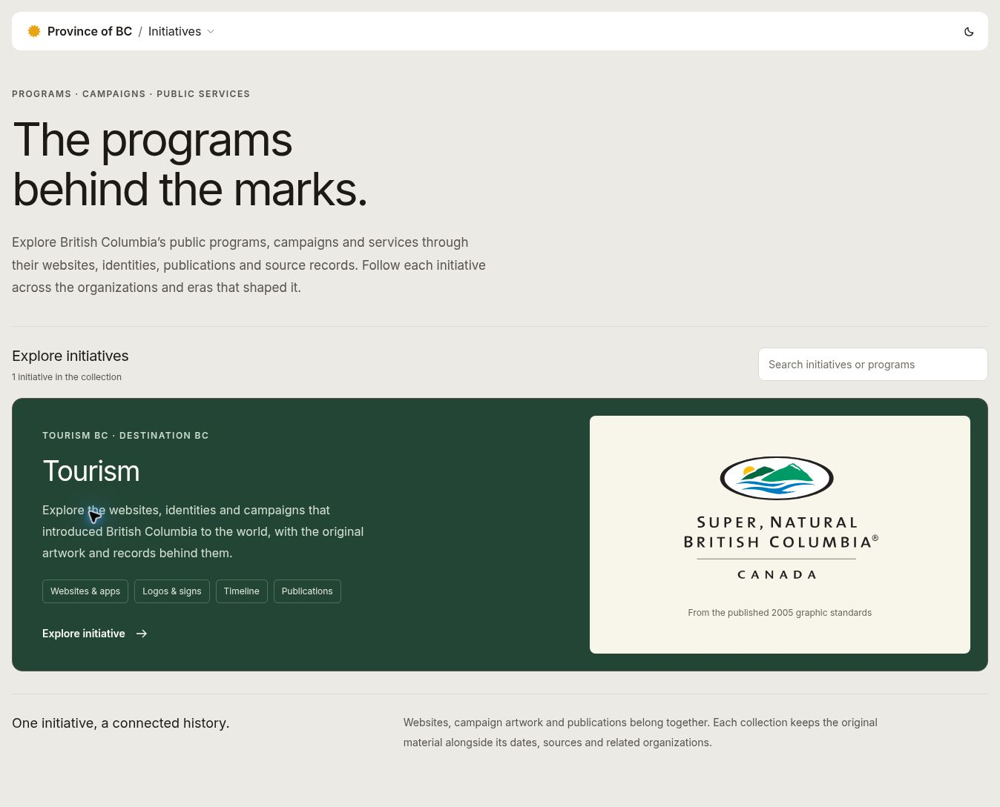

# Initiatives: Tourism implementation and visual review

This change adds **Initiatives** to the site’s main navigation. Its searchable
index opens a documented Tourism collection connecting identities, websites,
apps, publications and their sources. A lightweight registry, lazy data loaders
and shared section renderer support future initiatives when their evidence is
ready. Tourism is the only live entry; the index has no speculative placeholders.

| Destination | Stable route |
| --- | --- |
| Initiatives index | `?view=initiatives` |
| Tourism | `?view=initiatives&initiative=tourism` |
| Websites & apps | `?view=initiatives&initiative=tourism&section=websites` |
| HelloBC record | `?view=initiatives&initiative=tourism&section=websites&record=hellobc` |
| Corporate identity gallery | `?view=gallery&logos=tourism-bc-destination-bc` |

The corporate artwork remains in Logos. The old `collected-tourism-bc` and
`collected-destination-bc` collection IDs still resolve there. A former tourism
detail link such as
`?view=gallery&logos=tourism-bc-destination-bc#tourism-websites/hellobc` migrates to
the equivalent initiative section and record. Gallery links selecting a corporate
mark keep their original destination. Both corporations retain their own histories,
graph nodes and artwork ownership.

Named records such as HelloBC, WorldHost, BC Escapes and Near Me BC are discoverable
through initiative search and the gallery’s main search. The
[initiative contributor guide](../../initiatives.md) documents the registry,
detail model, optional sections and stable identifiers.

## What changed

| Section | Included in this PR |
| --- | --- |
| Websites & apps | Nine documented records, name/domain search, evidence filters, and a detail dialog with dated visual specimens and source links. |
| Logos & signs | Twenty-one mark/name groups, with original published images, scan evidence and fifteen native vector variants from the December 2005 standards. |
| Timeline | Thirteen events distinguishing organizational changes, publication dates, campaign launches and system in-service dates. |
| Publications | Seven records describing located material and titles still sought, plus seventeen further research leads. |
| Sources & domains | Fifteen sources and all 193 listed Appendix 5 address cells, searchable by name and type, with a complete JSON download. |

The collection contains 58 visual specimens: 15 extracted publication vectors,
20 original Gazette GIFs, 20 crops of the order, and three published website
images. The latter depict WorldHost in a 2014 guide, a HelloBC listing in a 2022
guide, and the publisher’s 2025 SupernaturalBC launch image. Their dates identify
the evidence; they are not all described as 2013 website captures.

The inventory includes 178 domain entries, eight subdomains and seven historical
email entries. It retains two duplicate cells, leaving 191 distinct addresses.
Printed case, spelling and source positions are preserved. These entries do not
become asserted live websites or contact links.

Tourism BC’s 2010 dissolution, Destination BC’s 2012 establishment and its 2013
operational start/asset transfer remain distinct. The connected collection does not add
a legal rename relationship.

The [source and acquisition notes](../../../research/identity/tourism-asset-transfer-2013/README.md)
explain the evidence, remaining gaps and deterministic data build.

## Screenshots

These are browser screenshots of the implemented `InitiativesView`, `GalleryView`
and `ViewSwitcher`, served from a focused production build through
`scripts/preview-gallery.mjs`. The preview uses the site’s masthead and real view
menu. It disables other views and their preloading only within the local preview,
so their separate assets are not required for this review. It does not claim to
render the complete application. No proposed interface or historical website was
drawn to simulate a screenshot.

Desktop captures include the navigation, index and detail views; several use
browser-native clipping to show a complete section. Mobile captures use the same
app inside a 390 × 844 pixel iframe, including its 15-pixel desktop scrollbar. Its content area
is 375 pixels wide. The table scrolls within its own container without widening
the document. Exact image dimensions and SHA-256 checksums are in
[`screenshots.json`](screenshots.json).

| View | Screenshot |
| --- | --- |
| Initiatives index | [00-initiatives-index.jpg](00-initiatives-index.jpg) |
| Tourism initiative opening | [01-collection-overview.jpg](01-collection-overview.jpg) |
| Websites, apps and evidence filters | [02-websites-and-apps.jpg](02-websites-and-apps.jpg) |
| Logo family | [03-logos-and-signs.jpg](03-logos-and-signs.jpg) |
| Original vector, variant controls and exact source page | [04-vector-record.jpg](04-vector-record.jpg) |
| Source library and searchable address inventory | [05-sources-and-domains.jpg](05-sources-and-domains.jpg) |
| Timeline | [06-timeline.jpg](06-timeline.jpg) |
| Publication records | [07-publications.jpg](07-publications.jpg) |
| Mobile Tourism opening | [08-mobile-overview.jpg](08-mobile-overview.jpg) |
| Mobile website card | [09-mobile-websites.jpg](09-mobile-websites.jpg) |
| Dark theme | [10-dark-theme.jpg](10-dark-theme.jpg) |
| Main navigation with Initiatives | [11-navigation-menu.jpg](11-navigation-menu.jpg) |
| Corporate identities retained in Logos | [12-corporate-identities.jpg](12-corporate-identities.jpg) |
| Mobile Initiatives index | [13-mobile-index.jpg](13-mobile-index.jpg) |

### Initiatives index



### Tourism opening


### Website records


### Artwork record


### Mobile


## Verification

Focused verification commands:

```sh
npm run check:tourism-collection
node --test src/gallery/collections.test.js src/gallery/galleryPlace.test.js src/site/browserHistory.test.js
node scripts/preview-gallery.mjs --build --base /PofBC/ --out dist-gallery
git diff --check
```

The focused suites pass **41 tests**: 29 in `npm run check:tourism-collection`
and twelve in the gallery, collection and browser-history suites above. They cover
deterministic generation and image bytes, complete address-cell transcription,
exact source spellings, evidence dates, corporate
chronology, legacy routes, separate artwork ownership, search behavior and browser
history. Initiative model tests also use an unrelated, test-only subject to check
custom section IDs, optional evidence fields, stale record selection and server
rendering without adding that subject to the live registry. All 58 acquired
specimens pass their recorded SHA-256 checks.

Browser checks verified:

- Initiatives index search for WorldHost, empty results and reset, and Back
  navigation restoring both the query and card focus.
- Desktop and mobile navigation menus, all five Tourism sections, Home/End tab
  selection and focus, and Escape closing the record dialog.
- Website image provenance distinguishing the July 2022 HelloBC publication from
  the 2025 SupernaturalBC launch image. Selecting the reverse Horizontal B vector
  retains its dark plate and points to manual PDF page 10.
- The seven-row email filter and a JSON download that still includes all 193
  address entries and the Ministerial Order 68 source record.
- Migration of a legacy `#tourism-websites/hellobc` gallery link to the canonical
  initiative query and record, plus the reciprocal corporate-identity link.
- Light and dark theme computed styles, a mobile index and detail page with no
  document overflow at 375 pixels of content width, and a source table that scrolls
  within its own container. The WorldHost dialog fits inside the 390 × 844 review
  frame, with a 339 × 824 dialog positioned 18 pixels from the content edge and
  10 pixels from the top.

The focused Logos and Initiatives production preview builds successfully at both
the root path (`/`) and the project path (`/PofBC/`), with **333 modules**. The
preview uses the repository’s supported TeX Gyre font stand-in where licensed generator fonts are
unavailable; the collected vectors retain their original outlined lettering.

All fourteen review screenshots were verified as JPEG files and recorded with
their SHA-256 checksums in `screenshots.json`. The source checksums of the 58
acquired specimens are unchanged.

A full application bundle was attempted and remains blocked by **19 unresolved
imports**: sixteen pre-existing research files absent from the sparse checkout and
three unbuilt geo-toolkit outputs. This preview does not establish a successful
full-site production build. An earlier broader collected-artwork test attempt also
reached two missing-file failures for a pre-existing BC Housing asset absent from
the checkout. Those limitations are separate from the focused tourism checks.
No GitHub Actions run was requested; PR commits use `[skip ci]`.

## Reproduce the preview

With dependencies and the repository’s submodules initialized, prepare the
existing gallery font/artwork prerequisites if they are not already built:

```sh
npm run build:fonts
npm run build:current-extras
node scripts/preview-gallery.mjs --port 4175
```

Open the printed local URL with `?view=initiatives`, then open Tourism or use one
of the stable detail links above. The same preview supports the corporate Logos
gallery. The script also accepts `--host` and copies `public/tourism/` into a
static review build. Other menu destinations are intentionally outside this local
preview; their production routes remain the responsibility of the full app.

## Remaining collection work

Earlier HelloBC market captures, the Near Me BC app interface, campaign-site
captures, complete guide and magazine issues, training materials and additional
international variants remain research leads where the inspected sources do not
provide the artwork. They are labeled accordingly. The extraction scripts and
source manifests make future verified specimens straightforward to add.
