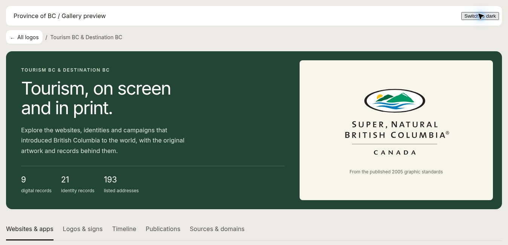
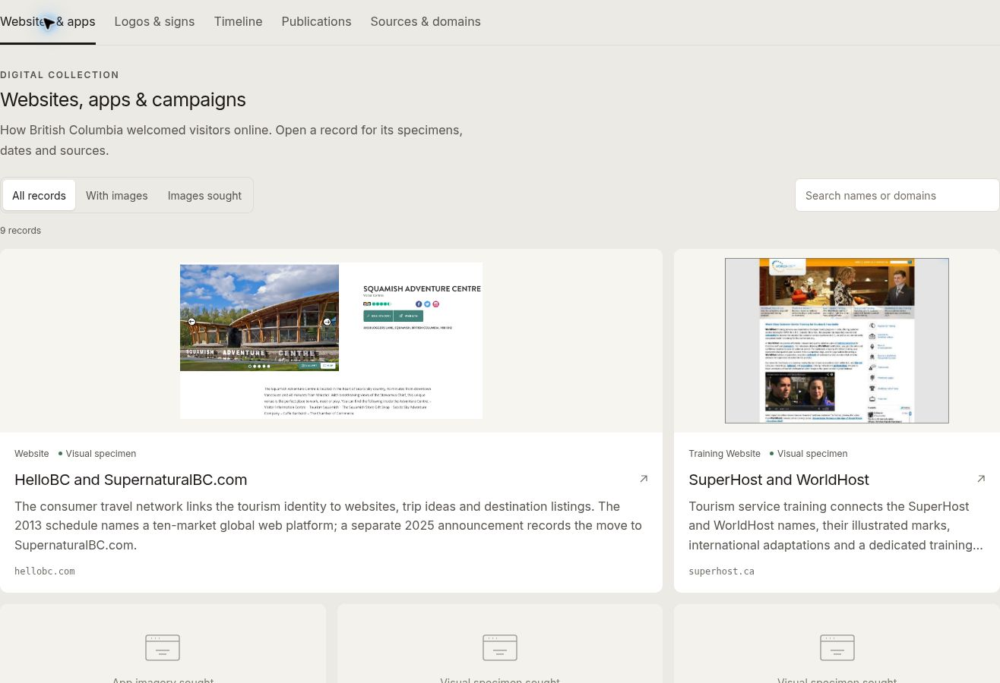
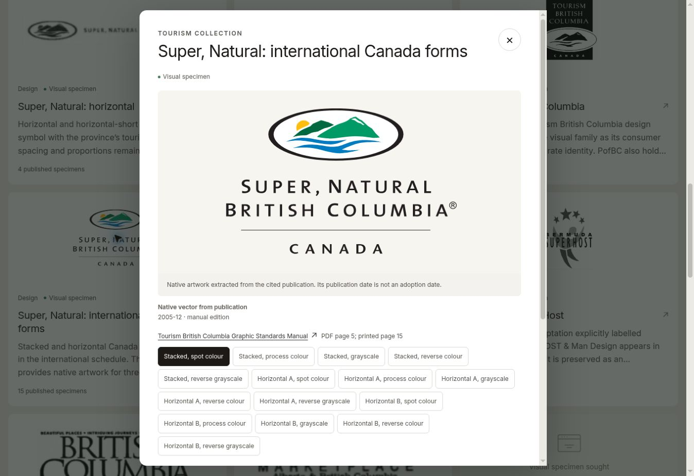
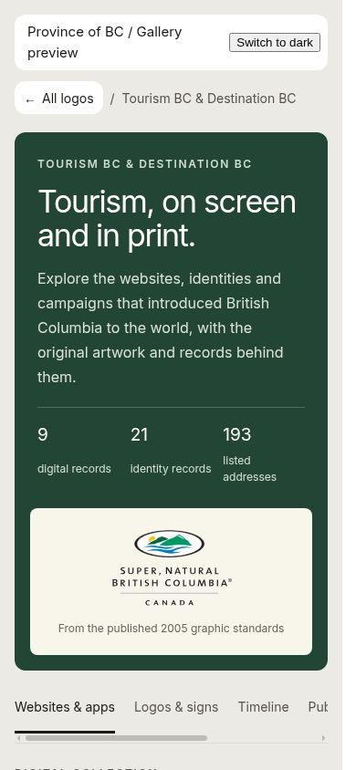

# Tourism collection: implementation and visual review

This change expands the gallery’s Tourism BC and Destination BC material into one
connected collection of identities, websites, apps, publications and documentary
evidence. It uses the existing gallery, theme, organization links and artwork
records. The two corporations retain their own histories and graph nodes.

Open the gallery at:

```text
?view=gallery&logos=tourism-bc-destination-bc#tourism-websites
```

The old `collected-tourism-bc` and `collected-destination-bc` collection links still
resolve. Named records such as HelloBC, WorldHost, BC Escapes and Near Me BC are
also discoverable through the gallery’s main search.

## What changed

| Section | Included in this PR |
| --- | --- |
| Websites & apps | Nine documented records, name/domain search, evidence filters, and a detail dialog with dated visual specimens and source links. |
| Logos & signs | Twenty-one mark/name groups, with original published images, scan evidence and fifteen native vector variants from the December 2005 standards. |
| Timeline | Thirteen events distinguishing organizational changes, publication dates, campaign launches and system in-service dates. |
| Publications | Seven records describing located material and titles still sought, plus seventeen further research leads. |
| Sources & domains | Fifteen sources and all 193 listed Appendix 5 address cells, searchable by name and type, with a complete JSON download. |

The collection contains 58 visual specimens: 15 extracted publication vectors,
20 original Gazette GIFs, 20 crops of the order, and three published website
images. The latter depict WorldHost in a 2014 guide, a HelloBC listing in a 2022
guide, and the publisher’s 2025 SupernaturalBC launch image. Their dates identify
the evidence; they are not all described as 2013 website captures.

The inventory includes 178 domain entries, eight subdomains and seven historical
email entries. It retains two duplicate cells, leaving 191 distinct addresses.
Printed case, spelling and source positions are preserved. These entries do not
become asserted live websites or contact links.

Tourism BC’s 2010 dissolution, Destination BC’s 2012 establishment and its 2013
operational start/asset transfer remain distinct. The shared shelf does not add
a legal rename relationship.

The [source and acquisition notes](../../../research/identity/tourism-asset-transfer-2013/README.md)
explain the evidence, remaining gaps and deterministic data build.

## Screenshots

These are browser screenshots of the implemented `GalleryView`, served from its
production build through `scripts/preview-gallery.mjs`. They show the gallery
inside the existing lightweight review shell, rather than the whole application’s
navigation. No proposed interface or historical website was drawn to simulate a
screenshot.

Desktop captures use a 1348-pixel browser viewport; several use browser-native
clipping to show a complete section. Mobile captures use the same app inside a
390 × 844 pixel iframe, including its 15-pixel desktop scrollbar. Its content area
is 375 pixels wide. The table scrolls within its own container without widening
the document. Exact image dimensions and SHA-256 checksums are in
[`screenshots.json`](screenshots.json).

| View | Screenshot |
| --- | --- |
| Collection opening | [01-collection-overview.jpg](01-collection-overview.jpg) |
| Websites, apps and evidence filters | [02-websites-and-apps.jpg](02-websites-and-apps.jpg) |
| Logo family | [03-logos-and-signs.jpg](03-logos-and-signs.jpg) |
| Original vector, variant controls and exact source page | [04-vector-record.jpg](04-vector-record.jpg) |
| Source library and searchable address inventory | [05-sources-and-domains.jpg](05-sources-and-domains.jpg) |
| Timeline | [06-timeline.jpg](06-timeline.jpg) |
| Publication records | [07-publications.jpg](07-publications.jpg) |
| Mobile opening | [08-mobile-overview.jpg](08-mobile-overview.jpg) |
| Mobile website card | [09-mobile-websites.jpg](09-mobile-websites.jpg) |
| Dark theme | [10-dark-theme.jpg](10-dark-theme.jpg) |

### Collection opening



### Website records



### Artwork record



### Mobile



## Verification

Completed locally:

```sh
npm run check:tourism-collection
node --test src/gallery/collections.test.js src/gallery/galleryPlace.test.js
node scripts/preview-gallery.mjs --build --base /PofBC/ --out dist-gallery
git diff --check
```

The focused suites pass **27 tests**. They cover deterministic generation and
image bytes, complete address-cell transcription, exact source spellings,
evidence dates, corporate chronology, legacy routes, separate artwork ownership,
search behavior and navigation away from a tourism section.

Browser checks covered all five sections, the website image filters (two records
with images and seven awaiting images), name search, the seven-entry email
filter, preserved `BCWorldHost.com` capitalization, and the JSON download. The
download contains all 193 entries and its source record. Artwork selection
updates the exact source-page link, including the reverse Horizontal B vector
on manual PDF page 10; reverse specimens use a dark plate. Escape closes the
dialog. Arrow, Home and End keys select tabs. Light and dark themes and the mobile
layout were inspected.

The gallery production bundle builds successfully. Vite reports its existing
large-bundle and mixed static/dynamic-import warnings. The preview uses the
repository’s supported TeX Gyre font stand-in where licensed generator fonts are
unavailable; the collected vectors retain their original outlined lettering.

This is a focused gallery review, not a claim that the entire repository’s
production build or every test has run. A broader existing collected-artwork test
attempt reached two missing-file failures for a pre-existing BC Housing asset in
the sparse checkout; the focused tourism and navigation suites pass. No GitHub
Actions run was requested; the PR commit uses `[skip ci]`.

## Reproduce the preview

With dependencies and the repository’s submodules initialized, prepare the
existing gallery font/artwork prerequisites if they are not already built:

```sh
npm run build:fonts
npm run build:current-extras
node scripts/preview-gallery.mjs --port 4175
```

Open the printed local URL with the gallery query above. The preview script also
accepts `--host` and copies `public/tourism/` into a static review build.

## Remaining collection work

Earlier HelloBC market captures, the Near Me BC app interface, campaign-site
captures, complete guide and magazine issues, training materials and additional
international variants remain research leads where the inspected sources do not
provide the artwork. They are labeled accordingly. The extraction scripts and
source manifests make future verified specimens straightforward to add.
