# School district catalogue

Reviewed snapshot: **22 November 2026**. The [provincial directory](https://studentsuccess.gov.bc.ca/all/school-districts) supplies the current roster. This catalogue lists all **60 current districts**, their selected formation evidence, and their primary current logos. It also records the **15 documented 1996 amalgamations** and their **31 immediate predecessors**.

**Date labels matter:** “legal creation” identifies an effective date in an original instrument; “reported establishment” identifies a retained source claim; “institutional origin” identifies an earlier institutional or authority origin. “Source differences” flags an unresolved disagreement. An unverified entry can still have a dated boundary notice, shown separately. See the [collection guide](README.md#reading-a-formation-date) and [historical research notes](HISTORY-NOTES.md).

Logo thumbnails link to the retained local artwork. The source column links directly to the original asset or document, with a separate context link where available. **Vector** and **raster** describe the artwork, including raster content carried inside an SVG. Recruitment-profile fallbacks and white artwork are labelled. Website observation dates do not establish logo adoption dates. See the [November 25 vector review](VECTOR-REVIEW.md) for new sources, alternate colourways and open leads.

## Current districts

| District | Formation evidence | Current logo | Logo source |
| --- | --- | --- | --- |
| **SD5** [Southeast Kootenay](<https://www.sd5.bc.ca>) | [2 Dec 1996](<https://www.bclaws.gov.bc.ca/civix/document/id/oic/arc_oic/0861_1996>) legal creation |  Vector | [Original asset](<https://sb45storage.blob.core.windows.net/pub/themes/Sd5/fonts/icomoon.woff?i0ojrl>) [Publishing context](<https://www.sd5.bc.ca/>) |
| **SD6** [Rocky Mountain](<https://www.sd6.bc.ca>) | [2 Dec 1996](<https://www.bclaws.gov.bc.ca/civix/document/id/oic/arc_oic/0862_1996>) legal creation |  Vector | [Source PDF, p. 71](<https://www.sd6.bc.ca/download/408979#page=71>) [Earlier image source](<https://www.sd6.bc.ca/img/footer-logo.svg>) |
| **SD8** [Kootenay Lake](<https://www.sd8.bc.ca>) | [2 Dec 1996](<https://www.bclaws.gov.bc.ca/civix/document/id/oic/arc_oic/0970_1996>) legal creation |  Vector | [Original asset](<https://www.sd8.bc.ca/sites/default/files/2022-05/sd8_logo.svg>) [Publishing context](<https://www.sd8.bc.ca>) |
| **SD10** [Arrow Lakes](<https://sd10.bc.ca>) | [10 Apr 1946](<https://www2.gov.bc.ca/assets/gov/education/administration/resource-management/school-district-financial-reporting/financial-information/sd10-sofi-2024.pdf>) reported establishment | <a href="../../../public/education/school-districts/logos/sd010.png">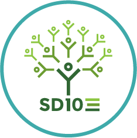</a> Raster | [Original asset](<https://sd10.bc.ca/wp-content/uploads/2023/08/SD10_Logo_2023_WEB.png>) [Publishing context](<https://sd10.bc.ca>) |
| **SD19** [Revelstoke](<https://www.sd19.bc.ca>) | [12 Apr 1946](<https://www2.gov.bc.ca/assets/gov/education/administration/resource-management/school-district-financial-reporting/financial-information/sd19-sofi-2024.pdf>) reported establishment | <a href="../../../public/education/school-districts/logos/sd019.webp">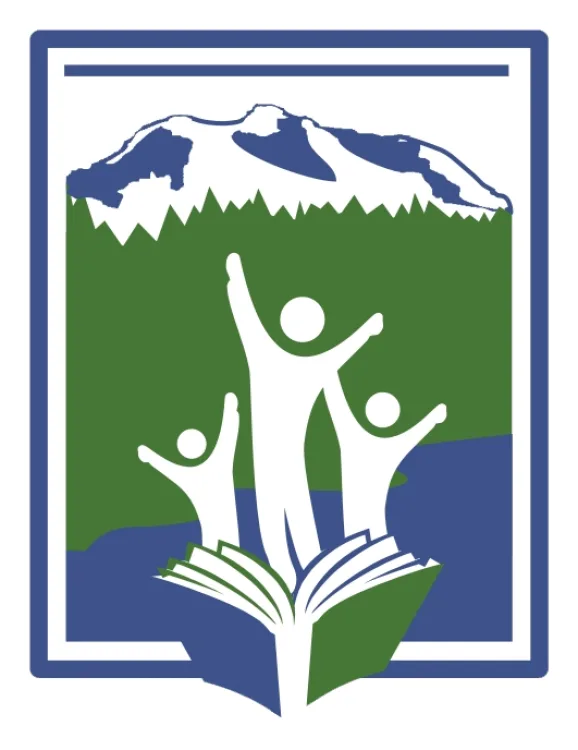</a> Raster | [Original asset](<https://www.sd19.bc.ca/wp-content/uploads/2023/12/SD19-Logo.webp>) [Publishing context](<https://www.sd19.bc.ca>) |
| **SD20** [Kootenay Columbia](<https://www.sd20.bc.ca>) | [2 Dec 1996](<https://www.bclaws.gov.bc.ca/civix/document/id/oic/arc_oic/0971_1996>) legal creation | <a href="../../../public/education/school-districts/logos/sd020.png">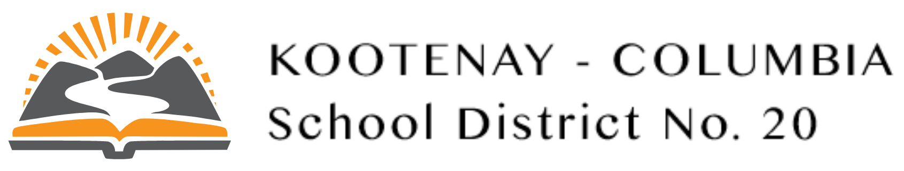</a> Raster | [Original asset](<https://www.sd20.bc.ca/pics/header_logo.png>) [Publishing context](<https://www.sd20.bc.ca/>) |
| **SD22** [Vernon](<https://www.sd22.bc.ca>) | [1 Apr 1946](<https://www2.gov.bc.ca/assets/gov/education/administration/resource-management/school-district-financial-reporting/financial-information/sd22-sofi-2025.pdf>) reported establishment |  Vector | [Source PDF, p. 1](<https://www.sd22.bc.ca/documents/d6f5539c-15d8-5806-a657-a32a7de9c288?fingerprint=ppb20251217032523#page=1>) [Earlier image source](<https://www.sd22.bc.ca/images/logo.png?fingerprint=ppb20251217032124>) |
| **SD23** [Central Okanagan](<https://www.sd23.bc.ca>) | [12 Apr 1946](<https://www.sd23.bc.ca/documents/91af030b-51d6-5f62-b5c9-c9271c1afea6/17-18_Audited_Financial_Statements.pdf>) reported establishment |  Vector | [Source PDF, p. 1](<https://www.sd23.bc.ca/documents/cb543508-71b4-4743-8a09-746ea8892945?fingerprint=ppb20251217060408#page=1>) [Earlier image source](<https://www.sd23.bc.ca/images/mobile-logo.png?fingerprint=ppb20251217040530>) |
| **SD27** [Cariboo Chilcotin](<https://www.sd27.bc.ca>) | [12 Apr 1946](<https://www.sd27.bc.ca/documents/468a0106-de53-5023-8fbd-c5796f60e2b9/june-2021-audited-financial-statements_5b29cc4061.pdf>) reported establishment |  Vector | [Original asset](<https://www.sd27.bc.ca/images/logo.svg?fingerprint=ppb20251217040624>) [Publishing context](<https://www.sd27.bc.ca>) |
| **SD28** [Quesnel](<https://www.sd28.bc.ca>) | [Unverified](<https://www.sd28.bc.ca/sites/default/files/documents/2024-12/Signed%20SOFI%20report%20to%20%20June%2030-2024.pdf>) [12 Apr 1946 boundary notice](<https://archive.org/details/governmentgazett86nogove_m4u8>) |  Vector | [Original asset](<https://www.sd28.bc.ca/sites/default/files/images/2026-07/SD28%20Logo_Tag%20C-WEB.svg>) [Publishing context](<https://www.sd28.bc.ca>) |
| **SD33** [Chilliwack](<https://www.sd33.bc.ca>) | [12 Apr 1946](<https://www2.gov.bc.ca/assets/gov/education/administration/resource-management/school-district-financial-reporting/financial-information/sd33-sofi-2025.pdf>) reported establishment |  Raster White artwork | [Original asset](<https://www.sd33.bc.ca/sites/sd33.bc.ca/files/inline-images/sd33Logo.png>) [Publishing context](<https://www.sd33.bc.ca>) |
| **SD34** [Abbotsford](<https://www.abbyschools.ca>) | [12 Apr 1946](<https://finance.abbyschools.ca/sites/default/files/documents/2024-01/22%2023%20SOFI%20Final%20report.pdf>) reported establishment |  Vector | [Original asset](<https://www.abbyschools.ca/sites/default/files/images/2022-12/AbbySchools_District%20%281%29_0.svg>) [Publishing context](<https://www.abbyschools.ca>) |
| **SD35** [Langley](<https://www.sd35.bc.ca>) | [12 Apr 1946](<https://www2.gov.bc.ca/assets/gov/education/administration/resource-management/school-district-financial-reporting/financial-information/sd35-sofi-2024.pdf>) reported establishment |  Vector | [Source PDF, p. 105](<https://media.sd35.bc.ca/media/Default/medialib/agenda-package-regular-meeting-of-the-board-of-education_jun17_2025.0cf2909901.pdf#page=105>) [Earlier image source](<https://sb45storage.blob.core.windows.net/pub/themes/sd35/images/logo.webp>) |
| **SD36** [Surrey](<https://www.surreyschools.ca>) | [1946](<https://media.surreyschools.ca/media/Default/frf/5/SRTA%20Snapshots.pdf>) reported establishment |  Vector | [Source PDF, p. 1](<https://media.surreyschools.ca/media/Default/medialib/strategic-plan-2023-28.06b65e163998.pdf#page=1>) [Earlier image source](<https://sbsurreystor.blob.core.windows.net/media/Default/medialib/surrey-schools-logo.43e97264549.png>) |
| **SD37** [Delta](<https://www.deltasd.bc.ca>) | [12 Apr 1946](<https://www2.gov.bc.ca/assets/gov/education/administration/resource-management/school-district-financial-reporting/financial-information/sd37-sofi-2024.pdf>) reported establishment |  Vector | [Source PDF, p. 11](<https://www.deltasd.bc.ca/wp-content/uploads/sites/2/2021/09/Delta-School-District-2021-Enhancing-Student-Learning-Report.pdf#page=11>) [Earlier image source](<https://www.deltasd.bc.ca/wp-content/themes/district/library/images/logo.png>) |
| **SD38** [Richmond](<https://www.sd38.bc.ca>) | [12 Apr 1946](<https://sd38.bc.ca/sites/default/files/2025-09/Agenda%20of%20Sep%2024%202025%20Public%20Meeting.pdf>) reported establishment |  Vector | [Source PDF, p. 20](<https://sd38.bc.ca/app/uploads/2026/02/2026-2030-Strategic-Plan-brochure-web.pdf#page=20>) [Earlier image source](<https://sd38.bc.ca/app/uploads/2026/01/Richmond-SD38-Logo-1536x385.png>) |
| **SD39** [Vancouver](<https://www.vsb.bc.ca>) | [12 Apr 1946](<https://media.vsb.bc.ca/media/Default/medialib/2015-2016-audited-financial-statement.e4d27a27094.pdf>) reported establishment |  Vector | [Original asset](<https://sb45storage.blob.core.windows.net/pub/themes/Vsb/images/www/images/logo-print.svg>) [Publishing context](<https://www.vsb.bc.ca>) |
| **SD40** [New Westminster](<https://newwestschools.ca/>) | [12 Apr 1946](<https://newwestschools.ca/wp-content/uploads/2023/12/2024-06-30-SD-40-New-Westminster-FS-FINAL-website-version.pdf>) reported establishment |  Vector | [Original asset](<https://newwestschools.ca/wp-content/uploads/2024/07/sd40_logo.svg>) [Publishing context](<https://newwestschools.ca/>) |
| **SD41** [Burnaby](<https://burnabyschools.ca/>) | [Unverified](<https://burnabyschools.ca/wp-content/uploads/2024/09/2023-24-fs-v12-SD41-Final-Website.pdf>) [12 Apr 1946 boundary notice](<https://archive.org/details/governmentgazett86nogove_m4u8>) |  Vector | [Source PDF, p. 1](<https://burnabyschools.ca/wp-content/uploads/2021/11/Strategic-Plan_How-Were-Doing-Highlights-and-Accomplishments_2020-21_11x17_web.pdf#page=1>) [Earlier image source](<https://burnabyschools.ca/wp-content/uploads/2018/10/BSD_WhiteLogoOnBlue_200x110_rgb.jpg>) |
| **SD42** [Maple Ridge Pitt Meadows](<https://www.sd42.ca>) | [12 Apr 1946](<https://www.sd42.ca/assets/media/2025-09-17-Public-Agenda-Package.pdf>) reported establishment |  Vector White source artwork | [Source PDF, p. 101](<https://www.sd42.ca/assets/media/2026-06-17-Public-Board-Meeting-Agenda-Package.pdf#page=101>) [Earlier image source](<https://www.sd42.ca/sd42/images/header-logo.png>) |
| **SD43** [Coquitlam](<https://www.sd43.bc.ca>) | [1 Jul 1946](<https://www.sd43.bc.ca/District/Departments/Finance/Financial%20Statements/2023-24%20Statement%20of%20Financial%20Information.pdf>) reported establishment | <a href="../../../public/education/school-districts/logos/sd043.webp">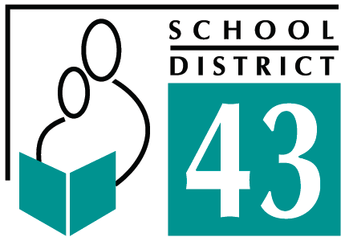</a> Raster | [Original asset](<https://sb45storage.blob.core.windows.net/pub/themes/sd43/images/logo2.webp>) [Publishing context](<https://www.sd43.bc.ca>) |
| **SD44** [North Vancouver](<https://www.sd44.ca>) | [12 Apr 1946](<https://www2.gov.bc.ca/assets/gov/education/administration/resource-management/school-district-financial-reporting/financial-information/sd44-sofi-2025.pdf>) reported establishment | <a href="../../../public/education/school-districts/logos/sd044.png">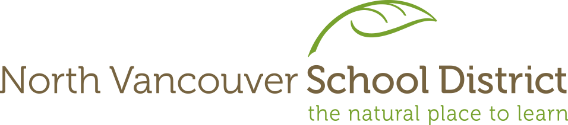</a> Raster | [Original asset](<https://www.sd44.ca/media/nvsd/nvsd/site-assets/images/North-Vancouver-School-District-Logo.png>) [Publishing context](<https://www.sd44.ca>) |
| **SD45** [West Vancouver](<https://westvancouverschools.ca/>) | [Unverified](<https://studentsuccess.gov.bc.ca/school-district/045>) [12 Apr 1946 boundary notice](<https://archive.org/details/governmentgazett86nogove_m4u8>) |  Vector | [Source PDF, p. 1](<https://westvancouverschools.ca/wp-content/uploads/2015/06/WVS_Strategic-Plan-2019-ONLINE.pdf#page=1>) [Earlier image source](<https://westvancouverschools.ca/wp-content/uploads/2017/12/WVSD_Logo.png>) |
| **SD46** [Sunshine Coast](<https://www.sd46.bc.ca>) | [Unverified](<https://studentsuccess.gov.bc.ca/school-district/046>) [12 Apr 1946 boundary notice](<https://archive.org/details/governmentgazett86nogove_m4u8>) |  Vector | [Source PDF, p. 11](<https://sd46.bc.ca/wp-content/uploads/2024-2029SD46_strategic_plan_Final-website.pdf#page=11>) [Earlier image source](<https://sd46.bc.ca/wp-content/uploads/SD46Logo.png>) |
| **SD47** [qathet](<https://www.sd47.bc.ca>) | [Unverified](<https://studentsuccess.gov.bc.ca/school-district/047>) [12 Apr 1946 boundary notice](<https://archive.org/details/governmentgazett86nogove_m4u8>) |  Raster | [Original asset](<https://sb45storage.blob.core.windows.net/pub/themes/Sd47/images/qathetLogo2.png>) [Publishing context](<https://www.sd47.bc.ca>) |
| **SD48** [Sea To Sky](<https://sd48seatosky.org>) | [12 Apr 1946](<https://www2.gov.bc.ca/assets/gov/education/administration/resource-management/school-district-financial-reporting/financial-information/sd48-sofi-2024.pdf>) reported establishment |  Raster | [Original asset](<https://www.sd48seatosky.org/pics/header_logo.png>) [Publishing context](<https://www.sd48seatosky.org/>) |
| **SD49** [Central Coast](<https://www.sd49.bc.ca>) | [12 Apr 1946](<https://www2.gov.bc.ca/assets/gov/education/administration/resource-management/school-district-financial-reporting/financial-information/sd49-sofi-2025.pdf>) reported establishment | <a href="../../../public/education/school-districts/logos/sd049.png">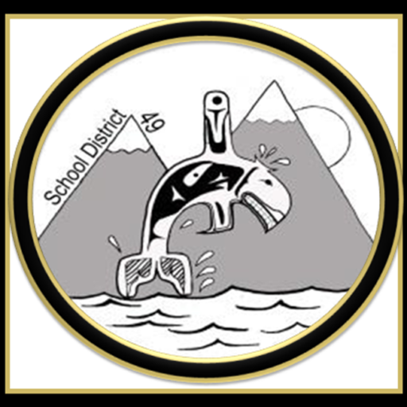</a> Raster | [Original asset](<https://www.sd49.bc.ca/wp-content/uploads/2022/11/cropped-Untitled.png>) [Publishing context](<https://www.sd49.bc.ca/>) |
| **SD50** [Haida Gwaii](<https://www.sd50.bc.ca>) | [1 Apr 1946](<https://www2.gov.bc.ca/assets/gov/education/administration/resource-management/school-district-financial-reporting/financial-information/sd50-sofi-2025.pdf>) reported establishment |  Raster | [Original asset](<https://www.makeafuture.ca/drive/uploads/2021/08/logo_haida-gwaii_sd50.jpg>) [Publishing context](<https://www.makeafuture.ca/bc-schools-and-districts/haida-gwaii-school-district-no-50/>) Recruitment-profile fallback |
| **SD51** [Boundary](<https://www.sd51.bc.ca>) | [2 Dec 1996](<https://www.bclaws.gov.bc.ca/civix/document/id/oic/arc_oic/0867_1996>) legal creation | <a href="../../../public/education/school-districts/logos/sd051.png">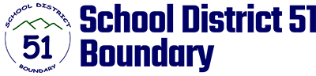</a> Raster | [Original asset](<https://www.sd51.bc.ca/wp-content/uploads/SD51-Logo-Lrg.png>) [Publishing context](<https://www.sd51.bc.ca>) |
| **SD52** [Prince Rupert](<https://www.rupertschools.ca>) | [1 Apr 1946](<https://www2.gov.bc.ca/assets/gov/education/administration/resource-management/school-district-financial-reporting/financial-information/sd52-sofi-2024.pdf>) reported establishment |  Vector | [Source PDF, p. 1](<https://rupertschools.ca/wp-content/uploads/2024/01/Web-version.pdf#page=1>) [Earlier image source](<https://rupertschools.ca/wp-content/uploads/2017/03/sd52-logo.png>) |
| **SD53** [Okanagan Similkameen](<https://www.sd53.bc.ca>) | [2 Dec 1996](<https://www.bclaws.gov.bc.ca/civix/document/id/oic/arc_oic/0868_1996>) legal creation | <a href="../../../public/education/school-districts/logos/sd053.png">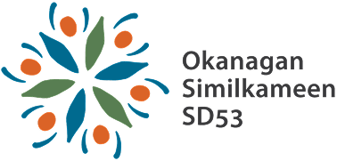</a> Raster | [Original asset](<https://www.sd53.bc.ca/images/logo.png?fingerprint=ppb20251217053415>) [Publishing context](<https://www.sd53.bc.ca>) |
| **SD54** [Bulkley Valley](<https://www.sd54.bc.ca>) | [Unverified](<https://studentsuccess.gov.bc.ca/school-district/054>) [12 Apr 1946 boundary notice](<https://archive.org/details/governmentgazett86nogove_m4u8>) | <a href="../../../public/education/school-districts/logos/sd054.png">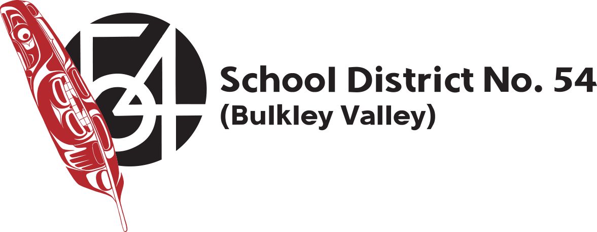</a> Raster | [Original asset](<https://www.sd54.bc.ca/wp-content/uploads/2022/10/logo2.png>) [Publishing context](<https://www.sd54.bc.ca>) |
| **SD57** [Prince George](<https://www.sd57.bc.ca>) | [15 Apr 1946](<https://www2.gov.bc.ca/assets/gov/education/administration/resource-management/school-district-financial-reporting/financial-information/sd57-sofi-2025.pdf>) reported establishment | <a href="../../../public/education/school-districts/logos/sd057.png">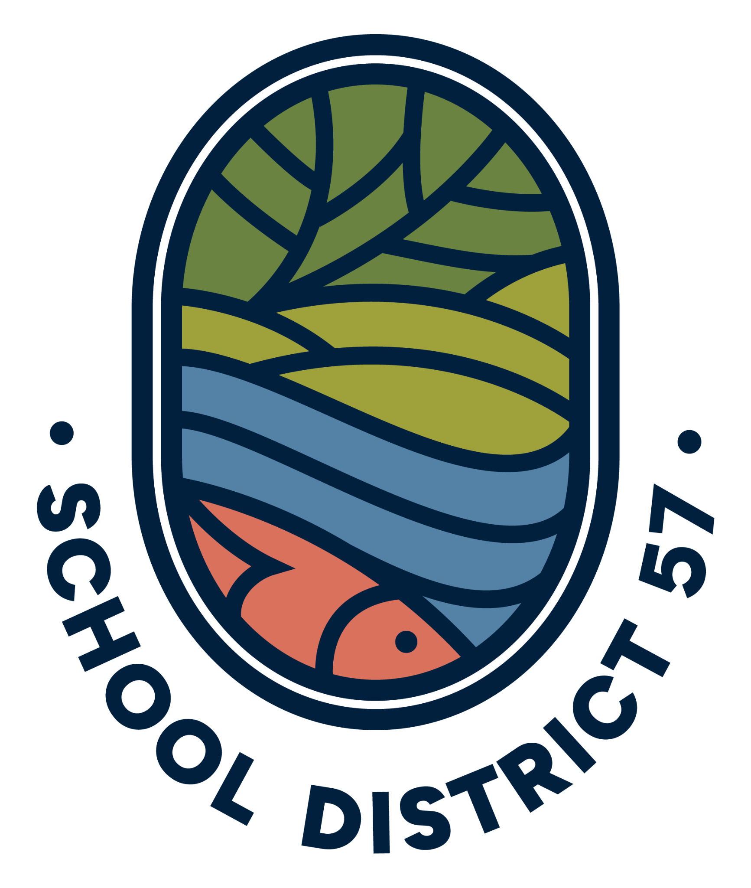</a> Raster | [Source document](<https://sd57.bc.ca/wp-content/uploads/2026/07/2025.09.09MediaRelease-NewSD57Logo.pdf>) [Publishing context](<https://sd57.bc.ca/media-release-new-sd57-logo/>) |
| **SD58** [Nicola Similkameen](<https://www.sd58.bc.ca>) | [2 Dec 1996](<https://www.bclaws.gov.bc.ca/civix/document/id/oic/arc_oic/0869_1996>) legal creation |  Vector | [Original asset](<https://www.nssd.ca/sites/default/files/images/2025-06/SD58%20Logo-Horiz-C_0.svg>) [Publishing context](<https://www.nssd.ca/>) |
| **SD59** [Peace River South](<https://www.sd59.bc.ca>) | [12 Apr 1946](<https://www2.gov.bc.ca/assets/gov/education/administration/resource-management/school-district-financial-reporting/financial-information/sd59-sofi-2024.pdf>) reported establishment |  Vector | [Original asset](<https://www.sd59.bc.ca/themes/sd59blue/logo.svg>) [Publishing context](<https://www.sd59.bc.ca>) |
| **SD60** [Peace River North](<https://www.prn.bc.ca>) | [12 Apr 1946](<https://www2.gov.bc.ca/assets/gov/education/administration/resource-management/school-district-financial-reporting/financial-information/sd60-sofi-2025.pdf>) reported establishment | <a href="../../../public/education/school-districts/logos/sd060.png">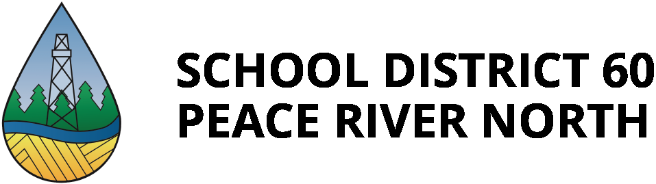</a> Raster | [Original asset](<https://www.prn.bc.ca/wp-content/themes/prn__district/library/images/prn__logo--print.png>) [Publishing context](<https://www.prn.bc.ca>) |
| **SD61** [Greater Victoria](<https://www.sd61.bc.ca>) | [Unverified](<https://studentsuccess.gov.bc.ca/school-district/061>) [12 Apr 1946 boundary notice](<https://archive.org/details/governmentgazett86nogove_m4u8>) |  Vector | [Source PDF, p. 2](<https://www.sd61.bc.ca/wp-content/uploads/sites/91/2025/06/GVSD61_StrategicAndOperationalPlan-3.pdf#page=2>) [Earlier image source](<https://www.sd61.bc.ca/wp-content/themes/district/library/images/gvsd-logo-blue.png>) |
| **SD62** [Sooke](<https://www.sd62.bc.ca>) | [12 Apr 1946](<https://www.sookeschools.ca/sites/default/files/uploads/meetings/agendas/Sep%2024_00_FULL%20PACKAGE%20AGENDA_compressed.pdf>) reported establishment |  Vector | [Original asset](<https://www.sd62.bc.ca/sites/default/files/SD62_Secondary%20Logo%20%28Horizontal%29.svg>) [Publishing context](<https://www.sd62.bc.ca>) |
| **SD63** [Saanich](<https://saanichschools.ca/>) | [Unverified](<https://studentsuccess.gov.bc.ca/school-district/063>) [12 Apr 1946 boundary notice](<https://archive.org/details/governmentgazett86nogove_m4u8>) |  Vector | [Source PDF, p. 2](<https://saanichschools.ca/sites/default/files/assets/files/Board%20Trustees/SASC-11371%20Strategic%20Plan%20Document_v8.pdf#page=2>) [Earlier image source](<https://saanichschools.ca/sites/default/files/saanich-schools-logo-reverse.png>) |
| **SD64** [Gulf Islands](<https://www.sd64.bc.ca>) | [12 Apr 1946](<https://media.sd64.bc.ca/media/Default/medialib/2025-09-10-public-agenda-package.c3e4966327.pdf>) reported establishment | <a href="../../../public/education/school-districts/logos/sd064.png">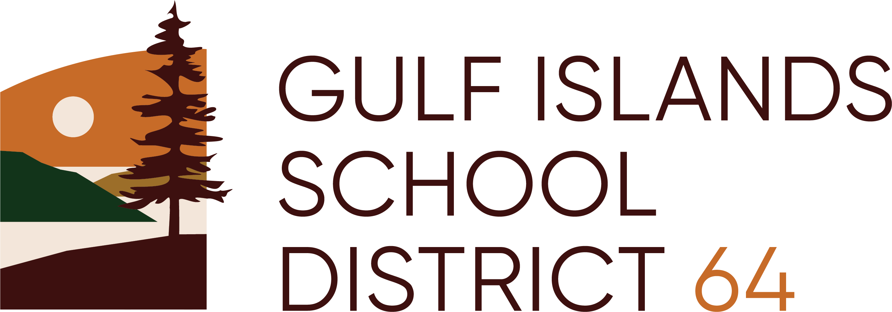</a> Raster | [Original asset](<https://sb45storage.blob.core.windows.net/pub/themes/Sd64/images/HeaderLogo.png>) [Publishing context](<https://www.sd64.bc.ca>) |
| **SD67** [Okanagan Skaha](<https://www.sd67.bc.ca>) | [2 Dec 1996](<https://www.bclaws.gov.bc.ca/civix/document/id/oic/arc_oic/0870_1996>) legal creation | <a href="../../../public/education/school-districts/logos/school-district-67-strategic-plan-shield.svg">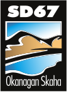</a> Vector | [Source PDF, p. 1](<https://22.files.edl.io/a3bd/09/28/23/164740-de9d1b0c-06b6-41cf-9fc1-a85d199f2644.pdf#page=1>) [Earlier image source](<https://www.sd67.bc.ca/pics/header_logo.png>) |
| **SD68** [Nanaimo Ladysmith](<https://www.sd68.bc.ca>) | [12 Apr 1946](<https://www2.gov.bc.ca/assets/gov/education/administration/resource-management/school-district-financial-reporting/financial-information/sd68-sofi-2025.pdf>) reported establishment |  Raster | [Original asset](<https://www.sd68.bc.ca/wp-content/uploads/NLPS_logo-300x140.png>) [Publishing context](<https://www.sd68.bc.ca>) |
| **SD69** [Qualicum](<https://www.sd69.bc.ca>) | [1946](<https://www2.gov.bc.ca/assets/gov/education/administration/resource-management/school-district-financial-reporting/financial-information/sd69-sofi-2025.pdf>) reported establishment |  Raster | [Original asset](<http://www.qsdlearns.ca/uploads/logoheader.png>) [Publishing context](<https://www.qsdlearns.ca/>) |
| **SD70** [Pacific Rim](<https://www.sd70.bc.ca>) | [1887](<https://media.sd70.bc.ca/media/Default/medialib/sd70-final-signed-fs-6-30-2024-package_revised.d3e1699110.pdf>) institutional origin |  Raster | [Original asset](<https://sb45storage.blob.core.windows.net/pub/themes/Sd70/images/logo.svg>) [Publishing context](<https://www.sd70.bc.ca>) |
| **SD71** [Comox Valley](<https://www.comoxvalleyschools.ca>) | [1946](<https://www.comoxvalleyschools.ca/wp-content/uploads/2025/12/2024-25-Statement-of-Financial-Information.pdf>) reported establishment |  Vector | [Source PDF, p. 1](<https://studyinbritishcolumbia.com/wp-content/uploads/2023/11/CVISP-Brand-Standards-Manual.pdf#page=1>) [Earlier image source](<https://www.comoxvalleyschools.ca/wp-content/uploads/2020/05/SD71_logo_2-300x209.png>) |
| **SD72** [Campbell River](<https://www.sd72.bc.ca>) | [12 Apr 1946](<https://media.sd72.bc.ca/media/Default/medialib/2024-2025-sd72-audited-financial-statements.15888d22383.pdf>) reported establishment |  Raster | [Original asset](<https://sb45storage.blob.core.windows.net/pub/themes/Sd72/images/logo.png>) [Publishing context](<https://www.sd72.bc.ca>) |
| **SD73** [Kamloops Thompson](<https://www.sd73.bc.ca>) | [2 Dec 1996](<https://www.bclaws.gov.bc.ca/civix/document/id/oic/arc_oic/0871_1996>) legal creation |  Vector | [Source PDF, p. 1](<https://lib.sd73.bc.ca/media/Default/medialib/2027-28-budget-process-timeline.c9407816443.pdf#page=1>) [Earlier image source](<https://sb45storage.blob.core.windows.net/pub/themes/sd73/images/logo.min.jpg>) |
| **SD74** [Gold Trail](<https://www.sd74.bc.ca>) | [2 Dec 1996](<https://www.bclaws.gov.bc.ca/civix/document/id/oic/arc_oic/0872_1996>) legal creation | <a href="../../../public/education/school-districts/logos/sd074.png">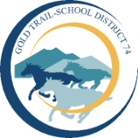</a> Raster | [Original asset](<https://www.sd74.bc.ca/pics/school_logo.png>) [Publishing context](<https://www.sd74.bc.ca>) |
| **SD75** [Mission](<https://www.mpsd.ca>) | [12 Apr 1946](<https://www.mpsd.ca/Board/Reports/Budgets/Financial%20info/2021%202022/2021-22%20SOFI_for%20website.pdf>) reported establishment **Source differences** |  Raster | [Original asset](<https://sb45storage.blob.core.windows.net/pub/themes/mpsd/images/logo1.webp>) [Publishing context](<https://www.mpsd.ca>) |
| **SD78** [Fraser Cascade](<https://www.sd78.bc.ca>) | [2 Dec 1996](<https://www.bclaws.gov.bc.ca/civix/document/id/oic/arc_oic/0873_1996>) legal creation |  Raster | [Original asset](<https://sd78.bc.ca/wp-content/uploads/2026/03/fraser-cascade-school-district-78-png-logo.png>) [Publishing context](<https://sd78.bc.ca/>) |
| **SD79** [Cowichan Valley](<https://www.sd79.bc.ca>) | [2 Dec 1996](<https://www.bclaws.gov.bc.ca/civix/document/id/oic/arc_oic/0874_1996>) legal creation | <a href="../../../public/education/school-districts/logos/sd079.png">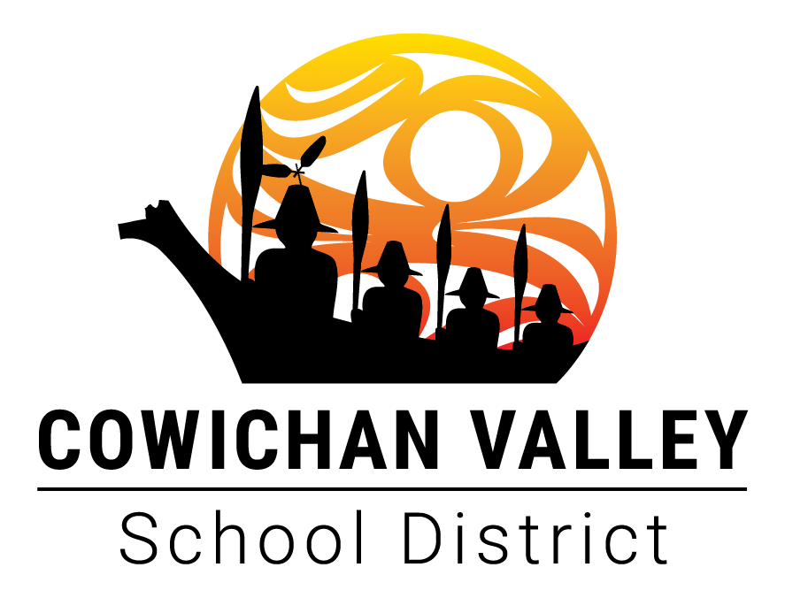</a> Raster | [Original asset](<https://sd79.bc.ca/wp-content/uploads/2024/06/Cowichan-Valley-School-District-Portrait.png>) [Publishing context](<https://sd79.bc.ca/>) |
| **SD81** [Fort Nelson](<https://www.sd81.bc.ca/>) | [1955](<https://www2.gov.bc.ca/assets/gov/education/administration/resource-management/school-district-financial-reporting/financial-information/sd81-sofi-2025.pdf>) institutional origin **Source differences** | <a href="../../../public/education/school-districts/logos/sd081.png">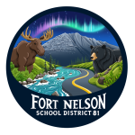</a> Raster | [Original asset](<https://sd81.bc.ca/wp-content/uploads/fort-nelson-school-district-81-512x512-1-150x150.png>) [Publishing context](<https://sd81.bc.ca/>) |
| **SD82** [Coast Mountains](<https://cmsd.bc.ca/>) | [2 Dec 1996](<https://www.bclaws.gov.bc.ca/civix/document/id/oic/arc_oic/0875_1996>) legal creation |  Raster | [Original asset](<https://cmsd.bc.ca/assets/favicons/favicon.ico>) [Publishing context](<https://cmsd.bc.ca/>) |
| **SD83** [K̓wsaltktnéws Ne Secwepemcúl’ecw](<https://www.sd83.bc.ca>) | [2 Dec 1996](<https://www.bclaws.gov.bc.ca/civix/document/id/oic/arc_oic/0876_1996>) legal creation | <a href="../../../public/education/school-districts/logos/sd083.png">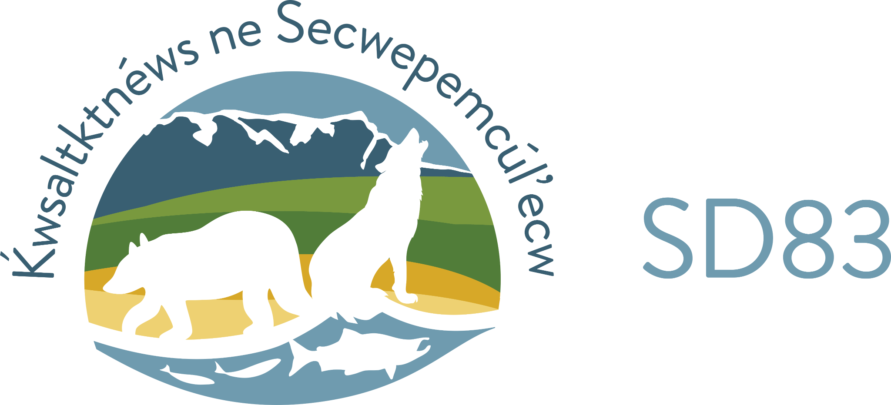</a> Raster | [Original asset](<https://www.sd83.bc.ca/images/logo.png?fingerprint=ppb20251217061303>) [Publishing context](<https://www.sd83.bc.ca>) |
| **SD84** [Vancouver Island West](<https://www.sd84.bc.ca>) | [1 Jan 1965](<https://www2.gov.bc.ca/assets/gov/education/administration/resource-management/school-district-financial-reporting/financial-information/sd84-sofi-2025.pdf>) reported establishment | <a href="../../../public/education/school-districts/logos/sd084.png">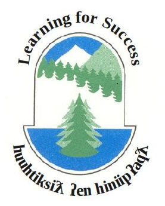</a> Raster | [Original asset](<https://sd84.bc.ca/wp-content/uploads/2022/02/cropped-School-District-Nuu-chah-nulth-Logo_ImgID1.png>) [Publishing context](<https://sd84.bc.ca/>) |
| **SD85** [Vancouver Island North](<https://www.sd85.bc.ca>) | [1 Jul 1965](<https://www2.gov.bc.ca/assets/gov/education/administration/resource-management/school-district-financial-reporting/financial-information/sd85-sofi-2025.pdf>) reported establishment | <a href="../../../public/education/school-districts/logos/sd085.png">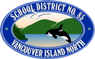</a> Raster | [Original asset](<https://www.makeafuture.ca/drive/uploads/2021/08/logo-sd85-vancouver_island_north-horizontal-1.png>) [Publishing context](<https://www.makeafuture.ca/bc-schools-and-districts/vancouver-island-north-school-district-no-85/>) Recruitment-profile fallback |
| **SD87** [Stikine](<https://www.sd87.bc.ca>) | [1 Jan 1966](<https://www2.gov.bc.ca/assets/gov/education/administration/resource-management/school-district-financial-reporting/financial-information/sd87-sofi-2025.pdf>) reported establishment |  Raster | [Original asset](<https://www.sd87.bc.ca/images/6be79d12-caab-59d7-b43b-c8627948a233?fingerprint=ppb20261014174322>) [Publishing context](<https://www.sd87.bc.ca>) |
| **SD91** [Nechako Lakes](<https://www.sd91.bc.ca>) | [2 Dec 1996](<https://www.bclaws.gov.bc.ca/civix/document/id/oic/arc_oic/0877_1996>) legal creation | <a href="../../../public/education/school-districts/logos/sd091.svg">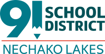</a> Vector | [Original asset](<https://www.sd91.bc.ca/images/logo.svg?fingerprint=ppb20251217061115>) [Publishing context](<https://www.sd91.bc.ca>) |
| **SD92** [Nisga'a](<https://www.nisgaa.bc.ca>) | [1 Jan 1975](<https://www2.gov.bc.ca/assets/gov/education/administration/resource-management/school-district-financial-reporting/financial-information/sd92-sofi-2025.pdf>) reported establishment **Source differences** |  Raster | [Original asset](<https://www.nisgaa.bc.ca/nisgaa-icon-banner.png>) [Publishing context](<https://www.nisgaa.bc.ca>) |
| **SD93** [Conseil scolaire francophone](<https://www.csf.bc.ca>) | [1995](<https://archive.news.gov.bc.ca/releases/archive/pre2001/1997/0607.asp>) institutional origin **Source differences** |  Vector | [Original asset](<https://www.csf.bc.ca/wp-content/uploads/2022/05/csf-logoHoriz-desc-court-coul.svg>) [Publishing context](<https://www.csf.bc.ca>) |

The eight unverified formation entries retain original 1946 boundary-notice evidence. **SD75, SD81, SD92, and SD93** retain unresolved source differences. **SD70’s 1887 date** is an institutional origin; it does not establish the creation date of the modern numbered district.

The selected primary logos comprise **12 vector and 48 raster assets**. The [logo research records](logos.json) additionally contain **four historical marks and three current variants**, bringing the retained collection to **67 files**, together with **12 sourced brand-history events**.

## The 1996 amalgamations

Every creation and predecessor abolition in this table took effect on **2 December 1996**. Approval is a separate milestone. The original orders support the named predecessor relationships, asset and liability transfers, and effective date. These 31 immediate predecessors are the reviewed historical connection scope; earlier histories and partial boundary transfers remain open research.

| Current successor | Predecessors abolished | Order approved | Effective creation and abolition | Original instrument |
| --- | --- | --- | --- | --- |
| **SD5** Southeast Kootenay | SD1 Fernie; SD2 Cranbrook | 25 Jul 1996 | 2 Dec 1996 | [Order in Council 861/1996](<https://www.bclaws.gov.bc.ca/civix/document/id/oic/arc_oic/0861_1996>) |
| **SD6** Rocky Mountain | SD3 Kimberley; SD4 Windermere; SD18 Golden | 25 Jul 1996 | 2 Dec 1996 | [Order in Council 862/1996](<https://www.bclaws.gov.bc.ca/civix/document/id/oic/arc_oic/0862_1996>) |
| **SD8** Kootenay Lake | SD7 Nelson; SD86 Creston-Kaslo | 15 Aug 1996 | 2 Dec 1996 | [Order in Council 970/1996](<https://www.bclaws.gov.bc.ca/civix/document/id/oic/arc_oic/0970_1996>) |
| **SD20** Kootenay Columbia | SD9 Castlegar; SD11 Trail | 15 Aug 1996 | 2 Dec 1996 | [Order in Council 971/1996](<https://www.bclaws.gov.bc.ca/civix/document/id/oic/arc_oic/0971_1996>) |
| **SD51** Boundary | SD12 Grand Forks; SD13 Kettle Valley | 25 Jul 1996 | 2 Dec 1996 | [Order in Council 867/1996](<https://www.bclaws.gov.bc.ca/civix/document/id/oic/arc_oic/0867_1996>) |
| **SD53** Okanagan Similkameen | SD14 Southern Okanagan; SD16 Keremeos | 25 Jul 1996 | 2 Dec 1996 | [Order in Council 868/1996](<https://www.bclaws.gov.bc.ca/civix/document/id/oic/arc_oic/0868_1996>) |
| **SD58** Nicola Similkameen | SD17 Princeton; SD31 Merritt | 25 Jul 1996 | 2 Dec 1996 | [Order in Council 869/1996](<https://www.bclaws.gov.bc.ca/civix/document/id/oic/arc_oic/0869_1996>) |
| **SD67** Okanagan Skaha | SD15 Penticton; SD77 Summerland | 25 Jul 1996 | 2 Dec 1996 | [Order in Council 870/1996](<https://www.bclaws.gov.bc.ca/civix/document/id/oic/arc_oic/0870_1996>) |
| **SD73** Kamloops Thompson | SD24 Kamloops; SD26 North Thompson | 25 Jul 1996 | 2 Dec 1996 | [Order in Council 871/1996](<https://www.bclaws.gov.bc.ca/civix/document/id/oic/arc_oic/0871_1996>) |
| **SD74** Gold Trail | SD29 Lillooet; SD30 South Cariboo | 25 Jul 1996 | 2 Dec 1996 | [Order in Council 872/1996](<https://www.bclaws.gov.bc.ca/civix/document/id/oic/arc_oic/0872_1996>) |
| **SD78** Fraser Cascade | SD32 Hope; SD76 Agassiz-Harrison | 25 Jul 1996 | 2 Dec 1996 | [Order in Council 873/1996](<https://www.bclaws.gov.bc.ca/civix/document/id/oic/arc_oic/0873_1996>) |
| **SD79** Cowichan Valley | SD65 Cowichan; SD66 Lake Cowichan | 25 Jul 1996 | 2 Dec 1996 | [Order in Council 874/1996](<https://www.bclaws.gov.bc.ca/civix/document/id/oic/arc_oic/0874_1996>) |
| **SD82** Coast Mountains | SD80 Kitimat; SD88 Terrace | 25 Jul 1996 | 2 Dec 1996 | [Order in Council 875/1996](<https://www.bclaws.gov.bc.ca/civix/document/id/oic/arc_oic/0875_1996>) |
| **SD83** K̓wsaltktnéws Ne Secwepemcúl’ecw | SD21 Armstrong-Spallumcheen; SD89 Shuswap | 25 Jul 1996 | 2 Dec 1996 | [Order in Council 876/1996](<https://www.bclaws.gov.bc.ca/civix/document/id/oic/arc_oic/0876_1996>) |
| **SD91** Nechako Lakes | SD55 Burns Lake; SD56 Nechako | 25 Jul 1996 | 2 Dec 1996 | [Order in Council 877/1996](<https://www.bclaws.gov.bc.ca/civix/document/id/oic/arc_oic/0877_1996>) |

The [1946 Gazette index](gazette-1946-district-index.json) preserves an additional archival roster of 74 districts with original names and notice-page locators. District numbers were reused, so the archival roster must not be joined to current entities solely by number. The [public JSON catalogue](../../../public/education/school-districts/catalogue.json) supplies stable entity identifiers and the explicit reviewed connections.

## Provenance and updates

This Markdown catalogue reflects the reviewed generated catalogue at the date above. Source locators, date meanings, disagreement notes, logo fidelity details, observation dates, and hashes remain in [history.json](history.json), [logos.json](logos.json), and the [generated catalogue](../../../public/education/school-districts/catalogue.json). Follow the [rebuild and check instructions](README.md#files-and-maintenance) when updating the collection.
