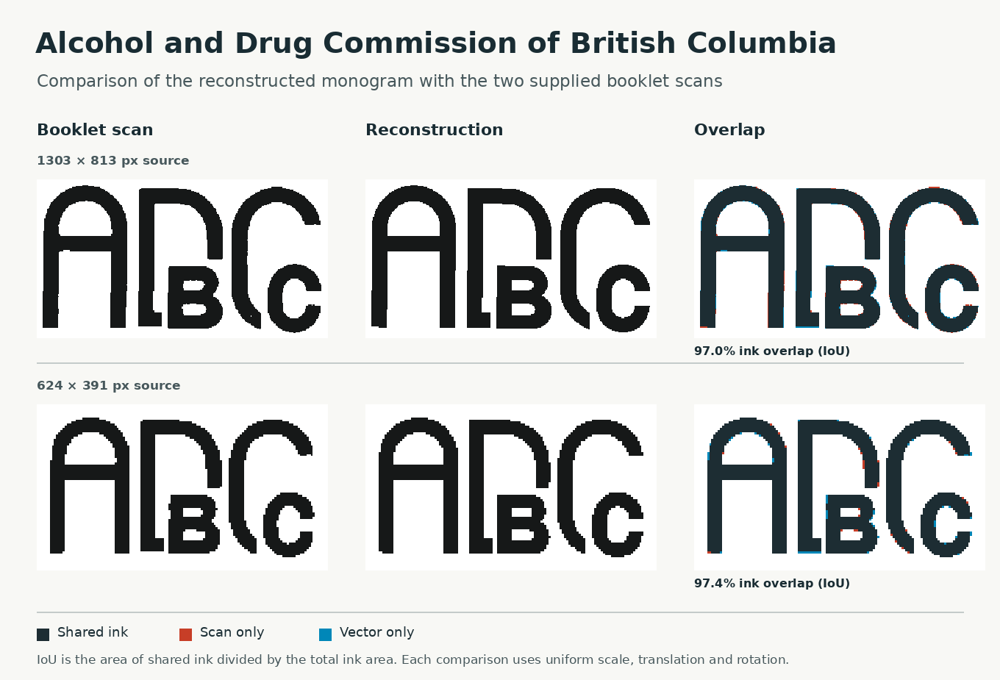

# Alcohol and Drug Commission of British Columbia

[Download the five-letter SVG](../../../public/identity-collected/alcohol-and-drug-commission/monogram.svg)

The Education Department imprint names the Commission and gives its address as 307 West Broadway, Vancouver, B. C. The two supplied images show the same booklet page at different sizes. Its title and publication date are unknown.

The reconstruction uses five closed letter outlines with transparent counters. The overlay below compares the SVG with the ink at a greyscale threshold of 128. Each fit allows a single scale, translation and rotation. Angles are clockwise. Origins are the positions of the SVG’s top-left corner in the full supplied image.

| Supplied image | Origin in pixels | Pixels per SVG unit | Rotation | Intersection over union |
| --- | --- | ---: | ---: | ---: |
| 1303 × 813 | 454.19, 526.49 | 0.99970 | 0.426° | 97.01% |
| 624 × 391 | 217.37, 232.76 | 0.42099 | 0.438° | 97.39% |

Sections 2–4 of the 1973 Act established the Commission as an agent of the provincial Crown, with members, chair and vice-chair appointed or designated by the Lieutenant Governor in Council. The legislature repealed its enabling Act in 1983. [1973 Act](https://www.bclaws.gov.bc.ca/civix/document/id/hstats/hstats/408463782) · [1983 repeal](https://www.bclaws.gov.bc.ca/civix/document/id/hstats/hstats/577115892)
