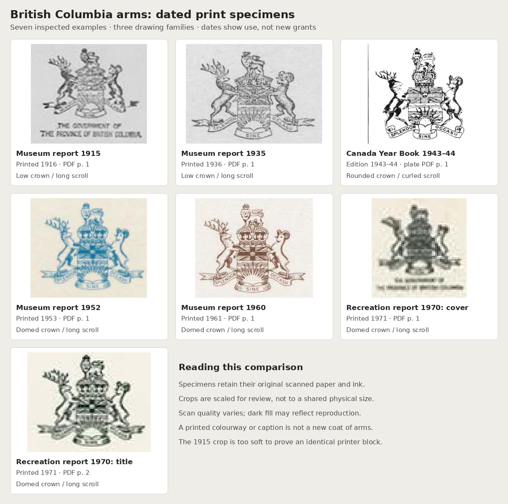

# British Columbia arms: a visual catalogue

**32 illustrated specimens, proposals, objects and reproduction treatments, with 30 linked sources; researched 14 November 2026.** This is a source catalogue for the PofBC Identity collection. It extends the [document-heading study](../document-arms-2026-11-13/README.md) with actual dated examples of different drawings.

Open the [visual catalogue PDF](catalogue.pdf), the [selected variants overview](selected-variants.jpg), the [dated print comparison](printed-comparison.jpg), or the [machine-readable inventory](catalogue.json). The inventory records dates, classifications, source URLs, image hashes and evidence limits for every illustrated entry.

## What the evidence supports

There are three principal provincial arms design stages, with predecessors and unadopted proposals alongside them:

| Design stage | What changes | Evidence |
| --- | --- | --- |
| **1895 Beanlands arms** | Sun and waves above the Union Flag; royal crest, stag, ram and motto. Provincial adoption on 19 July 1895. | [B.C. government history][S01] |
| **1906 granted shield and motto** | Union Flag moved to the top, with an antique crown at its centre; waves and sun below. Grant dated 31 March 1906. Earlier crest and supporters continued in use without being included in that grant. | [Authority register][S02]; [contemporary 1943–44 account][S16] |
| **1987 complete achievement** | Formal crest and supporters, helmet and mantling, dogwood collar and floral base. Grant dated 15 October 1987. | [Contemporary report, pp. vi–vii][S21]; [Authority register][S02] |

The **1870 lion-and-crown badge** is a predecessor device, and **Lorne’s c. 1882 trial shields** were proposals. They are useful historical branches, not adopted versions of the later sun-and-waves arms. [The 1870 correspondence][S05] and [LAC’s catalogue][S08] establish their respective contexts.

The **1990 Canadian registration** has a separately credited painting by **Cathy Bursey-Sabourin**. It records the existing arms; it does not create a fourth provincial design stage. The current Legislature account says the arms have remained unchanged since 1987. The **2023 Great Seal** changes the surrounding sovereign’s legend and is catalogued as a related seal. [S02][S02] · [S22][S22] · [S27][S27]

## The most useful new distinction: drawings within the old arms



The inspected government publications support at least **three visibly distinct drawing families** within the pre-1987 full achievement:

| Descriptive family | Dated specimens found | Visible distinction |
| --- | --- | --- |
| **Low crown / long scroll** | Museum report 1915, printed 1916; report 1935, printed 1936 | Lower, open-looking crown; slender supporters; long forked ribbon tails. The 1915 scan is too soft to prove the same block. |
| **Rounded crown / curled scroll** | Canada Year Book, 1943–44 edition | Larger long-bodied lion; high rounded crown; fuller supporters; scroll ends curl beneath them. |
| **Domed crown / long scroll** | Museum report 1952, printed 1953; report 1960, printed 1961; Recreation and Conservation report 1970, printed 1971 | Prominent domed crown; bold Union-cross; long projecting tails. Blue, brown and dark inks are printing treatments. |

These are research labels for visible differences. They are not official version names or demonstrated printer lineages. The report year, imprint year and artwork introduction date are different things. A specimen proves use at that time; it does not prove when its drawing was created. Sources: [1915][S14], [1935][S15], [1943–44][S16], [1952][S17], [1960][S18], [1970][S19].

## How the supplied document headings fit

The three user images preserve **layouts** of the older full arms: split serif capitals, a condensed government caption, and split blackletter. They do not by themselves establish three different heraldic designs. Their small, dark scans also do not establish that every heading used an identical engraving.

The complete four-page **[Order in Council 1121/1978][S30]**, approved **4 May 1978**, independently identifies two supplied headings. Its **page 1** matches the government-caption crop (entry 20); its **page 4** matches the blackletter heading (entry 21) on a map attachment naming **Kootenay District**, **Provincial Rental Housing Corporation** and **Crown Grant No. 8498**. The [held PDF](https://github.com/ahzs645/PofBC/blob/d3e4fbf55538e3991179a9868496dcf2e28a68c5/research/identity/document-arms-2026-11-14/reference/oic-1121-1978.pdf) and [source-identification record](https://github.com/ahzs645/PofBC/blob/d3e4fbf55538e3991179a9868496dcf2e28a68c5/research/identity/document-arms-2026-11-14/README.md) preserve the document and comparison evidence.

The blackletter sheet is a **map attachment, not a complete Crown-grant instrument**. Its presence in the May 1978 order establishes an occurrence; the map's own creation date, original grant's issue date and engraving date remain unknown. The split-serif crop numbered **279** (entry 19) remains unidentified and undated. The original user images are unchanged; the newly identified PDF supplies provenance, not a substitute image or a recovered artwork master.

The 1970 report independently demonstrates both captioned and arms-only applications within one publication. These distinctions are preserved in entries 15–16 and 19–21. See the [source register][S20], [1970 report][S19] and [OIC 1121/1978][S30].

The existing Historic arms renderer remains a **provisional layout study**. The earlier audit identifies its shared geometry as a vector conversion of a generated master. The new evidence supplies better reconstruction targets; it does not retroactively make that existing path an exact historical engraving.

## Suggested Identity structure

Keep separate choices for **historical design**, **drawing**, **document layout** and **reproduction treatment**. For example:

| Choice | Examples supported by this survey |
| --- | --- |
| Historical design | 1895 Beanlands; 1906 shield with the older assumed full achievement; 1987 complete arms |
| Drawing or object | 1935 museum engraving; 1943–44 Year Book drawing; 1960 museum drawing; 1990 registration painting |
| Layout | Arms alone; split serif; government caption; split blackletter; modern English or French wordmark |
| Treatment | Source colour; one-colour print; the guide’s authored reverse treatment |
| Evidence status | Dated original publication; later reproduction; undated source; provisional reconstruction |

A future reconstruction should start from one named specimen, preserve its proportions and linework, and carry its source and confidence label. The three dated print families are good separate targets. The current guide supplies explicit modern production examples, including reverse rules; it does not establish a period standard for the older headings. [Guide, p. 3][S25]

This research change adds the catalogue and reference imagery. It does not modify the application’s renderer, routes or export behaviour.

## First reconstruction target

Start with **entry 14: the Provincial Museum report for 1960, printed in 1961**, using its **cover / PDF page 1**. Open the [official report](https://rbcm.ca/wp-content/uploads/2025/07/annual_report_1960.pdf#page=1), [held arms crop](reference/museum-report-1960.png) and [dated print comparison](printed-comparison.jpg) together.

This is a practical target for the **composition and proportions** of the domed-crown, long-scroll drawing family. Its light brown printing separates the main contours more clearly than the small, dense 1954 and 1978 heading specimens. That visual similarity does **not** establish an identical engraving or printing block, and the target should retain its own specimen identity.

The native cover image is **2179 × 3162 pixels**, but the arms occupy only about **200 × 175 source pixels**. The saved **276 × 233** rendered crop does not add source detail. Fine hatching, small animal features and exact lettering remain unresolved; obtain a better scan or printing master before claiming an exact reconstruction. A subsequent overlay should align the named specimen to the candidate at a common scale and record which details are source-supported or still uncertain.

## Date and image policy

- **Design date:** adoption or grant of the heraldic composition.
- **Specimen date:** a dated object, registration, document or printed publication.
- **Artwork date:** retained as unknown when no source establishes it.
- **Retrieval date:** identifies when an online specimen was inspected, not when it was drawn.

Scans retain paper colour, ink colour, blur and source watermarks. Source images are copied or extracted; none is traced, cleaned up, recoloured or replaced with generated imagery. The PDF scales examples independently, so it is not a physical-size comparison. Image SHA-256 values in the inventory verify the saved reference files; source-PDF hashes are included where recorded.

Reference photographs and artwork retain their source credits. In particular, the Vancouver Island seal photograph is by **Will.Jackson.Vancouver**, dated 18 April 2016, under [CC BY-SA 4.0](https://creativecommons.org/licenses/by-sa/4.0/), and is unchanged. The Speaker’s Chair photo is credited to **Carl Larsen**; the pin-dish image to the **Vachon Collection**. These reference files are not newly created export masters.

## Limits and next archival targets

This is a bounded survey of the variants located and inspected, not an assertion that every surviving rendering has been found. The inventory also records ten documentary records and unretrieved visual leads. The strongest next targets are:

- Original **1906 and 1987 grant artwork**. The 1987 lead is College of Arms reference **I.84/265**, mentioned in its January 2024 Newsletter no. 74; the original image was not obtained.
- The **1889 Admiralty Flag Book**, plate 16, for a dated printed badge.
- The **1893 foundation plaque** with crest and motto.
- The **1906 Wedgwood plate**, reported to retain the 1895 arms and place the motto above the crest. It is distinct from the inspected Foley China pin dish.
- Original printer artwork or reproduction sheets for the **Order-in-Council and Crown-grant headings**.

Two source conflicts are recorded rather than resolved by guesswork: LAC’s **c. 1882** date for Lorne’s sheet versus an older **1881** caption, and **6 versus 16 September 1896** for the seal. The catalogue uses the primary approximate date in the first case and the year only in the second. The 2012 Blazon survey also contains a **1997** caption for the 1987 arms and an incorrect ceremony location; official and contemporary sources take precedence.

No archival enquiries or messages were sent. Unretrieved drawings are described as leads without substitute images.

## Files and regeneration

The complete catalogue is `catalogue.json`; `reference/` contains its 32 image assets. `build_catalogue.py` renders the PDF using Python, Pillow and ReportLab:

```sh
python build_catalogue.py catalogue.json --compact
```

The script reads only local catalogue assets. Consult its `--help` output for output and pagination options. Re-render and visually inspect the pages after changing copy or images.

## Illustrated entry index

| No. | Specimen | Date label | Type | Sources |
| --- | --- | --- | --- | --- |
| 01 | [Vancouver Island colonial seal](reference/vancouver-island-seal.jpg) | Seal dispatched 1850 · photo 2016 | Predecessor colonial seal | [S03][S03] · [S04][S04] |
| 02 | [Lion, crown and B/C badge](reference/royal-crest-bc-badge.jpeg) | Flag badge approved 1870 · drawing undated | Precursor badge | [S05][S05] · [S06][S06] · [S07][S07] |
| 03 | [Lorne’s four trial shields](reference/lorne-proposals.png) | c. 1882 · reproduced 1983 | Unadopted proposals | [S08][S08] · [S09][S09] |
| 04 | [Crest, branches and motto](reference/crest-wreath-motto.jpeg) | Undated · reproduced 2012 | Decorative badge rendition | [S07][S07] |
| 05 | [Beanlands arms: line drawing](reference/beanlands-web-drawing.gif) | Design adopted 1895 · drawing undated | Provincial adoption / later reproduction | [S01][S01] |
| 06 | [Great Seal with the older shield](reference/beanlands-seal.jpg) | 1896 seal design · impression undated | Seal rendition | [S10][S10] · [S28][S28] |
| 07 | [Diamond Jubilee stained glass](reference/diamond-jubilee-window.jpg) | 1897 window · modern photograph | Dated physical rendition | [S11][S11] |
| 08 | [Speaker’s Chair carving](reference/speakers-chair.jpeg) | 1890s chair and canopy · photo published 2012 | Carved rendition | [S12][S12] · [S07][S07] |
| 09 | [Foley China pin dish](reference/foley-china.jpg) | Object undated · photo published 2012 | Decorative ceramic rendition | [S13][S13] · [S07][S07] |
| 10 | [Museum title page](reference/museum-report-1915.png) | Report 1915 · printed 1916 | Dated printing specimen | [S14][S14] |
| 11 | [Fine engraved museum arms](reference/museum-report-1935.png) | Report 1935 · printed 1936 | Dated printing specimen | [S15][S15] |
| 12 | [Canada Year Book drawing](reference/canada-year-book-1943-44.png) | Edition 1943–44 | Dated printing specimen | [S16][S16] |
| 13 | [Blue museum cover arms](reference/museum-report-1952.png) | Report 1952 · printed 1953 | Dated printing specimen | [S17][S17] |
| 14 | [Brown museum cover arms](reference/museum-report-1960.png) | Report 1960 · printed 1961 | Dated printing specimen | [S18][S18] |
| 15 | [Government-caption cover](reference/recreation-conservation-report-1970-cover.png) | Report 1970 · printed 1971 | Dated printing specimen | [S19][S19] |
| 16 | [Arms-only title page](reference/recreation-conservation-report-1970-title.png) | Report 1970 · printed 1971 | Dated printing specimen | [S19][S19] |
| 17 | [Government history illustration](reference/old-full-arms-government.jpg) | 1906-era design family · drawing undated | Undated colour reproduction | [S01][S01] |
| 18 | [Alternative colour illustration](reference/old-full-arms-colour.jpg) | Pre-1987 design family · drawing undated | Undated colour reproduction | [S10][S10] |
| 19 | [Split serif heading](reference/supplied-split-serif.png) | Document undated | Document layout | [S20][S20] |
| 20 | [Government-caption heading](reference/supplied-government-caption.png) | Order approved 4 May 1978 | Document layout; OIC page 1 | [S20][S20] · [S30][S30] |
| 21 | [Crown-grant blackletter heading](reference/supplied-blackletter.png) | In 4 May 1978 order; map undated | Map attachment; OIC page 4 | [S20][S20] · [S30][S30] |
| 22 | [1987 complete arms: period plate](reference/full-1987-period-report.png) | 1987–88 report | Period colour reproduction | [S21][S21] |
| 23 | [1990 registration painting](reference/full-1990-cha-registration.jpg) | Registered 17 April 1990 | Attributed painting | [S02][S02] |
| 24 | [Legislature web drawing](reference/full-current-legislature-web.jpg) | Undated · observed 2026 | Current colour drawing | [S22][S22] |
| 25 | [Provincial web specimen](reference/full-current-government-web.jpg) | Undated · observed 2026 | Current colour reproduction | [S01][S01] |
| 26 | [Educational painted rendition](reference/full-legislature-factsheet-2025.png) | Fact sheet printed June 2025 | Painted educational rendition | [S24][S24] |
| 27 | [Elek Imredy sculpture](reference/full-1987-sculpture.jpg) | Unveiled 15 October 1987 | Cast-aluminum rendition | [S23][S23] |
| 28 | [Colour layouts: alone, EN, FR](reference/guide-colour-lockups.png) | Guide undated | Wordmark layouts | [S25][S25] |
| 29 | [One-colour black treatment](reference/guide-monochrome.png) | Guide undated | Production treatment | [S25][S25] |
| 30 | [Reverse white-on-blue treatment](reference/guide-reverse.png) | Guide undated | Production treatment | [S25][S25] |
| 31 | [Shield with English wordmark](reference/guide-shield-only.png) | Guide undated | Component / wordmark layout | [S25][S25] |
| 32 | [Great Seal for Charles III](reference/great-seal-2023.png) | Released 6 May 2023 | Related administrative seal | [S26][S26] · [S27][S27] |

## Sources and credits

- **S01 — [B.C. government: history of the coat of arms](https://www2.gov.bc.ca/gov/content/governments/celebrating-british-columbia/symbols-of-bc/coat-of-arms)**. Official retrospective history.
- **S02 — [Canadian Heraldic Authority: 1990 registration, Vol. II, p. 3](https://www.gg.ca/en/heraldry/public-register/project/1406)**. Authority register. Painting: Cathy Bursey-Sabourin; calligraphy: Nancy Ellis.
- **S03 — [Grey to Blanshard, 29 June 1850: dispatch of Vancouver Island seal](https://bcgenesis.uvic.ca/old/2.0/V507003.html)**. Contemporary correspondence, UVic Colonial Despatches.
- **S04 — [Vancouver Island seal: photograph and licence](https://commons.wikimedia.org/wiki/File:The_Great_Seal_of_Colony_of_the_Island_of_Vancouver_and_its_Dependencies.jpg)**. Object photograph. Will.Jackson.Vancouver, 18 April 2016. CC BY-SA 4.0: https://creativecommons.org/licenses/by-sa/4.0/ . Image unchanged.
- **S05 — [Musgrave to Granville, 17 May 1870: proposed flag badge](https://bcgenesis.uvic.ca/B70072.html)**. Contemporary correspondence.
- **S06 — [Kimberley to Musgrave, 9 July 1870: flag approval](https://hcmc.uvic.ca/~coldesp/B707102.html)**. Contemporary correspondence.
- **S07 — [The Blazon, Winter 2012: illustrated BC arms history](https://bc-yukon.heraldry.ca/archives/blazon/issues/Blazon-2012-2-Winter.pdf)**. Later illustrated survey. Carl A. Larsen / BC-Yukon Branch, Royal Heraldry Society of Canada. Individual photo credits retained.
- **S08 — [Library and Archives Canada: Lorne proposal, c. 1882](https://www.flickr.com/photos/lac-bac/32652584240/)**. Primary archival catalogue. MIKAN 3922080; e010767157. Marquess of Lorne.
- **S09 — [The Blazon, April 1983: Lorne proposal reproduction, p. 9](https://bc-yukon.heraldry.ca/archives/blazon/issues/Blazon-1983-2-April.pdf)**. Later reproduction of archival drawing. Historical sheet credited to Public Archives of Canada, C16216.
- **S10 — [Hubert de Vries: British Columbia illustrated history](https://www.hubert-herald.nl/CanBritishColumbia.htm)**. Secondary illustrated history.
- **S11 — [Legislature: the Diamond Jubilee Window](https://www.leg.bc.ca/learn/discover-your-legislature/building-tour/interior-features/hall-of-honour/diamond-jubilee-window)**. Official object history. Photograph: Legislative Assembly of British Columbia.
- **S12 — [Legislature: the Speaker’s Chair](https://www.leg.bc.ca/learn/discover-your-legislature/building-tour/interior-features/legislative-chamber/speakers-chair-interior)**. Official object history.
- **S13 — [Auguste Vachon: Beanlands and the Foley China pin dish](https://www.heraldicscienceheraldique.com/b.html)**. Specialist object attribution. Vachon Collection, Canadian Museum of Civilisation (now Canadian Museum of History).
- **S14 — [Provincial Museum report for 1915; imprint 1916](https://rbcm.ca/wp-content/uploads/2025/07/annual_report_1915.pdf)**. Contemporary official publication.
- **S15 — [Provincial Museum report for 1935; imprint 1936](https://rbcm.ca/wp-content/uploads/2025/07/annual_report_1935.pdf)**. Contemporary official publication.
- **S16 — [Canada Year Book 1943–44: provincial arms plate](https://www66.statcan.gc.ca/eng/1943-44/194301060000_Provincial%20Coats-of-Arms%20and%20Emblems.pdf)**. Contemporary official publication.
- **S17 — [Provincial Museum report for 1952; imprint 1953](https://rbcm.ca/wp-content/uploads/2025/07/annual_report_1952.pdf)**. Contemporary official publication.
- **S18 — [Provincial Museum report for 1960; imprint 1961](https://rbcm.ca/wp-content/uploads/2025/07/annual_report_1960.pdf)**. Contemporary official publication.
- **S19 — [Recreation and Conservation report for 1970; imprint 1971](https://rbcm.ca/wp-content/uploads/2025/07/annual_report_1970.pdf)**. Contemporary official publication.
- **S20 — [User-supplied document crops: existing project source register](https://github.com/ahzs645/PofBC/blob/d3e4fbf55538e3991179a9868496dcf2e28a68c5/research/identity/document-arms-2026-11-13/source-register.json)**. User-supplied evidence. Images supplied by project owner; copied unchanged. Government and blackletter headings identified in OIC 1121/1978 (S30); split-serif source remains unidentified.
- **S21 — [Provincial Secretary annual report, year ended 31 March 1988](https://rbcm.ca/wp-content/uploads/2025/07/bca_annual_report_1987_88.pdf)**. Contemporary official publication.
- **S22 — [Legislature: coat-of-arms history and current drawing](https://www.leg.bc.ca/learn/discover-your-legislature/provincial-and-parliamentary-symbols/bc-coat-of-arms)**. Official history and current specimen.
- **S23 — [Legislature: Lower Rotunda and the Imredy sculpture](https://www.leg.bc.ca/learn/discover-your-legislature/building-tour/interior-features/upper-rotunda-and-entrance-to-legislative-chamber/lower-rotunda)**. Official object history. Sculpture: Elek Imredy. Photograph: Legislative Assembly of British Columbia.
- **S24 — [Legislature: coat-of-arms fact sheet, printed June 2025](https://www.leg.bc.ca/sites/default/files/images/pdf/peo/The-Coat-of-Arms-Fact-Sheet-English.pdf)**. Dated official educational specimen.
- **S25 — [The Emblems of British Columbia: reproduction guide](https://www2.gov.bc.ca/assets/gov/british-columbians-our-governments/celebrating-british-columbia/symbols-of-bc/bc-emblems-set.pdf)**. Official reproduction guide. Government of British Columbia. SAMPLE marks retained.
- **S26 — [Coronation presentation: Great Seal, PDF p. 32](https://www2.gov.bc.ca/assets/gov/british-columbians-our-governments/organizational-structure/office-of-the-premier/intergovernmental-relations-secretariat/protocol/official-visits-to-bc/coronation_pp_sovereign_his_majesty_king_charles_iii.pdf)**. Official illustrated presentation.
- **S27 — [B.C. announcement of the updated Great Seal, 6 May 2023](https://news.gov.bc.ca/releases/2023PREM0027-000660)**. Contemporary official announcement.
- **S28 — [The Blazon, Summer 2021: historical illustrations and Watt reprint](https://bc-yukon.heraldry.ca/archives/blazon/issues/Blazon-2021-2-Summer.pdf)**. Later survey and reprint of 1987 ceremony history.
- **S29 — [Royal BC Museum: annual report archive](https://rbcm.ca/corporate-information/reports-policies/annual-report-archive/)**. Official source index.
- **S30 — [Order in Council 1121/1978](https://www.bclaws.gov.bc.ca/civix/document/id/oic/arc_oic/1121_1978)**. Contemporary official record, approved 4 May 1978. Queen's Printer of British Columbia / BC Laws. Government heading on PDF page 1; blackletter map attachment on page 4. The complete retained PDF is identified by SHA-256 in the inventory.

[S01]: https://www2.gov.bc.ca/gov/content/governments/celebrating-british-columbia/symbols-of-bc/coat-of-arms
[S02]: https://www.gg.ca/en/heraldry/public-register/project/1406
[S03]: https://bcgenesis.uvic.ca/old/2.0/V507003.html
[S04]: https://commons.wikimedia.org/wiki/File:The_Great_Seal_of_Colony_of_the_Island_of_Vancouver_and_its_Dependencies.jpg
[S05]: https://bcgenesis.uvic.ca/B70072.html
[S06]: https://hcmc.uvic.ca/~coldesp/B707102.html
[S07]: https://bc-yukon.heraldry.ca/archives/blazon/issues/Blazon-2012-2-Winter.pdf
[S08]: https://www.flickr.com/photos/lac-bac/32652584240/
[S09]: https://bc-yukon.heraldry.ca/archives/blazon/issues/Blazon-1983-2-April.pdf
[S10]: https://www.hubert-herald.nl/CanBritishColumbia.htm
[S11]: https://www.leg.bc.ca/learn/discover-your-legislature/building-tour/interior-features/hall-of-honour/diamond-jubilee-window
[S12]: https://www.leg.bc.ca/learn/discover-your-legislature/building-tour/interior-features/legislative-chamber/speakers-chair-interior
[S13]: https://www.heraldicscienceheraldique.com/b.html
[S14]: https://rbcm.ca/wp-content/uploads/2025/07/annual_report_1915.pdf
[S15]: https://rbcm.ca/wp-content/uploads/2025/07/annual_report_1935.pdf
[S16]: https://www66.statcan.gc.ca/eng/1943-44/194301060000_Provincial%20Coats-of-Arms%20and%20Emblems.pdf
[S17]: https://rbcm.ca/wp-content/uploads/2025/07/annual_report_1952.pdf
[S18]: https://rbcm.ca/wp-content/uploads/2025/07/annual_report_1960.pdf
[S19]: https://rbcm.ca/wp-content/uploads/2025/07/annual_report_1970.pdf
[S20]: https://github.com/ahzs645/PofBC/blob/d3e4fbf55538e3991179a9868496dcf2e28a68c5/research/identity/document-arms-2026-11-13/source-register.json
[S21]: https://rbcm.ca/wp-content/uploads/2025/07/bca_annual_report_1987_88.pdf
[S22]: https://www.leg.bc.ca/learn/discover-your-legislature/provincial-and-parliamentary-symbols/bc-coat-of-arms
[S23]: https://www.leg.bc.ca/learn/discover-your-legislature/building-tour/interior-features/upper-rotunda-and-entrance-to-legislative-chamber/lower-rotunda
[S24]: https://www.leg.bc.ca/sites/default/files/images/pdf/peo/The-Coat-of-Arms-Fact-Sheet-English.pdf
[S25]: https://www2.gov.bc.ca/assets/gov/british-columbians-our-governments/celebrating-british-columbia/symbols-of-bc/bc-emblems-set.pdf
[S26]: https://www2.gov.bc.ca/assets/gov/british-columbians-our-governments/organizational-structure/office-of-the-premier/intergovernmental-relations-secretariat/protocol/official-visits-to-bc/coronation_pp_sovereign_his_majesty_king_charles_iii.pdf
[S27]: https://news.gov.bc.ca/releases/2023PREM0027-000660
[S28]: https://bc-yukon.heraldry.ca/archives/blazon/issues/Blazon-2021-2-Summer.pdf
[S29]: https://rbcm.ca/corporate-information/reports-policies/annual-report-archive/
[S30]: https://www.bclaws.gov.bc.ca/civix/document/id/oic/arc_oic/1121_1978
