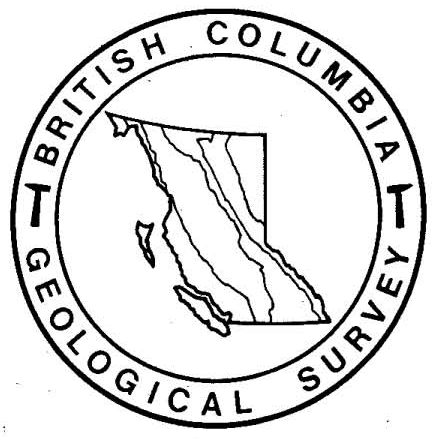
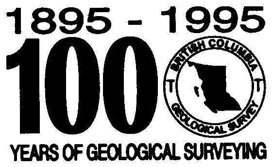
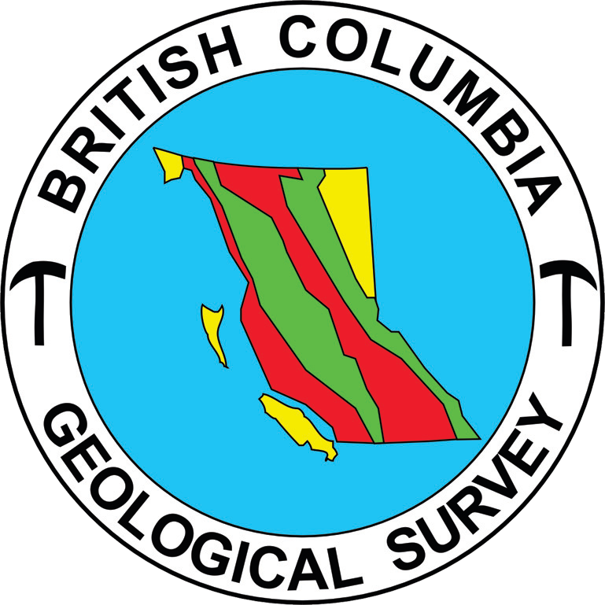
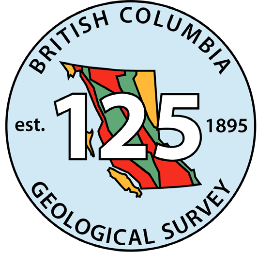
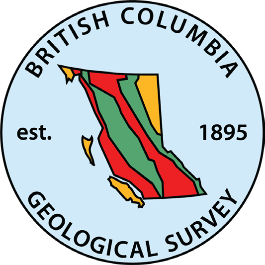

# British Columbia Geological Survey

The catalogue held two versions of the hammer-and-map seal, a monochrome printing from 1992 and a shaded colour image from 2017. It also cited plans from 1990 and 1991. The Survey and its Vancouver Mineral Development Office already had government records. The November 2026 review added **nine Survey specimens**, including four native vectors. It also added three MapPlace graphics, a MINFILE web mark with a desktop screenshot, and three specimens for the independent Geoscience BC society. The earliest seal located is on the title page of the 1989 circular reporting on exploration in 1988. [Earlier catalogue audit](../departmental-branch-audit/README.md) · [1989 title page](https://cmscontent.nrs.gov.bc.ca/geoscience/PublicationCatalogue/InformationCircular/BCGS_IC1989-01.pdf#page=1)

## Survey marks

| 1989 | 1995 | 2013 | 2020 | 2024 |
| --- | --- | --- | --- | --- |
|  |  |  |  |  |
| [1989-1, title page](https://cmscontent.nrs.gov.bc.ca/geoscience/PublicationCatalogue/InformationCircular/BCGS_IC1989-01.pdf#page=1) | [1995-1, pp. 2–3](https://cmscontent.nrs.gov.bc.ca/geoscience/PublicationCatalogue/InformationCircular/BCGS_IC1995-01.pdf#page=2) | [2013-4, cover](https://cmscontent.nrs.gov.bc.ca/geoscience/PublicationCatalogue/InformationCircular/BCGS_IC2013-04.pdf#page=1) | [GeoFile 2020-10, cover](https://cmscontent.nrs.gov.bc.ca/geoscience/PublicationCatalogue/GeoFile/BCGS_GF2020-10.pdf#page=1) | [Open File 2024-09, cover](https://cmscontent.nrs.gov.bc.ca/geoscience/PublicationCatalogue/OpenFile/BCGS_OF2024-09.pdf#page=1) |

The 1989 specimen has straight hammer handles and outlined geological bands. The 2013 version has curved picks and a flat blue field. A shaded blue version like the held 2017 seal also appears in a May 2014 publication. The later ordinary seal carries “est. 1895” where the hammers used to be. It appears by 2021. The dates establish use on particular publications. The designer and adoption date of the original seal remain open. [2014 circular, p. 20](https://cmscontent.nrs.gov.bc.ca/geoscience/PublicationCatalogue/InformationCircular/BCGS_IC2014-08.pdf#page=20) · [2021 cover](https://cmscontent.nrs.gov.bc.ca/geoscience/PublicationCatalogue/InformationCircular/BCGS_IC2021-05.pdf#page=1)

## Downloadable vector artwork

| Design | SVG | Where the original paths appear |
| --- | --- | --- |
| 1995 centennial | [100 years of geological surveying](../../../public/identity-collected/bc-geological-survey/centennial-1995.svg) | Upper right of *Porphyry deposits in British Columbia*, Open File 1995-23. The 544 plotted paths include the hatching inside “100” and the small lettering around the seal. [Map sheet](https://cmscontent.nrs.gov.bc.ca/geoscience/PublicationCatalogue/OpenFile/BCGS_OF1995-23.pdf#page=1) |
| 1999 hammer-and-map seal | [Hammer seal](../../../public/identity-collected/bc-geological-survey/hammer-seal-1999.svg) | Cover of the 1998 exploration review, issued in 1999. The 56 paths include lettering expanded from the embedded typeface. [Circular cover](https://cmscontent.nrs.gov.bc.ca/geoscience/PublicationCatalogue/InformationCircular/BCGS_IC1999-01.pdf#page=1) |
| 2020 anniversary seal | [125th anniversary](../../../public/identity-collected/bc-geological-survey/anniversary-2020.svg) | Upper left of the *Catching the tail of a golden dragon* geochemistry poster. All 26 paths, including the outline around “125”, are preserved on a transparent surround. [Poster](https://cmscontent.nrs.gov.bc.ca/geoscience/PublicationCatalogue/GeoFile/BCGS_GF2020-04.pdf#page=1) |
| 2022 founding-year seal | [Seal with “est. 1895”](../../../public/identity-collected/bc-geological-survey/est-1895-seal-2022.svg) | Title block on *Bedrock geology of the Dease Lake area*. The 22 paths include the geological bands and lettering. [Map sheet](https://cmscontent.nrs.gov.bc.ca/geoscience/PublicationCatalogue/GeoscienceMap/BCGS_GM2022-01.pdf#page=1) |

Each SVG was isolated from the drawing in its publication and checked against a rendering of the same page region. All four contain paths only, with a descriptive title. The centennial SVG matched its source crop pixel for pixel at 6×. Earlier digital copies need care when dating the seal. For example, the 1988 Smyth paper has a coloured Survey header layered separately from the scanned article. The 1989 circular remains the earliest period printing verified in this review. [Digitized 1988 paper](https://cmscontent.nrs.gov.bc.ca/geoscience/PublicationCatalogue/Paper/BCGS_P1988-01-00_Smyth.pdf#page=1) · [1989 circular](https://cmscontent.nrs.gov.bc.ca/geoscience/PublicationCatalogue/InformationCircular/BCGS_IC1989-01.pdf#page=1)

## Institutional history

| When | What the evidence establishes |
| --- | --- |
| 1874 | The first provincial Minister of Mines collected reports from gold commissioners and mining recorders. The annual reports preserve evidence from before the Bureau existed. [Ministry’s historical preface](https://cmscontent.nrs.gov.bc.ca/geoscience/PublicationCatalogue/GeologyExplorationMining/BCGS_GEO1976.pdf) |
| 1895–1896 | The *Bureau of Mines Act, 1895*, dated February 21, directed the establishment of an office to collect and publish mining information. William A. Carlyle, Provincial Mineralogist, and Herbert Carmichael, assayer and chemist, began organizing it in January 1896. In June the Provincial Bureau of Mines issued Carlyle’s *Report on the Alberni Mining District* as Bulletin No. 1. Its title page gives the early institutional imprint in type. [Act, ss. 3–7](https://www.bclaws.gov.bc.ca/civix/document/id/hstats/hstats/1221491311) · [1896 annual report](https://cmscontent.nrs.gov.bc.ca/geoscience/publicationcatalogue/AnnualReport/BCGS_AR1896.pdf) · [Bulletin No. 1](https://cmscontent.nrs.gov.bc.ca/geoscience/PublicationCatalogue/Bulletin/BCGS_B1896-1.pdf#page=1) |
| 1917 | The *Mineral Survey and Development Act* divided B.C. into six survey districts. Resident engineers worked in the districts while the Bureau continued its work. [Act, Part I](https://www.bclaws.gov.bc.ca/civix/document/id/hstats/hstats/1088300592) · [Centennial history, printed pp. 41–43](https://cmscontent.nrs.gov.bc.ca/geoscience/PublicationCatalogue/Miscellaneous/BCGS_MP-77.pdf#page=51) |
| 1937–1939 | The 1937 *Department of Mines Act* came into force on April 1, 1938, repealing the district survey legislation. The centennial history describes the Mineralogical Branch and the centralization of its technical staff in Victoria in 1939. [Act, ss. 17–18](https://www.bclaws.gov.bc.ca/civix/document/id/hstats/hstats/527244410) · [Centennial history, printed pp. 49–50](https://cmscontent.nrs.gov.bc.ca/geoscience/PublicationCatalogue/Miscellaneous/BCGS_MP-77.pdf#page=59) |
| 1973 | The department’s annual report explicitly says the Mineralogical Branch became the **Geological Division** during the reorganization. [1973 annual report, p. A58](https://cmscontent.nrs.gov.bc.ca/geoscience/PublicationCatalogue/AnnualReport/BCGS_AR1973.pdf#page=58) |
| 1980–1981 | The 1980 report, issued in May 1981, names the Geological Division. The next report’s organization chart names the **Geological Branch** as at December 31, 1981. These contemporary records narrow the changeover left unclear in the centennial history. The exact effective date remains open. [1980 report, title page](https://cmscontent.nrs.gov.bc.ca/geoscience/PublicationCatalogue/AnnualReport/BCGS_AR1980.pdf#page=1) · [December 1981 chart](https://cmscontent.nrs.gov.bc.ca/geoscience/PublicationCatalogue/AnnualReport/BCGS_AR1981.pdf#page=6) |
| 1986 | The province renamed the Geological Branch the **Geological Survey Branch**. The centennial history dates the change, and the ministry’s cataloguing note identifies the issuing bodies for 1985 and 1986. [Centennial account, printed p. 95](https://cmscontent.nrs.gov.bc.ca/geoscience/PublicationCatalogue/Miscellaneous/BCGS_MP-77.pdf#page=105) · [Publication imprint, PDF p. 3](https://cmscontent.nrs.gov.bc.ca/geoscience/PublicationCatalogue/InformationCircular/BCGS_IC1995-01.pdf#page=3) |
| 1995 and 2020 | The Survey counted both anniversaries from the Bureau’s 1895 origin. The 1998 centennial history records that Minister Anne Edwards commissioned a commemorative poster and that Survey publications carried a centennial logo that year. The 2020 profile describes the Survey’s field mapping and laboratory programs, with offices in Victoria and Vancouver. [Centennial account, printed p. 95](https://cmscontent.nrs.gov.bc.ca/geoscience/PublicationCatalogue/Miscellaneous/BCGS_MP-77.pdf#page=105) · [2020 profile, PDF p. 4](https://cmscontent.nrs.gov.bc.ca/geoscience/PublicationCatalogue/CPTG/2020_CPTG.pdf#page=4) |

## Related identities and remaining gaps

| Entry | Catalogue finding |
| --- | --- |
| **MapPlace** | Three program graphics. The Survey credits W. Kilby with initial development of the mapping service in 1995. Slide 3 of its archived tour preserves a Netscape page marked “last updated: November 28, 2001”. A map of Canada bears the name “The Map Place”. [2001 web graphic](../../../public/identity-collected/bcgs-mapplace/web-panel-2001.png) · [Archived presentation](https://cmscontent.nrs.gov.bc.ca/geoscience/MapPlace1/MapPlaceTour.ppt) · [Developers’ history, p. 9](https://cmscontent.nrs.gov.bc.ca/geoscience/PublicationCatalogue/Paper/BCGS_P2007-01-05_Jones.pdf#page=9) A May 2014 guide shows **MapPlace.ca** with a wired mouse. The 2017 workshop cover and 2020 profile pair **MapPlace** with geological bands and the line “digital geoscience for British Columbia”. The original 1995 launch artwork remains unverified. [Service history](https://www2.gov.bc.ca/gov/content/industry/mineral-exploration-mining/british-columbia-geological-survey/mapplace) · [2014, p. 20](https://cmscontent.nrs.gov.bc.ca/geoscience/PublicationCatalogue/InformationCircular/BCGS_IC2014-08.pdf#page=20) · [2017 workshop cover](https://cmscontent.nrs.gov.bc.ca/geoscience/PublicationCatalogue/InformationCircular/BCGS_IC2017-03.pdf#page=1) · [2020, p. 4](https://cmscontent.nrs.gov.bc.ca/geoscience/PublicationCatalogue/CPTG/2020_CPTG.pdf#page=4) |
| **MINFILE** | One new boxed wordmark, preserved in a screenshot on printed page E-9 of the volume covering 1998. The article includes January 1999 data, and the screenshot itself is undated. The provincial inventory began on cards in 1967, fed UBC’s MINDEP project in 1973, took the name MINFILE in 1976 and was rewritten for the internet in 2005. The 2007 manual reproduces the desktop title screen and search buttons. Its original 723 × 444 screenshot accompanies the gallery entry. The standalone early web graphic remains unlocated. [Desktop screenshot](../../../public/identity-collected/bcgs-minfile/desktop-2007.jpeg) · [Manual, pp. 9–10](https://cmscontent.nrs.gov.bc.ca/geoscience/MINFILE/MINFILE_usermanual.pdf#page=10) [Printed screenshot](https://cmscontent.nrs.gov.bc.ca/geoscience/PublicationCatalogue/GeologyExplorationMining/BCGS_EXP1998-00.pdf#page=140) · [Survey’s MINFILE history](https://www2.gov.bc.ca/gov/content/industry/mineral-exploration-mining/british-columbia-geological-survey/mineralinventory/moreinfo) |
| **Geoscience BC Society** | Two society designs, both recovered in vector form. This independent nonprofit incorporated on April 26, 2005. Its 2017 report has green ridges and a crosshair. In January 2019 the society announced a three-colour design for its minerals, energy and water research. The back cover of its 2021–22 report preserves the three ridges as paths and the lettering in an embedded typeface. [2017 SVG](../../../public/identity-collected/geoscience-bc/mountains-2017.svg) · [Three-colour SVG](../../../public/identity-collected/geoscience-bc/mountains-2022.svg) · [2021–22 back cover](https://cdn.geosciencebc.com/pdf/Geoscience%20BC%20Annual%20Report%202021-22%20-%20Web.pdf#page=24) [Annual report, cover and PDF p. 27](https://cdn.geosciencebc.com/pdf/2017AnnualReport.pdf) · [Launch newsletter](https://mailchi.mp/657b79b0b5d2/geoscience-bc-quarterly-newsletter) · [Provincial publication index](https://www2.gov.bc.ca/gov/content/industry/mineral-exploration-mining/british-columbia-geological-survey/publications/geoscience-bc-releases) |
| **Mineral Development Office, Cordilleran Section and Resource Information Section** | The Vancouver office already has a government record. The staff directory names both sections, and the 2013 structure chart calls the first the **Cordilleran Geoscience Section**. All three now have identity register entries. The office’s covers use the Survey’s 125th-anniversary and founding-year seals under the office name. [2020 office cover](https://cmscontent.nrs.gov.bc.ca/geoscience/PublicationCatalogue/InformationCircular/BCGS_IC2020-04.pdf#page=1) · [2024 office cover](https://cmscontent.nrs.gov.bc.ca/geoscience/PublicationCatalogue/InformationCircular/BCGS_IC2024-03.pdf#page=1) A distinct emblem for any of the three remains unverified. [Staff directory](https://www2.gov.bc.ca/gov/content/industry/mineral-exploration-mining/british-columbia-geological-survey/aboutbcgs) · [2013 structure chart, p. 2](https://cmscontent.nrs.gov.bc.ca/geoscience/PublicationCatalogue/InformationCircular/BCGS_IC2013-04.pdf#page=2) |
| **ARIS, COALFILE and Property File** | The site identifies a mineral and placer assessment report index, a coal assessment collection and an archive of donated documents. Mineral assessment report filing began in 1947. The Survey records the transfer of its printed assessment summaries to ARIS in 1989. All three services now have identity register entries. The Property File portal uses the provincial mark, including in its browser icon. Separate marks remain unverified. [Assessment reports](https://www2.gov.bc.ca/gov/content/industry/mineral-exploration-mining/british-columbia-geological-survey/assessmentreports) · [Historical series](https://www2.gov.bc.ca/gov/content/industry/mineral-exploration-mining/british-columbia-geological-survey/publications/geology-exploration-and-mining-in-bc) · [Property File](https://www2.gov.bc.ca/gov/content/industry/mineral-exploration-mining/british-columbia-geological-survey/propertyfile) |

For comparable surveys outside B.C., the Committee of Provincial and Territorial Geologists’ directory lists the Yukon, Alberta and other provincial and territorial surveys. Its introduction also explains the national role of the Geological Survey of Canada. [Canadian provincial and territorial geological surveys, pp. 2–3](https://cmscontent.nrs.gov.bc.ca/geoscience/PublicationCatalogue/CPTG/2020_CPTG.pdf#page=2)
