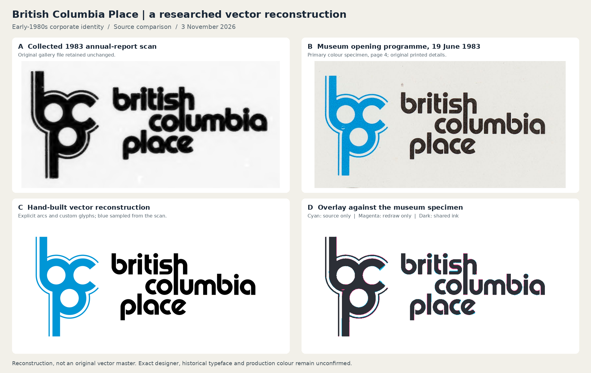

# British Columbia Place: researched vector reconstruction

**3 November 2026 · Modern reconstruction of an early-1980s corporate identity.**

The three SVGs in this change rebuild the linked British Columbia Place Ltd. mark
using explicit circles, arcs, straight stems and custom letterform paths. They are
editable vector artwork. They are not recovered original vector masters. The
original designer, exact historical typeface, introduction/retirement dates and
production colour specification remain unconfirmed.



## Deliverables

| File | What it contains |
| --- | --- |
| [Monochrome signature](../../../public/identity-collected/bc-place-ltd/bc-place-1982-lockup-reconstruction.svg) | Joined b/c/p monogram, parallel outer line and the complete staggered lowercase wordmark. |
| [Blue and black signature](../../../public/identity-collected/bc-place-ltd/bc-place-1982-lockup-colour-reconstruction.svg) | The same geometry; monogram colour sampled from the colour-managed museum scan, with black lettering. |
| [Separate monogram](../../../public/identity-collected/bc-place-ltd/bc-place-1982-monogram-reconstruction.svg) | The b/c/p symbol alone, in black. |

The filenames use **1982 because it is the earliest visually confirmed specimen
found in this pass**, not because a design/adoption year has been established.
The full signatures contain 25 path elements; the isolated monogram contains two.
There are no embedded bitmaps, live text, fonts, scripts, filters or external
resources. The blue is an interpretation of a surviving scan, not a historical
brand specification.

## What the historical research established

### 1. The identity was already in use in September 1982

The [Gulf Islands Driftwood, 22 September 1982, printed page 6](https://saltspringarchives.com/driftwood/1982/v23n38p1Sept22-1982.pdf)
contains a BC Place corporate advertisement headed “Already Paying Its Way.”
The lower-right signature has the same outlined b/c/p monogram and staggered
three-line lettering as the target. The advertisement calls the organization a
provincial Crown corporation and discusses the stadium alongside a broader
development programme.

The downloaded PDF was visually inspected. The [whole-page context](evidence/1982-driftwood-page6-context.png)
retains the publication date and advertisement together; a [native-resolution crop](evidence/1982-driftwood-logo.png)
records the signature. This establishes **documented use by 22 September 1982**.
It does not establish the first day the design was used.

### 2. The 1983 opening programme supplies a much clearer colour reference

The Canadian Museum of History hosts the [BC Place Grand Opening Gala programme](https://www.historymuseum.ca/ke/_resources/5807325/2023-F0003-24.pdf).
Its cover explicitly dates the gala to **19 June 1983**. Page 4 prints the exact
target identity above “A Provincial Crown Corporation”: a bright blue monogram
and black wordmark.

This is the principal reconstruction reference. Its [colour-managed crop](evidence/1983-programme-logo.png)
reveals details that the existing microfiche crop obscures:

- Deliberately open bowl joins in the wordmark's **b**, **p** and **a**.
- Round **i** dots and squared vertical stems.
- The broad horizontal **s**, angled **c** terminals and diagonal **e** crossbar.
- The staggered three-line arrangement and aligned **h/l** stems.
- Separate open portions of the thin line outside the monogram.

All four PDF pages are scans: the inspected pages have embedded images and no
native drawing paths. This source improves the visual evidence, but does not
supply extractable original vector artwork.

### 3. The collected annual-report crop is preserved

The repository already identifies the linked PNG as a crop from the cover of
the [1983 British Columbia Place Ltd. annual report](https://archive.org/details/micro_IA40243510_1428).
Its existing image and provenance are retained byte for byte. It was visually
compared with the new museum specimen and the reconstruction. This pass does not
claim a new independent extraction of the annual report.

The original remains at:

`public/identity-collected/bc-place-ltd/bc-place-1983-logo.png`

SHA-256: `81f8e81394f8682fb210e8dc99f6b40e4b22fda5a046f7b0e7753e7bcee4785e`

Its gallery IDs remain `collected-bc-place-ltd` and
`source-bc-place-ltd-bc-place-1983-logo-png`, so the user's existing link continues
to identify that historical specimen.

### 4. A distinct 1984 variant also survives

The [Museum of Vancouver's BC Place Update, Spring 1984](https://openmovportal.ca/argus/final/ViewRecord.aspx?record=8bc778ca-4bea-4503-ba93-89f537dbd82d&template=Object),
catalogue **H2025.7.1**, contains a different application: a solid white monogram
inside a royal-blue circle, with a flush-left three-line black wordmark.
The front and rear public scan images were inspected; the [header crop](evidence/1984-newsletter-header.png)
records the difference. That version does not have the target's parallel outline.

It is documented here as a separate variant and has not been silently substituted
into the target reconstruction. The museum identifies Ray Dykes as the newsletter
author and BC Place public-relations head; this is not evidence of logo authorship.

## Typeface investigation

Official public specimens of [ITC Bauhaus](https://www.myfonts.com/collections/bauhaus-font-itc),
[Pump](https://www.myfonts.com/collections/pump-font-itc) and
[Blippo](https://www.myfonts.com/collections/blippo-lt-font-linotype) were compared
visually with the programme. No documentary source was found identifying the
original typeface.

| Candidate | Useful resemblance | Reason not to substitute it wholesale |
| --- | --- | --- |
| ITC Bauhaus Bold | Open bowls, squared r shoulder, broad flat s | The modern specimen's c terminals and e do not reproduce all of the printed target's details. |
| Pump Demi | Circular bowls, open joins, angled c and diagonal e | Its r and especially s differ. |
| Blippo Pro Black | Circle/rectangle construction and open joins | The compared default c, e, r and s are not an exact match. |

These are visual comparisons, not identifications. No font binary was downloaded,
embedded or converted into the delivered paths. The wordmark uses hand-specified
geometry for only the necessary characters. Microsoft dates the digital
[Bauhaus 93 family to 1993](https://learn.microsoft.com/en-us/typography/font-list/bauhaus-93),
so that specific font file cannot be the original source of a 1982/83 print.

## Construction decisions

The [deterministic generator](../../../scripts/build-bc-place-reconstruction.py)
contains the complete design geometry and uses only the Python standard library.
It does not read any image or font. The three monogram bowls share an outer radius
of 51 reference units and counters of radius 28. The outside line has a 3.6-unit
stroke and controlled circular arcs. Circle intersections define the combined
silhouette. The b and p stems and the c opening remain editable.

The letterforms use shared construction rules, with measured optical differences
for individual characters. The p mirrors the b construction; both retain the
narrow open join. The a has its corresponding open lower join. The e combines a
circular bowl with a diagonal crossbar. Individual letter paths are named, so an
editor can select them without installing a font.

This approach intentionally restores clean geometry instead of reproducing the
microfiche's blurred corners, closed gaps, dust and uneven ink edges. The original
image remains available as historical evidence.

### Colour handling

The museum PDF uses an ICC-based image colour space. Extracting its JPEG without
applying that profile gives a visibly different blue. The evidence crop therefore
comes from a PyMuPDF page render at the native 3280 × 4201 dimensions, which applies
the PDF colour profile before cropping.

A 16 × 37-pixel patch inside the monogram stem has median RGB **(0, 150, 214)**,
represented by **#0096D6**. Its exact coordinates and the downloaded-source hashes
are in [source-evidence.json](source-evidence.json). That value records a repeatable
scan sample. Paper, printing, ageing, scanning and colour management prevent it
from establishing an original Pantone or ink recipe.

## Verification

The [validation script](validate.py) renders every delivered SVG, parses its
structure, checks its recorded SHA-256, and checks that ink is not clipped by the
viewBox. The [recorded results](qa/validation.json) include all three asset hashes,
path counts and the comparison method.

The primary comparison renders the monochrome reconstruction on the same
760 × 385-coordinate canvas as the programme crop. **No affine registration,
local warp or image-to-path conversion is used.** A threshold mask identifies
printed black and blue ink. The blue threshold is halfway between the sampled
ink and the local paper in the red channel, with a hue check. Tiny isolated scan
specks are excluded from the comparison mask; the evidence image is unchanged.

| Region | Ink-mask intersection over union | 95th percentile boundary distance |
| --- | ---: | ---: |
| Entire signature | 93.99% | 1 reference pixel |
| Monogram | 93.76% | 1 reference pixel |
| Lettering | 94.18% | 1 reference pixel |

Threshold sensitivity gives whole-signature overlap between **92.70% and 93.99%**
for the three documented threshold pairs. These are comparisons with one imperfect
scan, **not percentages of historical authenticity**. The [overlay](qa/programme-overlay.png)
uses cyan for source-only ink, magenta for reconstruction-only ink and charcoal
for shared ink. Visual inspection found no missing letter, counter, outline
segment or material displacement. Remaining local edge/curve differences and
uncertain original production specifications are retained as limitations.

Gallery validation preserves the existing deep link and raster checksum, keeps
these entries under `reconstructed` provenance, and verifies local SVG links.
Light/dark display copies are generated separately from the unchanged downloads.
All 14 tests in `collectedCollections.test.js` and `collections.test.js` passed.
The six display copies retain every non-colour geometry attribute of their source
SVGs, and their generated output was checked for deterministic regeneration.

The changed detail component was compiled and server-rendered for the old PNG
and all three new SVG entries in a focused harness. That harness supplied an
in-memory empty export for the unrelated, unavailable licensed-font module
`src/current/generated/nameGlyphsExtra.js`, which is imported indirectly by
`tileArt` but is unused in these detail views. No production stub was added.
The full application build and the existing display test suite could not be
validated in this checkout because of that missing generated font dependency;
the new display SVGs were rendered and checked directly instead.

## Reproduce the outputs

From the repository root:

```bash
python3 scripts/build-bc-place-reconstruction.py
python3 research/identity/bc-place-reconstruction-2026-11-03/validate.py
node scripts/build-collected-marks.mjs
python3 scripts/build-bc-place-display.py
node --test src/gallery/collectedCollections.test.js src/gallery/collections.test.js
```

The geometry generator has no third-party dependencies. Validation and display
generation need PyMuPDF, Pillow, NumPy and SciPy; the gallery index uses Node.
The comparison-board labels use DejaVu Sans regular and bold. On Linux the default
directory is `/usr/share/fonts/truetype/dejavu`; on another system set
`POFBC_QA_FONT_DIR` to the directory containing `DejaVuSans.ttf` and
`DejaVuSans-Bold.ttf`. These are fonts for the research board, not for the logo.
If geometry changes, update the corresponding checksums/byte counts in
`source-register.json` before running validation and the gallery builder. Those
checks deliberately reject stale records.

## Unresolved research and useful next sources

No original vector master, original designer attribution or production standard
was located. The modern redraw does not close the project's search for original
historical artwork.

The [Canadian Centre for Architecture's British Columbia Place project archive](https://www.cca.qc.ca/en/archives/108951/arthur-erickson-fonds/397577/architectural-projects/417205/british-columbia-place),
reference **AP022.S1.1982.PR05**, includes 1982–83 project documentation and may
contain additional printed applications. Its architect attributions are not logo
designer attributions. The earlier repository research also identified corporate
marketing/index records through the [BCEC records schedule](https://www2.gov.bc.ca/assets/gov/british-columbians-our-governments/services-policies-for-government/information-management-technology/records-management/orcs/bcec_orcs_170469.pdf):
classification 20000-02 indexes could lead to marketing files under 20000-20.
These are archival leads, not confirmed locations of logo originals.

Third-party trademark listings for applications 901612 and 901613 were found,
but an official CIPO drawing was not verified. No rights-status or designer
conclusion is drawn from those listings. Secondary logo-gallery date ranges
were not used to override the primary 1982 and 1983 specimens.
