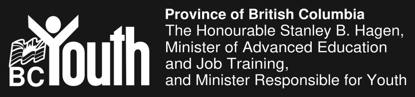
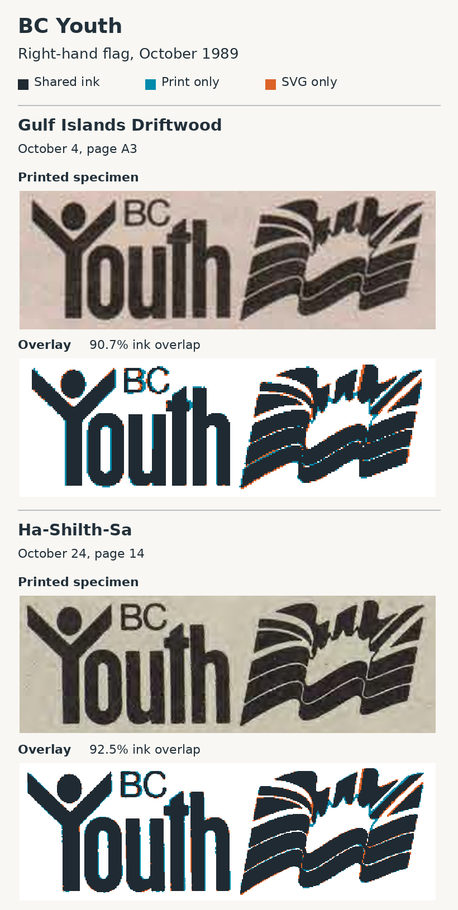

# BC Youth artwork

The three editable SVGs reproduce the flag-right identity, the white flag-left identity and the full white signature with ministerial attribution. The long signature follows the line breaks in the supplied image. All three have transparent grounds and use outlines throughout.

The figure and the four lowercase forms were constructed from measured stems, sloping arms, rounded shoulders and open counters. The flag uses the project’s existing Spirit of BC vector paths, from `src/assets/flagMark.js` in PofBC. The twelve-shape master includes a separate coloured sun; in the newspaper version the sun takes the paper colour. Eleven source shapes produce the ink. The right flag uses one affine placement and a small ink spread to match the proportions and narrow wave gaps in the print. The left flag uses a white outer keyline with knockout bands. Nimbus Sans Regular and Bold supply the outlined BC letters and ministerial wording as fitted typeface substitutes.

[Flag-right SVG](../../../public/identity-collected/bc-youth/right-flag.svg) · [Flag-left SVG](../../../public/identity-collected/bc-youth/left-flag.svg) · [Full ministerial signature](../../../public/identity-collected/bc-youth/left-flag-minister.svg)

## Comparison

The black right-hand flag arrangement appears on page A3 of the October 4, 1989 *Gulf Islands Driftwood* and on printed page 14 of the October 24, 1989 *Ha-Shilth-Sa* (PDF sheet 8, left page). Both advertisements name the British Columbia Youth Advisory Council, Youth Grants Program and Stanley B. Hagen.

The mark was drawn against the higher-resolution *Ha-Shilth-Sa* printing and checked against *Driftwood*. With ink defined as grayscale below 128, intersection over union for the full mark was 92.5% in *Ha-Shilth-Sa* and 90.7% in *Driftwood*. Both measurements used one uniform scale, rotation and translation per entire mark. Isolated scan specks under five pixels were excluded. The crops in original embedded-image coordinates were (831, 2967, 1267, 3111) and (1278, 774, 1545, 863), respectively. Crops and sample sizes differ. The display comparisons are enlarged after measurement.

The white arrangement was compared visually to the supplied ministerial signature. No date, edition or original colour master for that arrangement was established. The newspaper rule and accompanying grant advertisement are outside the standalone identity artwork.

- [Gulf Islands Driftwood, page A3](https://saltspringarchives.com/driftwood/1989/v30n40Oct4-1989A.pdf#page=3)
- [Ha-Shilth-Sa, page 14](https://data2.archives.ca/e/e449/e011207352.pdf#page=8)

The [initiative survey](initiative-survey.md) documents the three other youth programs in the 1989 debate and five initiatives already represented elsewhere in the gallery.
