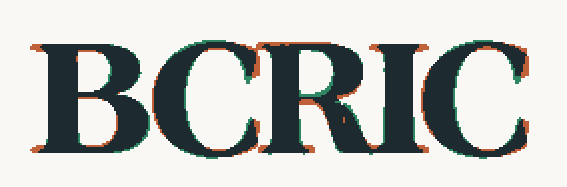
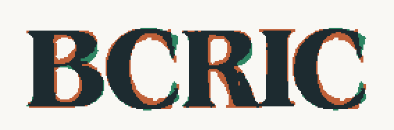

# BCRIC’s August 1979 wordmark

Gelasio Bold remains the gallery’s documented approximation. Of the six historical styles examined, ITC Benguiat Bold came closest on both impressions. Its 78.0% overlap on page 6 fell below the 90% target for proceeding to manual curve fitting. The original face and designer remain unidentified. [Archive brochure](https://sacda.ufv.ca/collections/2021_03_01_03_003)

## Letter-by-letter comparison

The first two columns measure the complete word. The last five measure individual letters on page 6. Each score is intersection over union of the fitted and printed ink masks, for which 100% would be identical. Each face received the same fitting procedure on each page.

| Face | Page 6 word | Page 3 word | B | First C | R | I | Second C |
| --- | ---: | ---: | ---: | ---: | ---: | ---: | ---: |
| Gelasio Bold (existing SVG) | 85.6% | 85.5% | 91.3% | 80.2% | 85.1% | 89.4% | 80.3% |
| Caslon Black | 72.0% | 70.4% | 77.6% | 64.1% | 75.8% | 76.9% | 63.0% |
| ITC Garamond Ultra | 70.7% | 70.1% | 74.9% | 71.0% | 67.1% | 68.1% | 70.3% |
| ITC Garamond Ultra Condensed | 73.4% | 71.8% | 78.3% | 69.5% | 72.9% | 75.5% | 68.7% |
| ITC Tiffany Heavy | 72.3% | 70.9% | 78.1% | 63.4% | 75.6% | 76.3% | 63.3% |
| ITC Tiffany Demi | 73.1% | 75.1% | 77.9% | 63.3% | 76.8% | 79.9% | 63.9% |
| ITC Benguiat Bold | 78.0% | 76.2% | 80.0% | 72.1% | 79.7% | 89.6% | 71.3% |

Both printed Cs show long inward-pointing terminals. Caslon Black’s terminals are much shorter, with the largest mismatch at the lower opening. Benguiat’s I fits particularly well, but both its Cs score below 73%. Page 3 gives a clearer look at the R where its curved leg meets the foot of the I. The vertical abrasion crossing the page 6 R is a print or scan feature. The Tiffany specimens include alternate Rs. Testing both alternates for each weight yielded at best 73.0% and 73.6% whole-word overlap on page 6 for Heavy and Demi respectively. [Brochure, page 3](https://sacda.ufv.ca/sites/default/files/2026-09/2021_03_01_03_003.pdf#page=3) · [Brochure, page 6](https://sacda.ufv.ca/sites/default/files/2026-09/2021_03_01_03_003.pdf#page=6)

The earlier research describes ten serifs tried. Its saved fit file contains six scores, led by Gelasio Bold at 77.49%. The current gallery SVG in its existing positions scores 78.74% under this study’s ink threshold and resolution. Refitting the *same outlines* with the scale and placement allowed to the historical candidates yields 85.64%. Only this last figure belongs in the fitted-face comparison. [Prior fit data](../historic-crowns-vector-2026-11-16/fits/bcric-fit2.json) · [Gallery SVG](../../../public/identity-collected/bc-resources-investment-corporation/bcric-1979-wordmark-rebuilt.svg)

## Registered overlays

The preview pixels are enlarged for inspection. Shared ink is charcoal, uncovered brochure ink is green and excess candidate ink is orange.

| Gelasio Bold, refitted control | ITC Benguiat Bold, closest historical candidate |
| --- | --- |
|  |  |

## Evidence and method

- The reference is the existing 567 × 187 page 6 crop. Page 3 of the same six-page shareholder brochure supplies a separate printed impression. It was registered independently. The corporation’s share certificate is a different object. [Page 6 crop](../../../public/identity-collected/bc-resources-investment-corporation/bcric-1979-brochure-wordmark-raster.png) · [SACDA record 2021_03_01_03_003](https://sacda.ufv.ca/collections/2021_03_01_03_003)
- Public alphabet sheets provide the shapes for David Farey’s Letraset Caslon Black, Tony Stan’s ITC Garamond Ultra and Ultra Condensed, and Ed Benguiat’s ITC Tiffany Heavy and Demi and ITC Benguiat Bold. Caslon Black is documented in 1969, Tiffany in 1974, Garamond Ultra in 1975, and Garamond Condensed and Benguiat in 1977. The sheets are later reproductions. Printing, reproduction and alternate cuts limit how far a comparison can establish authorship. [Caslon Black](https://e-daylight.jp/fonts/type/c/caslon-black.html) · [ITC Garamond specimens](https://e-daylight.jp/fonts/type/g/itc-garamond.html) · [Garamond release history](https://www.myfonts.com/collections/garamond-font-itc) · [ITC Tiffany](https://e-daylight.jp/fonts/type/t/tiffany.html) · [ITC Benguiat](https://e-daylight.jp/fonts/type/b/benguiat.html)
- A one-pixel Gaussian smooths the green-minus-red channel before downsampling to half the input dimensions and thresholding at 42. The two brochure impressions have comparable cap heights at that resolution. Repeating the page 6 fit at thresholds 32 and 52 kept the same top two places. Benguiat reached 79.9% and 76.4% respectively.
- Each face uses its published capitals, with a common horizontal scale and a common vertical scale across all five positions. The fit searches scales around the total word width and B cap height, then refines around the best result. Each placement may shift by four analysis pixels from box-centre alignment. Both Cs reuse the same silhouette and scales. Whole-word IoU counts the union of all five placements once. Letter scores compare each placement against its cell. The boundary through the joined R and I makes their individual scores less certain.
- The saved report records both pages, the four alternate Tiffany fits, input SHA-256 checksums and the exact scale ratios. Public specimen sheets are downloaded into a local cache when reproducing the measurement. [Scores and specimen URLs](scores.json) · [Comparison script](compare.py)

With Python, NumPy, SciPy, Pillow and PyMuPDF installed, run from the repository root.

```sh
python research/identity/bcric-wordmark-comparison/compare.py --cache /tmp/bcric-sources --output /tmp/bcric-results
diff research/identity/bcric-wordmark-comparison/scores.json /tmp/bcric-results/scores.json
```
