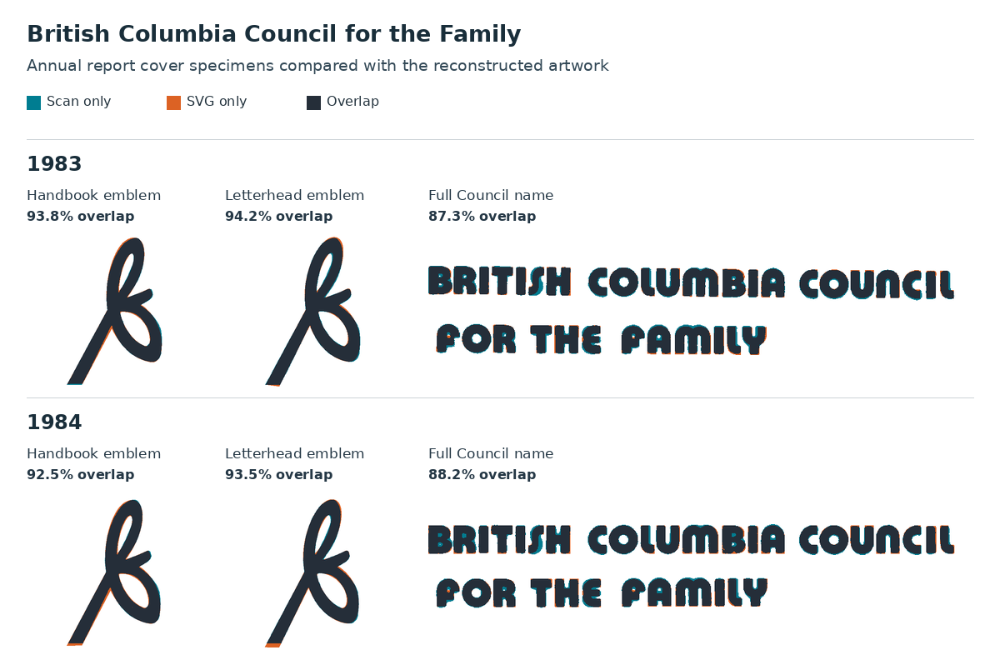

# British Columbia Council for the Family

| Editable SVG | Details |
| --- | --- |
| [Letterhead](../../../public/identity-collected/bc-council-for-the-family/letterhead.svg) | Tall emblem, horizontal rule, council name and the Parliament Buildings mailing address. |
| [Green handbook cover](../../../public/identity-collected/bc-council-for-the-family/handbook-green.svg) | Shorter, more inclined emblem above a black band carrying the name in white. |
| [Greyscale handbook cover](../../../public/identity-collected/bc-council-for-the-family/handbook-grey.svg) | Greyscale emblem with the top and left spacing seen in the supplied cover detail. |
| [Green emblem](../../../public/identity-collected/bc-council-for-the-family/emblem-green.svg) | The handbook emblem isolated on a transparent canvas. |

All three supplied print specimens are undated. The letterhead and handbook emblems were drawn separately with Bézier curves and open counters. Each repeated capital in the council name uses the same constructed letterform. The address uses fitted Nimbus Sans outlines. Each SVG opens without installed fonts or external artwork.

The green and grey are visual estimates. Flat grey represents the screen in the greyscale prints. The black band is a separate editable rectangle sized to the signature. The surrounding handbook titles and unused page area were excluded.

## Annual report comparisons

The 1983 and 1984 annual report covers print the same looped emblem and Council name above and below a rule. The 1984 printing clarified the width and spacing of the capitals and the enclosed counter in the F. The updated lettering was then checked against the 1983 printing. [1983 annual report, cover](https://archive.org/details/micro_IA40243510_1373) · [1984 annual report, cover](https://archive.org/details/micro_IA40243514_1471)

| Annual report | Handbook emblem | Letterhead emblem | Name before adjustment | Name after adjustment |
| --- | ---: | ---: | ---: | ---: |
| 1983 | 93.8% | 94.2% | 75.9% | 87.3% |
| 1984 | 92.5% | 93.5% | 75.9% | 88.2% |

The percentages give the shared ink area divided by the area marked in either image (intersection over union). Each report was rendered at 400 dpi. The emblem crop ends just above the printed rule. Pixels darker than 128 counted as ink, and isolated components smaller than 30 pixels were discarded. The reference mask was resampled to an ink width of 270 pixels for the emblem and 1,450 pixels for the name. Each SVG component was exported at 1,600 pixels wide and fitted using one uniform scale, one translation and one rotation for the entire component. The measured wordmark retains all six words on a single baseline. The diagram breaks the line for readability. [Crop coordinates, alignment and pixel counts](annual-report-registration.json)

The letterhead emblem requires about seven degrees of rotation to match the inclination on the report covers. These measurements cover the emblem and name. The address, colour, handbook band and page placement belong to different specimens.

