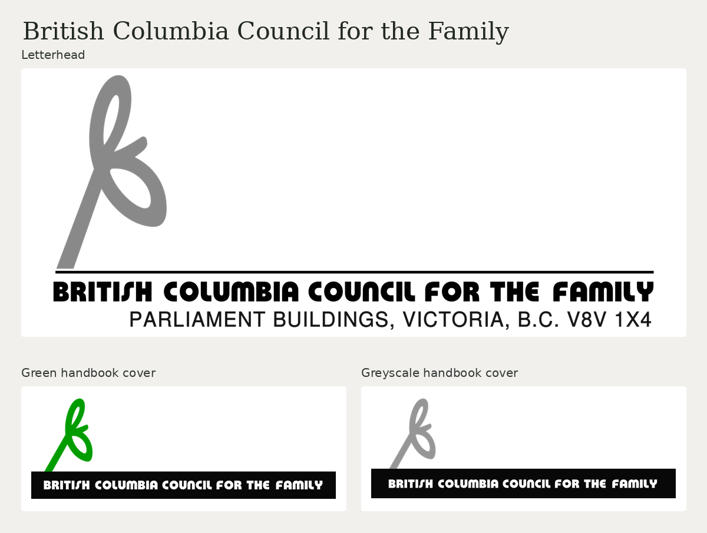

# British Columbia Council for the Family

| Editable SVG | Details |
| --- | --- |
| [Letterhead](../../../public/identity-collected/bc-council-for-the-family/letterhead.svg) | Tall emblem, horizontal rule, council name and the Parliament Buildings mailing address. |
| [Green handbook cover](../../../public/identity-collected/bc-council-for-the-family/handbook-green.svg) | Shorter, more inclined emblem above a black band carrying the name in white. |
| [Greyscale handbook cover](../../../public/identity-collected/bc-council-for-the-family/handbook-grey.svg) | Greyscale emblem with the top and left spacing seen in the supplied cover detail. |
| [Green emblem](../../../public/identity-collected/bc-council-for-the-family/emblem-green.svg) | The handbook emblem isolated on a transparent canvas. |

All three supplied print specimens are undated. The letterhead and handbook emblems were drawn separately with Bézier curves and open counters. Each repeated capital in the council name uses the same constructed letterform. The address uses fitted Nimbus Sans outlines. Each SVG opens without installed fonts or external artwork.

The green and grey are visual estimates. Flat grey represents the screen in the greyscale prints. The black band is a separate editable rectangle sized to the signature. The surrounding handbook titles and unused page area were excluded.
