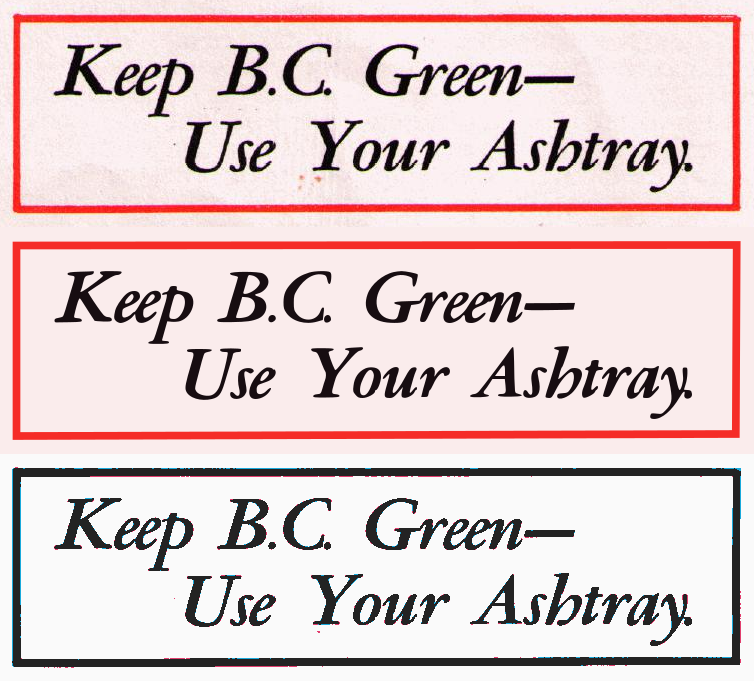

# Keep B.C. Green— Use Your Ashtray.

The Fish and Game Branch printed this red-framed panel on the notes panel immediately left of its cover in *British Columbia Game Regulations 1961–62*. The first foldout also carries other fire-prevention notices. This source establishes the wording, arrangement and printed application. The edition dates the specimen. The designer, typeface, original ink specifications and first use remain unidentified. [Province of British Columbia, first foldout](https://a100.gov.bc.ca/pub/acat/documents/r22560/regs_61-62_1348237474410_03f19de84e89ab74e08c6213e7e353100bb0074cd7c725155ed9367b3704a70a.pdf#page=1)

A July 5, 1962 account documents Ray Williston starting the Forest Service’s annual road-sign painting program on the Victoria–Sidney Highway. A paint gun and stencil applied the same words. The account supplies no picture of the stencil. The catalogue files the printed panel under fire-prevention campaign material and credits its publication to the Fish and Game Branch. [Summerland Review, PDF page 2](https://static1.squarespace.com/static/5995f4e96b8f5b9ef7c7355f/t/61ff07e33c229f6f8e9b5df0/1644103669635/1962%2BJUL.pdf#page=2)

## Source and reconstruction

The [reference](../../../src/posters/forest-service/use-your-ashtray.reference.png) comes from the original 6784 × 2624 JPEG on PDF page 1 (image 44). In native pixels measured from its top left, crop from (3423, 2237) to (4177, 2464), excluding the right and bottom bounds. The resulting 754 × 227 PNG has SHA-256 `9ced7ac82480853e1a0b1b19b2111d4dca45e8d19bd8e57d8cf63d52c34ef1a9`. The source PDF has SHA-256 `6853f371892aa19d74d31ba53794a0f5266a5140f8dd4150ede8b5065bd4909b`.

In the [editable SVG](../../../src/posters/forest-service/use-your-ashtray.svg) each word has its own group and the long dash moves independently. Each line is also grouped. Select dark ink with mean RGB below 146 and channel spread below 100 on the eight-bit crop. Fit closed outlines to the word masks with Potrace 1.16, a four-pixel speck threshold, 0.18 optimization tolerance and tenths of a pixel. The red rule follows four fitted straight segments at a width of 7.7 pixels. The paper, rule and lettering use their median sampled colours. The native scan shows paper texture, ink spread and small edge irregularities. The reconstruction uses flat fills and smooths those edges.

## Overlay check

The comparison below shows the source, reconstruction and overlay at native size. Shared ink is dark, source-only pixels are magenta and reconstruction-only pixels are cyan. The red-ink mask uses red minus green above 75 and green below 180. Both masks are applied identically to the source and the Inkscape rasterization of the SVG. These scores measure the outline fit to this scan.

| Mask | Source pixels | Reconstructed pixels | Intersection over union |
| --- | ---: | ---: | ---: |
| Dark lettering and punctuation | 14,648 | 14,827 | 93.33% |
| Red rule | 14,701 | 14,902 | 92.00% |

