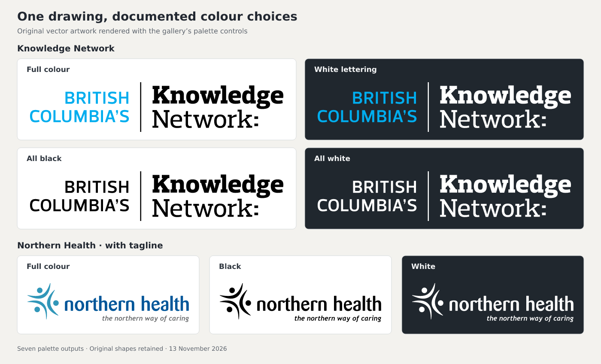

# PofBC gallery audit — 13 November 2026

## Scope and result

This is a **baseline audit of main at `1fb9e08dbb105bd691bed0790c81365b46ebc4f0`**, before this task's palette cleanup. It covers the gallery's source catalogue, generated collection model, stored artwork, and selected visual comparisons. It does not claim to be a census of every British Columbia logo. Any cleanup changes and their resulting counts should be reported separately.

The main opportunity is to represent **one design with selectable colour treatments**, while retaining separate arrangements, inscriptions, and historical drawings. The source collection is already substantially integrated: all 208 collected asset records are reachable through the gallery's entries or their variants; all 208 source files exist and match their recorded SHA-256; and no SVG beneath `public/identity-collected` is unreferenced.

The main remaining collection gaps are three explicitly sought historical eras, 16 collected-body records supported only by raster specimens, and 103 inventory bodies without held artwork. Those 103 are unresolved research records, not evidence that those organizations never used a logo.

Sources: [collected asset catalogue](https://github.com/ahzs645/PofBC/blob/1fb9e08dbb105bd691bed0790c81365b46ebc4f0/src/gallery/collectedData.js), [collection assembly](https://github.com/ahzs645/PofBC/blob/1fb9e08dbb105bd691bed0790c81365b46ebc4f0/src/gallery/collections.js), [acquisition inventory](https://github.com/ahzs645/PofBC/blob/1fb9e08dbb105bd691bed0790c81365b46ebc4f0/research/identity/collection-2026-10-22/inventory.json).

## Cleanup implemented with this audit

Four reviewed designs now use one original SVG each, with **11 documented colour choices**:

- **Knowledge Network:** full colour, white lettering, all black and all white. The existing EPS design URL is retained, but the preview and main download use the SVG. The original EPS remains under source files. Exact RGB colours come from the official kit, whose member hashes and colour measurements are in [knowledge-network-evidence.json](knowledge-network-evidence.json).
- **Northern Health with tagline:** full colour, black and white share one entry. The no-tagline layout stays separate.
- **Standalone StrongerBC RGB and solid wordmarks:** each has its own positive/reversed colour choices. The endorsed versions remain separate until their distinct paint roles are represented.

All source files are retained byte for byte. Palette selection changes only reviewed fill/stroke values. The preview and download use identical SVG bytes. Old source IDs resolve to the corresponding design and colour; the chosen colour is kept in the link. SVG sources now display directly wherever a collected vector would previously fall back to its PNG preview. Raster-only historical designs remain visible.

| Measure | Audited baseline | After cleanup |
|---|---:|---:|
| Gallery collections | 87 | 87 |
| Gallery entries | 246 | 242 |
| Collected designs | 184 | 180 |
| Grouped source variants | 24 | 28 |
| Collected source-file records | 208 | 208 |

The four removed entries were colour-only duplicates: two Northern Health variants and two standalone StrongerBC reversals. Knowledge already had one entry; its rendering, controls and primary download are improved here.

The comparison above renders the same palette function and original source SVGs used by the viewer. It is an artwork comparison, not a screenshot of the browser interface.

See [validation.md](validation.md) for commands, results and the browser-review limitation. The baseline counts and research queue below describe the repository before these changes.

## Baseline counts and what they count

| Measure | Count | Interpretation |
|---|---:|---|
| Gallery collections | 87 | Includes program/specimen collections as well as body shelves. |
| Gallery entry IDs | 246 | All distinct: 184 collected designs and 62 renderer/supplied entries. |
| Collected file records | 208 | 166 body assets and 42 program assets. |
| Collected designs | 184 | Assets without `variantOf`. |
| Already grouped variants | 24 | Additional source records shown within a design. |
| Pure vector SVG records | 132 | Browser-native vector sources. |
| Vector EPS records | 5 | Vector originals; the current gallery normally displays a raster preview for these. |
| Hybrid SVG records | 1 | Innovate BC colour logo includes the report's photograph and correctly has `isVector: false`. |
| Raster file records | 70 | 60 PNG, 4 JPG, 2 JPEG and 4 GIF. |
| Bodies in the acquisition inventory | 183 | Crown corporations and health bodies; the broader gallery also has selected programs. |
| Bodies with collected file records | 76 | Includes BCLC, which also has a researched renderer collection. |
| Bodies covered only by existing collections | 4 | BC Hydro, ICBC, BC Transit and BC Ferry Corporation. |
| Bodies without held artwork | 103 | 98 historical health bodies and 5 Crown bodies. |
| Collected-body records with rasters only | 16 | 34 raster records across these bodies; related family collections may have other supplied artwork. |

The body coverage categories reconcile as **76 + 4 + 103 = 183**. The collected catalogue reconciles as **184 designs + 24 variants = 208 source records**. Do not add `existingCollection` records to the 76 without checking overlap: BCLC is in both.

There are **137 physical SVG files** in `public/identity-collected`: 133 primary SVG records and 4 attached SVG downloads. The downloads are BC Steamship's emblem, wordmark and white round logo, and Ocean Falls' white logo. These are already referenced and should not be described as newly discovered unindexed artwork.

## Colour-only consolidation supported by geometry

The following pairs were compared by exact shape attributes (`d`, `points`, dimensions), viewBox, inherited transforms, and resolved paint. Extra groups with no styling or transforms were disregarded. Non-paint styling was compared separately. All listed pairs match geometry and non-paint styling.

| Design | Source records | Verified paint changes | Recommended treatment |
|---|---|---|---|
| Northern Health with tagline | Colour, black, white | Same 42 shapes: colour has 14 navy `#005699`, 6 blue `#3197b9`, 22 grey `#6d7071`; black makes all 42 black; white makes all 42 white. | One colour master, with Colour / Black / White choices. Keep the version without tagline separate. |
| StrongerBC standalone RGB | Positive and reverse | Same 11 shapes: 8 navy `#234075` become white, 2 gold `#e3a82b` stay gold, 1 no-fill rectangle stays unchanged. | One RGB wordmark with positive/reverse treatments. |
| StrongerBC standalone solid | Positive and reverse | Same 11 shapes: 10 `#231f20` shapes become white; the no-fill rectangle stays unchanged. | One solid wordmark with positive/reverse treatments. Keep solid and RGB layouts separate: their viewBoxes differ. |
| StrongerBC endorsed RGB | Positive and reverse | Same 31 shapes. 23 navy shapes become white, but the landscape path becomes blue-grey `#7b8cac`; 5 gold shapes, 1 white shape and 1 no-fill shape stay unchanged. | Consolidate only with explicit colour roles. A global navy-to-white substitution is incorrect. |

For the endorsed RGB treatment, the special landscape is **shape index 20, zero-based**, in shape-document order; its `d` begins `M51.74,94.87s7.19-1.44`. The JSON audit records all shape indices, original file paths and SHA-256 values. A renderer should tag that shape with a meaningful role rather than rely on a positional index at runtime.

Canonical IDs and paths are recorded in `gallery-audit-2026-11-13.json`. The Knowledge Network comparison is handled separately by the main task. Its EPS is itself vector; the misleading raster appearance comes from the displayed PNG preview. The safe improvement is to draw the existing SVG geometry in the verified colour treatments and preserve the official sources as downloads.

Sources: [Northern Health stored artwork](https://github.com/ahzs645/PofBC/tree/1fb9e08dbb105bd691bed0790c81365b46ebc4f0/public/identity-collected/northern-health), [StrongerBC stored artwork](https://github.com/ahzs645/PofBC/tree/1fb9e08dbb105bd691bed0790c81365b46ebc4f0/public/identity-collected/stronger-bc), [existing grouping rules](https://github.com/ahzs645/PofBC/blob/1fb9e08dbb105bd691bed0790c81365b46ebc4f0/scripts/build-collected-marks.mjs).

## Similar files that should remain distinct

The comparison image `candidates.png` was rendered from the stored source files and inspected side by side. It demonstrates why a blanket “remove every PNG if the body has an SVG” rule would discard valid artwork.

| Organization | Difference supported by the stored files | Action |
|---|---|---|
| First Peoples' Cultural Council | SVG and EPS differ in symbol scale, corner shape and lettering arrangement. | Treat them as distinct versions of the identity, not interchangeable download formats. Convert the EPS for browser display if desired. |
| First Nations Health Authority | Raster lockup is horizontal; SVG lockup is stacked. | Keep the horizontal reference until that exact layout is recovered as vector. |
| BC Infrastructure Benefits | Raster tagline sits underneath; vector tagline sits at the right. The mobile raster lacks the full-name extension. | Preserve each layout. The source vectors may help reconstruct missing vector arrangements, but that is a separately verified operation. |
| Land and Water BC | Raster has large serif “LWBC” initials; SVG spells the name out in italic type. | Keep both historical lockups. |
| BC Buildings Corporation | 2003 raster is stacked; 2005 SVG is horizontal “bcbc” with a tagline. | Keep both historical designs. |
| BC Transmission Corporation | The stored source notes identify different short-name lettering in 2009 from the earlier corporate-name specimen. | Keep the dated versions separate. |
| Innovate BC | Coloured SVG includes a photograph; white EPS is a pure vector silhouette. | Keep both treatments and preserve accurate vector/hybrid labels. Recolouring alone cannot recreate the photograph. |

## Highest-value artwork gaps

These three gaps are explicitly represented in the existing gallery. They are stronger acquisition targets than speculative lists of organizations.

| Collection | Missing item | Evidence already recorded | Next useful action |
|---|---|---|---|
| BC Timber Sales | Oval-crest BCTS lockup, 2017–2022 | Covers of the 2017/18–2019/20 and 2021/22–2023/24 business plans. | Inspect the native PDF objects for a complete extractable lockup, then compare the crest and lettering with the project's existing component artwork. |
| WorkSafeBC | Worker-protection emblem, 1968–1983 | WorkSafeBC's historical account describes its 1968 introduction; the gallery records no verified image. | Locate contemporary annual reports, stationery or a corporate-identity guide showing the emblem. A description alone is insufficient to reconstruct it. |
| BC Rail | Isolated operating-identity master | Railway timeline has dated red/blue graphic sightings and cited rail-history publications. | Recover an isolated original or carefully evidenced reconstruction, preserving differences between the 1984 name date and later graphic treatments. |

Sources: [gallery timeline records](https://github.com/ahzs645/PofBC/blob/1fb9e08dbb105bd691bed0790c81365b46ebc4f0/src/gallery/timelines.js), [railway history records](https://github.com/ahzs645/PofBC/blob/1fb9e08dbb105bd691bed0790c81365b46ebc4f0/research/identity/railway-history-2026-11-12/history.json). Exact URLs and page locators for all three appear in the JSON report.

### Collected-body records with raster-only artwork

These are acquisition targets for better original artwork, not permission to delete existing references.

| Organization | Held raster records |
|---|---:|
| British Columbia Toll Highways and Bridges Authority | 1 |
| British Columbia Ferry Authority | 2 |
| British Columbia Development Corporation | 2 |
| British Columbia Resources Investment Corporation | 3 |
| Urban Transit Authority | 4 |
| British Columbia Enterprise Corporation | 1 |
| Greater Trail Community Health Council | 1 |
| North Shore Health Region | 2 |
| South Cariboo Community Health Council | 2 |
| Sunshine Coast Community Health Council | 1 |
| Vancouver/Richmond Health Board | 5 |
| Okanagan Similkameen Health Region | 1 |
| Simon Fraser Health Region | 4 |
| Campbell River/Nootka Community Health Council | 2 |
| Coast Garibaldi Community Health Services Society | 1 |
| Kootenay Boundary Community Health Services Society | 2 |

All 16 are historical bodies. The related BC Ferries and BC Transit family collections contain other supplied/researched artwork, so “raster-only” here describes the **specific collected-body record**, not its entire family collection.

### Bodies without held artwork

Of 183 inventory bodies, 103 have neither collected assets nor an existing collection. The 98 historical health bodies form the largest research backlog. The five Crown records are Provincial Rental Housing Corporation, Crown-era BC Electric, Metro Transit Operating Company, W.L.C. Developments and the BC Harbours Board.

Only PRHC is classified current in the baseline inventory. Its record explicitly explains shared BC Housing administration and branding; this should be displayed as an unresolved/shared-identity question rather than a broken logo slot or an assertion that a separate PRHC graphic must exist.

The existing research points to tangible next steps for the historical gaps: BC Harbours Board timetable covers and the Port of Kitimat master-plan holdings; W.L.C. seals or original corporate documents; dated BC Electric material from the specific Crown-ownership interval; and MTOC original stationery or the described museum sticker. For northern health-body history, the North Peace record identifies Canadian Nurse recruitment issues and an original Patients First submission as leads, while the Upper Island/Central Coast record points to its cited 1998/99 annual report. These are **recorded leads**, not sources newly inspected by this audit.

The JSON contains the complete 103-record list with names, IDs, kinds, current/former flag and research status.

## Metadata and navigation cleanup

Every collected asset has its recorded checksum, byte count, retrieval/observed date and fidelity note. Eleven assets have neither a source-page nor source-file URL; all eleven are explicitly supplied artwork with source-package or locator metadata. Do not invent web URLs merely to fill these fields.

Dates need a more structured representation. Of 208 assets, **74 lack a source date**, **112 have a sourceDate accepted by the current strict parser**, and **22 contain narrative sourceDate strings that the parser rejects**. Two of those 22 are the genuinely undated BC Housing report, so their unknown date is correct. The remaining 20 require source-metadata review: report coverage years, publication dates, and a URL upload date are different facts. Examples include BCLC's “2009 service plan update”, WorkSafeBC's “2003 annual report”, and BCIB's “2024/25 reporting period”. Split the evidence date/period from the title and explanation, preserving unknown logo-adoption dates.

The current parser intentionally stopped extracting arbitrary years from prose. Do not relax it to make those cards appear dated again. Normalize the source records after verifying what the date means.

Sources: [date parser and collection model](https://github.com/ahzs645/PofBC/blob/1fb9e08dbb105bd691bed0790c81365b46ebc4f0/src/gallery/collectedCollections.js), [date regression cases](https://github.com/ahzs645/PofBC/blob/1fb9e08dbb105bd691bed0790c81365b46ebc4f0/src/gallery/collectedCollections.test.js).

## Existing main fixes to preserve

The current baseline already selects a usable SVG from an entry's colour versions for government-panel thumbnails, so Knowledge Network's EPS default no longer hides its available SVG from that panel. It already separates the BCEC-to-PavCo asset transfer from a simple company rename, and it already rejects unverified dates extracted from narrative strings. These are existing fixes, not new work from this task.

## Follow-up priorities after this cleanup

1. Add explicit shape roles before consolidating the endorsed StrongerBC RGB pair; its landscape uses a different reverse colour from its lettering.
2. Convert the remaining EPS-only display cases to verified SVG previews while retaining distinct layouts and the official EPS downloads. Forest Enhancement Society's ordinary horizontal and vertical logos are especially useful targets; its anniversary SVG is a different design.
3. Normalize source-date metadata and publish a focused “artwork still wanted” queue from the existing research records.
4. Acquire the three explicit missing-era targets and improve the raster-only historical specimens, with dated source comparisons for each addition.

The JSON is the machine-readable companion. It records counts, counting rules, file-integrity results, palette mappings, distinct-design exceptions, date-normalization candidates and the complete missing-body list.
