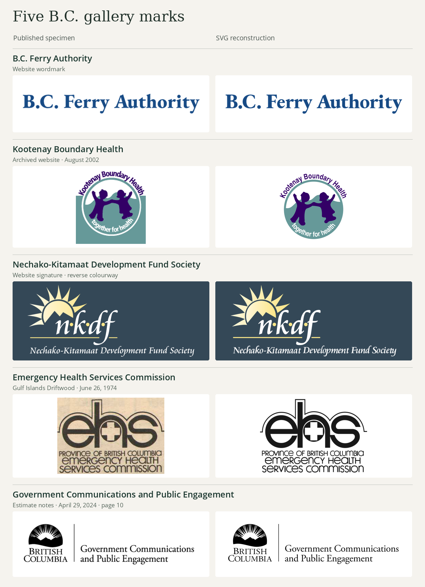

# Gallery vector reconstructions

| SVG | How it was rebuilt |
| --- | --- |
| [B.C. Ferry Authority](../../../public/identity-expanded/bc-ferry-authority-2003/bc-ferry-authority-wordmark-rebuilt.svg) | The blue website wordmark was drawn letter by letter. The authority dates to 2003. The website artwork is undated. |
| [Kootenay Boundary Health](../../../public/identity-collected/kootenay-boundary-community-health-services-society/kootenay-boundary-2002-website-rebuilt.svg) | The two figures and hills were redrawn. Both inscriptions follow circular arcs. The 131 × 139 website GIF leaves some uncertainty in the fine contours and type. The white rim and sky belong to the emblem, and the exterior is transparent. |
| [Nechako-Kitamaat Development Fund Society](../../../public/identity-expanded/nechako-kitamaat-development-fund/nechako-kitamaat-website-rebuilt.svg) | The curved sun rays, mountain opening, initials and smaller calligraphic letters were constructed separately. The published white-and-gold version reads on a dark background. A [light-page version](../../../public/identity-display/nechako-kitamaat-website-rebuilt.light.svg) is also available. |
| [Emergency Health Services Commission](../../../public/identity-recovered/emergency-health-services-commission/ehsc-launch-1974-rebuilt.svg) | The black monogram, cross and three lines of lettering were built from paths. A second printing identifies the fine rule adjoining the monogram as the advertisement border. |
| [Government Communications and Public Engagement](../../../public/identity-recovered/government-communications-and-public-engagement/gcpe-estimate-notes-2024-rebuilt.svg) | The existing English B.C. mark generator supplies the black symbol, divider and letterforms. Its two lines read “Government Communications” and “and Public Engagement,” as on page 10 of the 2024 estimate notes. |

The Commission’s announcement ran on the same day in two newspapers. The second impression gives a clearer view of the same design. [Gulf Islands Driftwood, June 26, 1974, p. 19](https://saltspringarchives.com/driftwood/1974/v15n24June26-1974.pdf#page=19) · [Sunshine Coast News, June 26, 1974, p. 2A](https://doi.org/10.14288/1.0175749) · [Detail of the second printing](https://iiif.library.ubc.ca/image/cdm.xcoastnews.1-0175749.0013/pct:30,82,25,14/1100,/0/default.jpg)

## Transparent SVGs for the three offices

| Office | On a light surface | On a dark surface |
| --- | --- | --- |
| Ombudsperson | [SVG](../../../public/identity-display/source-recovered-ombudsperson-website-logo-white.light.svg) | [SVG](../../../public/identity-display/source-recovered-ombudsperson-website-logo-white.dark.svg) |
| Information and Privacy Commissioner | [SVG](../../../public/identity-display/source-recovered-information-and-privacy-commissioner-website-logo-horizontal.light.svg) | [SVG](../../../public/identity-display/source-recovered-information-and-privacy-commissioner-website-logo-horizontal.dark.svg) |
| Representative for Children and Youth | [SVG](../../../public/identity-display/source-recovered-representative-for-children-and-youth-website-logo.light.svg) | [SVG](../../../public/identity-display/source-recovered-representative-for-children-and-youth-website-logo.dark.svg) |

The three published SVGs already have transparent artwork. These display copies remove the need for a gallery backing, fit the canvas to the ink, and adjust lettering for the selected page colour. Each office's gallery entry offers both the displayed SVG and the original file.
