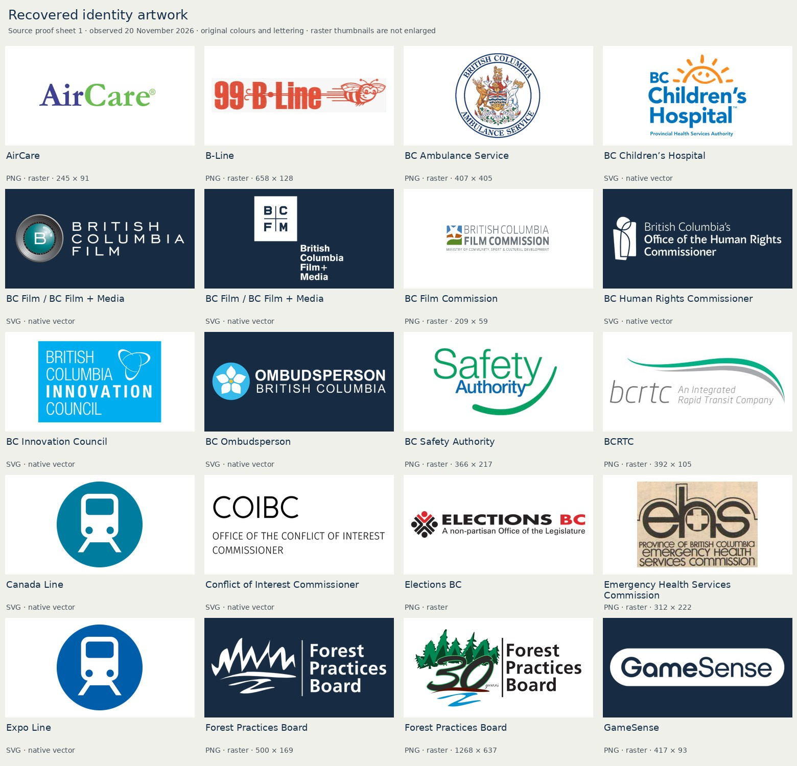

# Missing identity artwork recovered — 20 November 2026

This acquisition fills **170 previously empty identity subjects** with **177 artwork files**:
**51 native vectors** and **126 raster specimens**. The declared register remains **455 subjects**;
artwork is now held for **338**, compared with **168** at baseline commit
`882261bb27ce7a2d5c83c967aaa76a4a3f266147`. All previously held subjects remain held.

**117 subjects still have no accepted artwork.** A held specimen does not establish a complete
identity history, every variant, an original master, an adoption date, or permission to use a mark.

## Results and files

| Scope | Before: subjects with artwork | After: subjects with artwork | Newly filled gaps | Still without artwork |
|---|---:|---:|---:|---:|
| Entire declared register | 168 / 455 | 338 / 455 | 170 | 117 |
| Municipalities | 21 / 162 | 156 / 162 | 135 | 6 |
| Transit and fare systems | 10 / 25 | 23 / 25 | 13 | 2 |
| Independent offices | 1 / 8 | 8 / 8 | 7 | 0 |
| Innovation and trades training | 2 / 6 | 6 / 6 | 4 | 0 |
| Specialist health services | 7 / 10 | 10 / 10 | 3 | 0 |

The [machine-readable summary](coverage-summary.json) includes every family. Counts derive from
actual gallery entries owned by each subject, rather than filenames or parent/successor logos.
The frozen [before](coverage-before.json) and generated [after](coverage-after.json) inventories
make the change auditable.

- [Complete accepted-artwork list](acquired-identities.md): each owner, file, format and primary source.
- [Acquisition manifest](assets-manifest.json): SHA-256 hashes, byte lengths, source URLs, exact locators,
  date qualifications, dimensions, preserved sources, and 27 reproducible extraction recipes.
- [Remaining gaps](remaining-gaps.md) and [structured inventory](remaining-gaps.json): all 117 unresolved subjects.
- [Research outcomes](research-outcomes.json): the inspected scope and specific blocked/unconfirmed findings.
- [Artwork proof sheets](review/index.json): all 177 accepted files rendered across nine sheets.

Artwork and source files are under [`public/identity-recovered/`](../../../public/identity-recovered/).
The generated browser module is [`recoveredIdentityData.js`](../../../src/gallery/recoveredIdentityData.js).
The earlier acquisition manifests remain separate and reproducible.

## Principal recoveries

All seven source-located examples named in the earlier coverage document now have accepted
specimens: **BCRTC, SeaBus, RapidBus, B-Line, Metro Vancouver Regional Parks, LandSure, and BC
Children’s Hospital**. Their evidence differs: LandSure, Regional Parks, BC Children’s and the
SeaBus service icon are native vectors; BCRTC, RapidBus and B-Line are original published rasters.
Sources and qualifications are linked per file in the [accepted list](acquired-identities.md).

The independent-office register now has artwork for each of its eight subjects. New files include
Elections BC, the Ombudsperson, the Information and Privacy Commissioner, the Representative for
Children and Youth, the Human Rights Commissioner, the Police Complaint Commissioner, and the
Conflict of Interest Commissioner. The OIPC has horizontal and vertical originals. White source
lettering receives a dark display plate; the source files are not recoloured.

Historical recoveries include the Science Council of BC, BC Innovation Council, Industry Training
Authority, Industry Training and Apprenticeship Commission, British Columbia Film, BC Film + Media,
BC Film Commission, BC Safety Authority, and the Emergency Health Services Commission’s 1974
advertisement signature. The predecessor/successor and commission/program owners remain distinct.

The municipal search inspected all 141 originally unheld municipal subjects and accepted 137 files
for 135 of them. Original website files account for most; dated public documents supply Tofino,
Port Alberni and Granisle. Kitimat’s static website SVG component was parsed as literal data without
executing its JavaScript. Port McNeill’s nominal SVG is a raster wrapper: the embedded JPEG is
preserved as JPEG and is not counted as vector artwork.

## Evidence limits retained in the gallery

| Specimen | What is held / what remains open |
|---|---|
| SeaBus, Expo Line, Millennium Line, Canada Line, NightBus | Official service/line icons. Full wordmarks and historical variants remain research targets. |
| RapidBus | Original raster specimen retaining its published background and shadow; not a transparent or native vector master. |
| B-Line | The 1996 bee signature as original scan pixels. |
| West Vancouver Transit / Blue Bus | An attributable production proof with magenta non-printing knife-lines. The document specifies white finished vinyl; this is not the finished BLUE BUS wordmark. |
| AirCare | Original archived contractor-published PNG, with dated program corroboration. The 2016 archive capture is not an adoption date or evidence the program was then operating. |
| Power Smart | Independent CIPO design specimen and a native reversed component from a dated BC Hydro brochure. Register, event and PDF-export dates remain separate. |
| BC Film Commission | Small 209 × 59 historical email-signature specimen. The retained two-page excerpt establishes the email’s 21 January 2013 date. |
| ITAC | A scanned letterhead assembled by rendering its original PDF image-tile placement at 300 dpi. Raster only; no vector reconstruction or substitute lettering. |
| EHSC | Exact 312 × 222 crop from the Commission’s own 26 June 1974 newspaper advertisement, preserved by Salt Spring Archives. Paper colour, print texture and adjoining border strokes remain. |
| Lake Cowichan / Masset | Original low-resolution 40 × 50 / 65 × 92 website specimens. Larger originals or vector masters remain desirable. |

Downloaded originals retain their original bytes. Extracted components retain original paths or
pixels, with the source and exact procedure recorded. Full-document hashes and rewritten retained-page
PDF hashes are separate. No automatic tracing, generative artwork, replacement text, or inferred
adoption dates were introduced. The BC Safety Authority PNG includes its original soft transparency
mask; its opaque decoded alpha channel was removed before that separate mask was applied.

The batch observation date uses **America/Cambridge_Bay**. Precise UTC capture timestamps may be
21 November while the local observation date is 20 November. Upload-directory years are not logo dates.

## What remains

Of the **117 remaining subjects**, **98 are historical health boards/councils**, **6 are municipal**,
and **13 are other registered identities**. The health follow-up was a focused four-subject archival
pass, not an exhaustive new search of every council. The [health research log](health-research.json)
records a Thompson Health Region recruitment-ad lead and the updated Coast Garibaldi newspaper
archive route, alongside retrieval limits and exclusions.

The six municipal outcomes are concrete:

| Municipality | Inspected outcome |
|---|---|
| Grand Forks | Official homepage/library and annual-report PDF returned HTTP 403. |
| Keremeos | Homepage and strategy PDF returned HTTP 503 on the inspected host variants. |
| Warfield | The inspected homepage/report requests returned a challenge or CAPTCHA page, not a PDF/logo. |
| Lions Bay | The available candidate was a municipal flag; a separate corporate identifier remains unconfirmed. |
| Okanagan Falls | The inspected website announcement did not establish a distinct logo. |
| shíshálh Nation Government District | Nation artwork was found; attribution specifically to the Government District remains unconfirmed. |

See the [municipal research log](municipal-research.json) for attempted URLs. Other open subjects
include PVTT, Metro Transit Operating Company, Liquor Control Board, Crown-period BC Electric,
BC Archives, three courts, two provincial-administration subjects, and three historical research
subjects. Shared or unconfirmed identity states remain visible. A failed download or name-only
document is not evidence that a distinct logo never existed.

BC Archives’ current site presents a live-text Archives heading alongside the shared museum graphic.
That observation and the current site route are recorded in the [institution research log](institutions-research.json);
the text was not converted into a fabricated standalone mark.

## Reproduction and validation

With the repository’s Node dependencies installed, and **PyMuPDF 1.26.6 / Pillow 13.0.0** available:

```sh
node scripts/build-identity-expansion.mjs --check
python scripts/extract-recovered-identities.py --check
python scripts/extract-identity-expansion.py --check
node scripts/report-identity-recovery.mjs
python scripts/render-identity-recovery.py
npm run check:identity-coverage
npm run build
```

The integrity gate checks accepted-file hashes and format signatures, genuine outlined SVG content,
internal references, archived sources and supplementary evidence links. A narrowly scoped allowance
preserves an unused simple CSS class in the original Logan Lake SVG; every applied reference still
must resolve. The extracted Kitimat component retains all 37 original path strings.

The recovery comparison asserts that the subject set is unchanged, all earlier held subjects remain
held, and every newly held subject has its own acquisition record. Independent reviews checked
ownership, date handling, source paths, historical separation and display plates. Visual review
corrected incomplete COIBC path selection, white-wordmark plates, and the BC Safety Authority mask.

Recorded results are in [validation.md](validation.md). The proof sheets are artwork evidence,
**not application screenshots**. Browser interaction/viewport review was unavailable: local
Chromium was blocked by the environment’s socket permission. Server-rendered component checks
and source-artwork inspection do not claim to cover live browser interaction.


