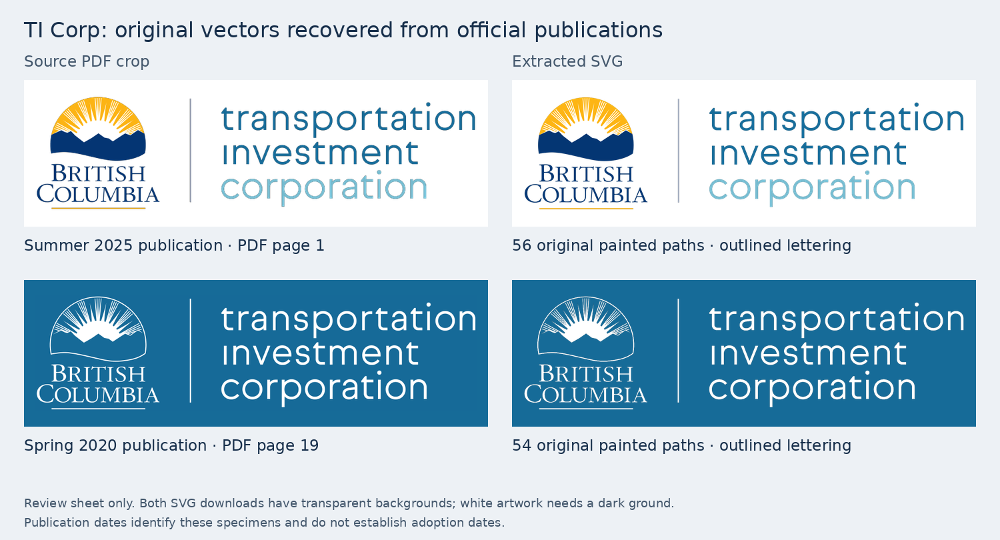

# Transportation Investment Corporation: original vectors recovered

Research date: 8 November 2026 (America/Vancouver).

The exact BC-emblem / three-line Transportation Investment Corporation lockup
previously held as a website PNG is available as native vector artwork inside
official Pattullo Bridge Replacement Project publications. This follow-up resolves
the open vector search for this design; the October research records remain as
the historical record of what had been checked then.

## Recovered specimens

| Specimen | Official source | Location | Painted paths | Download |
| --- | --- | --- | ---: | --- |
| Full colour | [Summer 2025 Project Update](https://www.pattullobridgereplacement.ca/app/uploads/sites/637/2025/06/Summer-2025-Project-Update.pdf) | PDF page 1, upper left | 56 | [SVG](../../../public/identity-collected/transportation-investment-corporation/ticorp-2025-colour-source-vector.svg) |
| Original white reverse | [Spring 2020 Project Overview](https://www.pattullobridgereplacement.ca/app/uploads/sites/637/2020/10/Project-Overview-May-2020.pdf) | PDF page 19, lower right | 54 | [SVG](../../../public/identity-collected/transportation-investment-corporation/ticorp-2020-reversed-source-vector.svg) |



These are extractions of original published vector paths, including lettering
already converted to outlines in the PDFs. They are not traced from the PNG and
are not separately published standalone SVG masters. The white version is the
source publication's own reverse artwork, including its outlined BC emblem.

The extraction preserves selected path nodes, their ancestor transforms and
referenced clipping definitions. It removes surrounding page content and excludes
the blue page background behind the white version. Both downloads have transparent
backgrounds. A 0.6-point margin avoids clipping antialiased edges; a 780px intrinsic
width gives the gallery a useful responsive preview without changing the
PDF-coordinate viewBox or path geometry.

MuPDF converts the PDF's print colours to sRGB. The shape and lettering match the
website specimen, but this does not assert that the converted RGB values equal
those in the website PNG or an unavailable brand master.

The dates are printed publication dates, not adoption or first-use dates. The full
colour design is also visible on page 1 of the Spring 2020 overview and page 1 of
the [Fall 2022 project update](https://www.pattullobridgereplacement.ca/app/uploads/sites/637/2022/10/Pattullo-Bridge-Replacement-Project-fall-2002-Project-Update.pdf)
(the official filename says `2002`; the publication says Fall 2022).

## Reproduction and verification

`source-register.json` records official URLs, PDF page numbers, source SHA-256
hashes, selected drawing indices and bounds, output checksums, and structural
validation. The source PDFs are downloaded to a scratch directory and are not
duplicated in this repository.

With Python, **PyMuPDF 1.26.6** and Pillow installed, run from the repository root:

```bash
python research/identity/ticorp-vector-2026-11-08/extract.py \
  --source-dir /tmp/pofbc-ticorp-sources --download
node scripts/build-collected-marks.mjs
python research/identity/ticorp-vector-2026-11-08/extract.py \
  --source-dir /tmp/pofbc-ticorp-sources --check
python research/identity/ticorp-vector-2026-11-08/render-comparison.py \
  --source-dir /tmp/pofbc-ticorp-sources
```

The review-sheet renderer uses the system DejaVu Sans font for annotations only;
no font is needed for the outlined logo artwork. On other systems, adjust its
annotation font path. `extract.py --check` verifies the SVGs and register byte for
byte. The script rejects changed source hashes, mismatched drawing order, raster
or live text intersecting the selected logo, unexpected SVG elements and external
or active content.

Visual review of the PDF crops and rendered SVGs confirms complete emblem,
lettering, divider and clipping. Both assets contain no embedded images, live
text or external resources. A second review independently reproduced the
extraction and confirmed the source match.

## Gallery integration

The two verified SVGs are appended to the existing Transportation Investment
Corporation collection through `scripts/build-collected-marks.mjs`. The original
PNG, its gallery entry and existing links remain available. The full colour SVG
uses the standard white preview plate; `darkBackground: true` gives the white SVG
a dark plate. Display recolouring and additional display copies are unnecessary.

Focused existing checks:

```bash
node scripts/build-current-extras.mjs
node --test src/gallery/collectedCollections.test.js \
  src/gallery/collections.test.js src/gallery/collectedDisplay.test.js
```

The first command generates the project's normal empty additional-alphabet module
when `GARAMOND_SOURCE` is unset; it does not require or bundle a licensed font.
The tests verify local file checksums, gallery mappings, source provenance,
dated-specimen handling and existing display behavior. This asset change does not
require the site's full licensed-font build.
