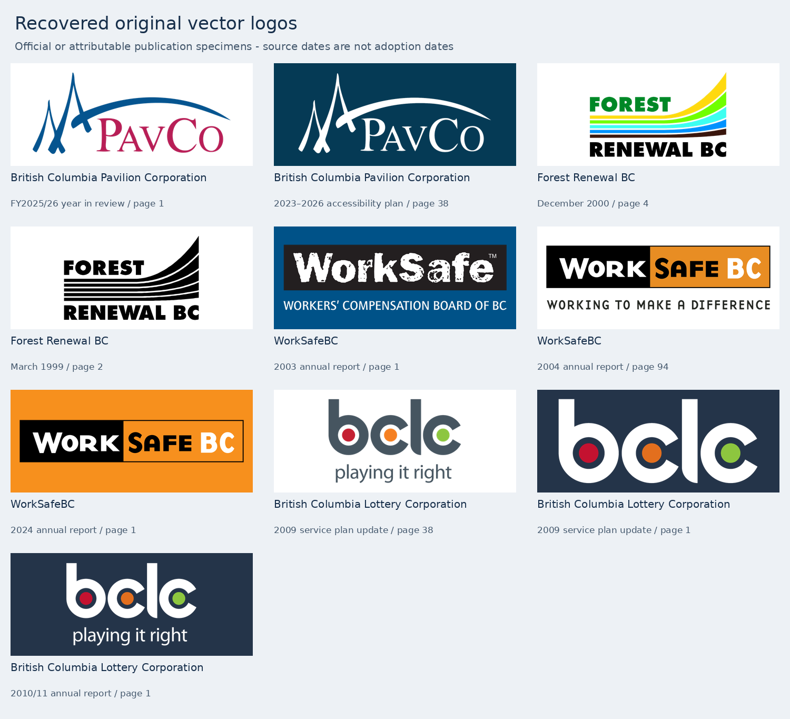

# Original vector logo follow-up — 8 November 2026

This pass recovered **ten original vector specimens across four identities**, from nine published PDFs. It follows the TI Corp recovery in [PR #51](https://github.com/ahzs645/PofBC/pull/51). Research and retrieval dates use **America/Vancouver**; a source document's printed period, PDF creation timestamp, and logo adoption date are separate facts.



## What was recovered

| Identity | Specimen and source | PDF page | Original drawings | What it adds |
| --- | --- | ---: | ---: | --- |
| PavCo | [FY2025/26 Year in Review](https://www.bcpavco.com/pdfs/PavCo%20FY2025-26%20Year%20in%20Review.pdf), full colour | 1 | 6 | Original artwork for a body previously represented by a raster specimen |
| PavCo | [Accessibility Plan 2023–2026](https://www.bcpavco.com/pdfs/PavCo-Accessibility-Plan_2023-2026%281%29.pdf), white reverse | 38 | 6 | A separately published reversed variant |
| Forest Renewal BC | [Annual Methods Report for Localization of Biogeoclimatic Linework](https://a100.gov.bc.ca/pub/acat/documents/r1498/pem_4039_bgc_1095808248945_9166ace7d9694265b194d72986a3bbf2.pdf), December 2000 | 4 | 20 | Original colour sponsor artwork in an attributable funded-project report hosted by the Province |
| Forest Renewal BC | [Woodlot Licence Inventory Manual](https://www.econ.ca/wp-content/uploads/2016/01/Econ_Woodlot-Inventory-Manual.pdf), March 1999 | 2 | 20 | A clean original black specimen in a government publication hosted by its named preparer |
| WorkSafeBC | [2003 annual report and 2004–2006 service plan](https://www.worksafebc.com/~/media/335158F1D70F4FE68BE299D5CFEDA0B7.ashx), distressed WorkSafe wordmark | 1 | 41 | A design missing from the gallery, with the board name below it |
| WorkSafeBC | [2004 annual report and 2005–2007 service plan](https://www.worksafebc.com/~/media/D01B2DADAA624A8A83680C1947803D07.ashx), black/orange with tagline | 94 | 37 | Period original artwork for a mark previously held as a reconstruction |
| WorkSafeBC | [2024 annual report and 2025–2027 service plan](https://www.worksafebc.com/~/media/8FBA76F2A2F54B9C92F416B87E4B26AA.ashx), black/orange | 1 | 13 | Contemporary original artwork and the collection's new cover |
| BCLC | [2009 service plan update](https://www.bcbudget.gov.bc.ca/2009_Sept_Update/sp/pdf/agency/bclc.pdf), older palette with “playing it right” | 38 | 8 | Original period artwork alongside the existing reconstructed recolour |
| BCLC | Same 2009 update, white letters and coloured dots | 1 | 7 | An original reversed variant without the tagline |
| BCLC | [2010/11 annual report](https://corporate.bclc.com/content/dam/bclccorporate/reports/annual-reports/2011/bclc-annual-report-1011.pdf), white with tagline | 1 | 8 | A second reversed lockup from a period report |

The SVGs are in `public/identity-collected/{bc-pavilion-corporation,forest-renewal-bc,worksafebc,bclc}/`. [source-register.json](source-register.json) records each exact file path, source link, page, selected drawing indices, source and SVG checksums, dimensions, date meaning, extraction method, and structural verification.

These are native paths recovered from publications. They are not independently supplied brand-master files. All lettering was already outlined in the PDFs. No tracing, substitute type, shape redrawing, smoothing, or manual recolouring was used. In particular, the slightly different colours in BCLC's dark and reversed period specimens remain different.

## Scope and gaps

The acquisition inventory contains 183 body records. The baseline is commit `658a83af56e4b6ebaf38bb1a69812d6052ce4cc1`, after TI Corp was added. [gap-audit.json](gap-audit.json) separates bodies with verified original vectors, bodies with only raster/reconstructed assets, bodies with no acquired artwork, and five identities already handled by dedicated collections. Those five are not counted as missing artwork.

PavCo and Forest Renewal BC close two gaps in the general body inventory. WorkSafeBC's new originals and BCLC's older-palette originals improve their dedicated collections. The new distressed WorkSafe specimen is an additional dated design, not a replacement for the separately documented 1983 worker emblem. Existing raster and reconstructed specimens retain their IDs and URLs.

Within the general inventory, bodies holding an original vector increase **47 → 49**, and bodies with artwork but no original vector decrease **28 → 26**. The **103** bodies with no acquired artwork and **five** dedicated collections are counted separately. This is a file-coverage audit, not evidence that every empty body used an independent logo. Regenerate it with `node research/identity/vector-followup-2026-11-08/audit.mjs`; add `--check` to verify it without writing. The baseline commit must be available locally.

This was a focused pass over 25 target rows across current Crown bodies, former Crown bodies, historical corporate identities, historical health bodies, and program timelines. It is not a search of every remaining body or proof that unresolved vectors do not exist.

The next useful targets remain:

- **BC Railway:** the precise collected logo is still raster in the inspected report; similar live-type headers are different artwork.
- **BC Ferries geometric dogwood:** no native original recovered. The inspected 2003 contract and failed 1999/2000 financial-statement retrieval do not settle the wider archive.
- **Historical health identities:** the eleven targeted bodies still need original artwork. New documents either lacked the target logo or were scanned; several other sources were inaccessible.
- **BC Stats, BC Timber Sales and BC Wildfire Service:** the historical BC Stats marks and the two oval crest designs remain unresolved. Current/report-header raster images do not substitute for the historical targets.
- **WorkSafeBC:** the sought 1968 design, an attributable original of the 1983 worker emblem, and actual adoption/retirement dates for the later wordmarks remain open.
- **Other former Crown bodies:** Expo 86, BC Enterprise Corporation, BCRIC and BC Systems Corporation remain unresolved after the inspected sources and retrieval failures documented below.
- **Provincial Rental Housing Corporation:** no independently verified graphic identity found; BC Housing's logo is not substituted for it.

## Search records

The [findings summary](findings/SEARCH-SUMMARY.md) covers the four delegated research lanes. Machine-readable findings preserve both successes and unsuccessful leads:

- `findings/current-crown.json`: PavCo, BC Railway and PRHC.
- `findings/historical.json`: Forest Renewal BC and four other former Crown bodies.
- `findings/historical-corporate.json`: BCLC and BC Ferries.
- `findings/health.json`: eleven historical health targets.
- [findings/programs.json](findings/programs.json): WorkSafeBC, BC Stats, BC Timber Sales and BC Wildfire Service.

A retrieval failure means the file was not inspected. A sampled-page negative is limited to those pages. The logs preserve those distinctions so a future pass can pursue better sources rather than repeat unsuccessful downloads. Exploratory source files use paths relative to the extraction source directory and are not bundled in git.

## Reproduce the accepted assets

Run from the repository root with Python and **PyMuPDF 1.26.6**. The checksum gate deliberately fails if a publisher replaces a source document.

```sh
python -m pip install PyMuPDF==1.26.6
python research/identity/vector-followup-2026-11-08/extract.py --source-dir /tmp/pofbc-vector-sources --download
python research/identity/vector-followup-2026-11-08/extract.py --source-dir /tmp/pofbc-vector-sources --check
node scripts/build-collected-marks.mjs
```

`sources.json` fixes the PDF hashes and selected drawing indices. Extraction preserves original path data, transforms, paint order, referenced clip definitions and page rotation. A PDF drawing with both fill and stroke becomes two SVG paint nodes; that is why the 2003 WorkSafe specimen has 41 source drawings and 42 painted SVG paths. Both rotated WorkSafe pages are cropped in the displayed orientation.

Unreviewed raster intersections and visible live text are rejected. The two white BCLC specimens have one explicitly reviewed page-background image each. The register identifies those images by index, xref, bounds, dimensions and digest; the extractor requires an exact match to the approved intersection set. The photographs and the separate 2011 header band are excluded. Every output SVG has zero image elements, live text, external resources or active content.

## Visual review and validation

[evidence/](evidence/) contains a source-PDF crop beside each extracted SVG. Dark plates in the comparisons and overview are preview backgrounds, not added logo geometry. For the two BCLC cover specimens, the source retains its published page background while the extracted transparent logo is shown on a plain plate.

The comparisons can be regenerated with PyMuPDF, Pillow and the DejaVu Sans font at `/usr/share/fonts/truetype/dejavu/DejaVuSans.ttf`:

```sh
python research/identity/vector-followup-2026-11-08/render-comparisons.py --source-dir /tmp/pofbc-vector-sources
```

Independent review confirmed all ten SVGs and the source register reproduce byte for byte, and that their lettering, geometry, colours and cropping match the selected source artwork. BCLC's image-exclusion guards were also checked against missing and surplus approvals. Gallery integration validation and its limits are recorded in the pull request; these PDF/SVG comparisons are not a full browser acceptance test or a production-build claim.
