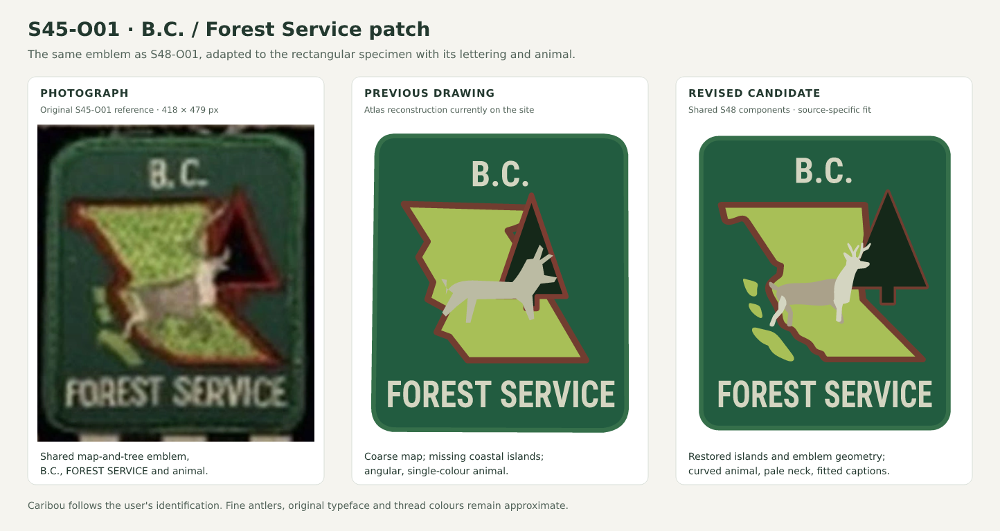
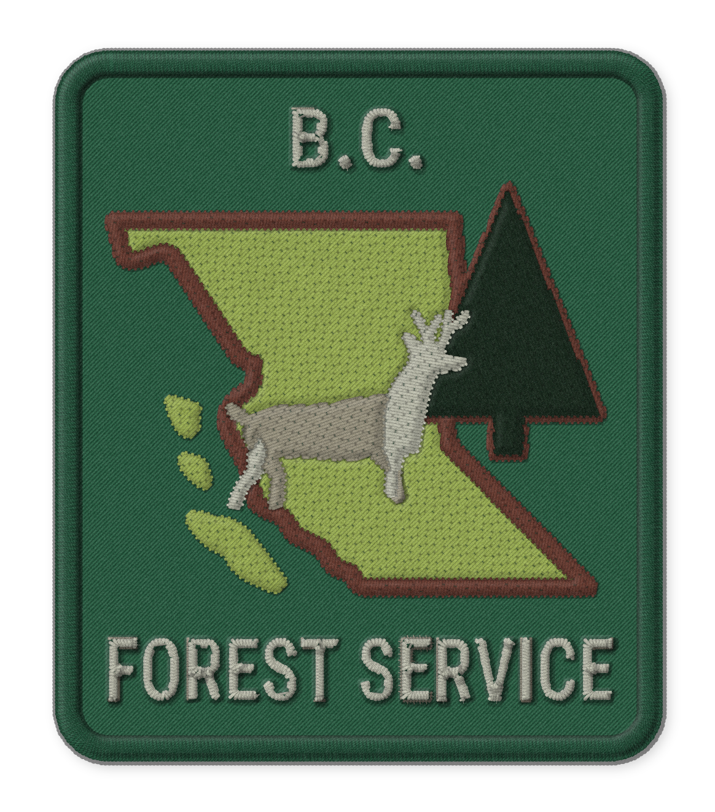

# S45-O01 Forest Service patch refinement

Reviewed November 14, 2026 against the existing, unaltered **418 × 479 pixel**
S45 source crop and the related S48 Forest Service emblem.

## What changed

The previous S45 drawing contained a coarse polygon map, omitted the separate
coastal islands and used a single angular animal outline. The new supplied
Patcher composition reads the same `src/internal/forest-service-emblem.svg`
components as S48: mainland, three islands, crown and trunk. Each component's
outline is retained while placement, scaling, reddish outlining and palette
are fitted to the rectangular S45 specimen.

The foreground animal is now constructed from smooth closed paths, with a
darker body, pale neck/head, visible legs and restrained antlers. **Caribou**
records the user's identification. The photograph does not independently
resolve species, fine antler structure, original lettering or thread colours.

The outlined `B.C.` and `FOREST SERVICE` glyphs are preserved and refitted.
The rectangular cloth border is constructed independently. Neither S48's
square border nor the printed emblem's bowed border is used for S45.

An independent visual pass led to a narrower tree crown and a smaller, higher,
left-shifted southern island. These are visual layout refinements, not a
photogrammetric registration or a claimed measured embroidery specification.

Both S45 and S48 now link to the existing Forest Service evergreen emblem in
Internal Logos. Their catalogue records stay separate; the link adds no issue
date or manufacturing attribution.

## Rebuild and provenance

Authored Patcher package:
`library/supplied/forest-service-map-caribou/`.

Patcher revision: `6bf1e105ff7f805f0a524d3951f4960cc485ec84`.

The supplied replacement is registered in `library/orgs.json`, so subsequent
atlas imports retain the improved drawing. The PofBC review ledger preserves
the old findings and baseline hash and records the new drawing as **needs
refinement**, with medium priority. It is not marked fully faithful.

| Artwork | SHA-256 |
| --- | --- |
| S45 baseline | `7fb037c68de06c2ee9368331cac8d6538a57055c1767e0bf96a0c5ecf6855972` |
| S45 candidate | `eb139ad5577d28d72be795df67c6c9bafcc7a572f9b50bb49df847d90e2660ce` |
| S48 unchanged | `cd0a8ad6864fd74283ab28dda1b42da9b88f3386109f9f74cf61e9306a6e42f7` |

The canonical atlas snapshot remains
`02f524d650e28b12a9600bfcd220e492d0fcb2b7cdce039d97e6655ab231c563`.

## Validation

- Patcher verification against the canonical atlas: **168 drawings verified**.
- Drawing-hash comparison: **only S45 changed; all other 167 drawings unchanged**.
- Existing Patcher library tests: **13 passed**.
- PofBC patch tests: **8 passed**, including the two shared-emblem links without
  inferred specimen dates.
- Focused production build of the actual patch viewer, its CSS, library assets
  and digitizing worker: **passed**, with 154 patch records and 191 source-crop
  references checked.
- SVG rendered and visually compared with the source and baseline. Source
  photographs were neither warped nor altered.
- Offline execution of Patcher's actual `digitize`, `renderTextured` and
  `writeDst` functions: **passed**, using resvg for SVG rasterization and native
  canvas for the output. At 89 mm, 8 px/mm, cloth ground and merrow edging, the
  result has 7,850 planned needle points, 123 blocks, six detected colours and a
  28,706-byte DST. Coordinates were finite, and the DST header, record alignment
  and end command passed structural checks. This is not a physical sew-out test.

The offline preview preserves both transformed caption groups in the lettering
mask. It uses matte thread, 225-degree light and 4 mm transparent padding. Its
alternative SVG rasterizer and canvas implementation do not substitute for a
browser interaction check. Detailed results are in
`S45-O01-offline-validation.json`.

The full review-index rebuild also refreshes pre-existing S56-O36 and S56-O46
catalogue/current-hash metadata. Their drawings and reviewed hashes are unchanged;
this exposes their existing review staleness rather than silently marking the
newer artwork reviewed. It makes no new visual findings about those patches.

### Browser limitation

The production preview was built, but local Chromium could not create its
process socket in the command sandbox. The environment's approval policy
rejected escalation. Therefore this change does not claim a completed browser
interaction test of the revised embroidery preview, download controls or mobile
layout. The live site's source and prior drawing were inspected before editing.

## Integration order

The artwork is maintained in Patcher, and the companion PofBC change pins that
artwork revision in `vendor/patcher`, adds the shared-emblem links, and refreshes
the review evidence. Review and merge [Patcher PR #7](https://github.com/ahzs645/patcher/pull/7)
before the companion PofBC change. Both changes are prepared as drafts while the
remaining visual and browser review is completed.

## Evidence

- [S45 source photograph](https://drive.google.com/file/d/1LuVoONE1ytqacJXacmQgiucv-k5JjleR/view)
- [S48 source photograph](https://drive.google.com/file/d/1bDBblhIfTPTb2v_euhvFb53evVVi_eWl/view)
- PofBC source master inspected at
  `33bcc62280b26d6e5f13725ac0d50b186d417cda`:
  `src/internal/forest-service-emblem.svg`.

A sharper, flatter photograph is the next useful evidence for refining the
animal, lettering and exact relative proportions.
