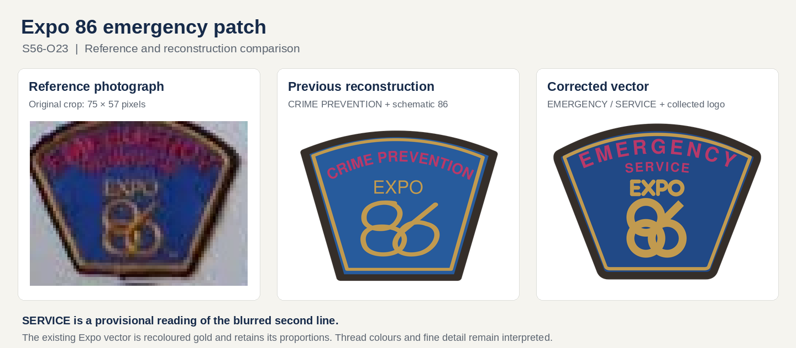

# S56-O23 — Expo 86 emergency patch correction

The previous reconstruction read **CRIME PREVENTION**, used generic EXPO
lettering and drew a broad, low approximation of the 86. The collector-board
reference instead supports **EMERGENCY**, a short second caption row, and a
compact stacked Expo logo.

## Correction

- EMERGENCY follows the curved crown. SERVICE is placed immediately beneath it,
  above the Expo logo, following the user's proposed reading.
- The whole EXPO-over-86 geometry comes from the existing collected asset
  `public/identity-collected/expo-86-corporation/expo86-symbol.svg`. Only its
  colour and uniform placement transform change.
- A constructed broad crown, tapered sides, dark edge and narrow gold inset
  border follow the specimen's overall shape. The blue and magenta are
  interpreted screen colours.
- The authored package is in Patcher's
  `library/supplied/expo-emergency-service/`, applied through `library/orgs.json`
  during the normal atlas import. Both the label and family are corrected.
- This record's individual review date is 2026-11-13. The viewer uses it while
  keeping the original date for records without an individual review date.

## Evidence limits

The reference is the unchanged **75 × 57** crop at
`public/patch-review/crops/S56-O23.webp`, from the 480 × 640 S56 collector board.
Its original proportions are retained in the comparison; enlargement adds no
new detail. EMERGENCY is visible. **SERVICE remains provisional**: the image
cannot establish each letter or rule out SERVICES. A clearer specimen is needed
to verify the second row, embroidered alphabet, border contours and thread
colours.

The collected Expo asset is Mwtoews's third-party vector reconstruction,
identified as such in the collection and Patcher package. It is not an original
historical manufacturing master. The source drawing and its attribution are
retained in the authored package.

## Integrity and validation

| Check | Result |
|---|---|
| Original atlas ZIP | Exact archive SHA-256 matched the existing review ledger |
| Normal Patcher atlas import | 168 designs regenerated; S56-O23 is the only changed design |
| Library verification with original source | All 168 designs rejoin and match their atlas or retained supplied source |
| PofBC patch tests | 8 passed, 0 failed |
| Actual patch viewer production build | Passed, including CSS, library assets and digitizing worker; 191 crop references checked |
| Visual comparison | Corrected vector and reference reviewed; no visible caption collisions, border overlaps or clipping |
| Browser interaction | Not completed: the connected browsers could not reach the workspace preview; local Chromium launch was unavailable |

Baseline SVG SHA-256:
`ce38984b19c265c5c0b79aef3d6b925073db55e93475ced0caaa8655d16b47d8`.

Corrected SVG SHA-256:
`a0029b139562dd84c977497fe7aac8b1a39e73218b252d4c3d4ea59173832b96`.

The review ledger preserves the baseline findings and hash, records the
correction separately, and retains the original crop and source metadata.
All other 153 patch review records remain unchanged.

The artwork is published in [Patcher PR #6](https://github.com/ahzs645/patcher/pull/6).
PofBC pins its reviewed commit `006cd315fb429938cbbd7a1bf766569e90c02e3d`.
