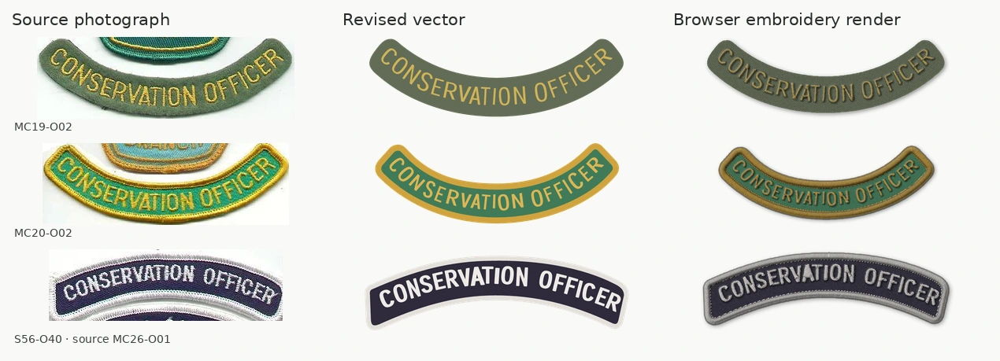

# Curved rocker captions

The review covers 16 detached title rockers. Ten drawings changed. Six collector-board specimens support retaining their present layout. The three Conservation Officer captions were compared at their source crop sizes.

| Design | Crop used | Previous letter overlap | Revised letter overlap |
| --- | --- | ---: | ---: |
| MC19-O02, olive | MC19-O02, 371 × 118 | 18% | 54% |
| MC20-O02, green and gold | MC20-O02, 385 × 128 | 20% | 60% |
| S56-O40, white | MC26-O01, 297 × 91 | 23% | 67% |

Overlap measures the intersection divided by the union of caption pixels. “Previous” uses Patcher commit `26d1ced`, including the first olive revision. Each caption was rendered with resvg into its reference canvas with the SVG aspect ratio preserved, retaining pixels at least half opaque. The comparison uses the published crop coordinates with no post-render translation or warping. The same photograph mask was used for each before-and-after pair.

For the olive specimen, reference gold pixels have R−B > 55, R−G > 6 and R > 130. The green specimen uses R−B > 65, R−G > −15 and R > 135. White uses min(R,B) > 150. To exclude the adjacent shields and edge thread, the masks are restricted to a band around the title. With x and y in crop pixels, the olive band uses 13 < x < 357 and |y − (86 − 0.00230(x−182)²)| < 19. Green uses 19 < x < 363 and |y − (94 − 0.00240(x−192)²)| < 17. White uses 12 < x < 292 and |y − (29 + 0.00183(x−145)²)| < 12. These approximate masks are sensitive to colour, blur and individual stitches. They measure fit to the photographs used to place the letters.

| Other rockers | Review outcome |
| --- | --- |
| Parks Branch S25-O02, S56-O55 | Opened the word gap and fitted broader capitals along the upper arc. |
| Parks / Outdoor Recreation S25-O04, S56-O54 | Tightened the two rows and fitted the lower line to a deeper arc. |
| Fire Control S49-O01 | Adjusted the title depth and word spacing against the Fire Control specimen. |
| Deputy Sheriff S56-O06, S56-O08 | Fitted a denser title with clear end margins and lightly rounded cloth ends. |
| Corrections S56-O26, S56-O29, S56-O62 and Highways S56-O13, S56-O15, S56-O17 | Retained. These 77–89 pixel-wide crops establish the overall title, cut and edging. Exact tracking and fine edge anatomy remain unresolved. |

The browser rendered embroidery for all 16. Each revised Conservation Officer vector also produced 19 distinct letter regions at crop resolution. Actual thread colours, scale and sew-out remain unverified.
